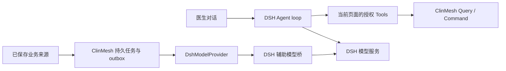

# 智能体平台的 Harness 边界

核验日期：2026-10-18。ClinMesh 源码基线：`ca90ef4d1e949578851e3f85332125dace8c3edd`。研究问题：平台是否具备编排层、能力层和连接层组成的 Harness，以及这些能力是否覆盖业务辅助模型任务。本文为源码与锁定依赖研究，不声明本轮完成运行时、实模或故障恢复验收。项目当前行为以 owner 文档和实现为准。

## 按三层架构判断

平台已经具备 Harness 的三层基础，其中有实际交付的医院业务 Harness；本次给定的完整清单尚未在医院业务入口统一闭环。连接层已有明确实现，能力层已有上下文、业务检索与受控执行，编排层已有对话循环、固定业务任务和人工审阅。当前医院 preset 未启用上游的规划、子 Agent、workflow 和 Skill 加载工具；所核对的 base、Web 与医院 preset 也未配置通用长期记忆检索。[Web 的 preset 边界][dsh-web-preset-plane]、[医院 preset](../../apps/dsh-web/cordis.patch.yml)

本仓库的直接交付依据是[医院业务 Harness 规格](../spec/2026-10-07-dsh-business-agent-harness.md)，状态为 `implemented`；[Issue #156](https://github.com/CaiZongyuan/clinmesh/issues/156)已于 2026-10-07 关闭。当前装配与权限归属由[系统架构](../architecture/agent-integration.md#7-agent-适配器与能力边界)和[业务会话](../agent-capabilities.md#业务会话)维护，[实现配置](../../apps/dsh-web/cordis.patch.yml)实际声明 `clinmesh-assistant`、医院 persona、用户澄清与上下文压缩。原规格中的医生纯查询绑定已有后续调整，以[当前绑定决定](../decisions/implemented/architecture/2026-10-08-doctor-agent-query-binding.md)和实际代码为准。

| 层 | 用户给出的能力 | 当前可确认的对应实现 | 覆盖边界 |
| --- | --- | --- | --- |
| 编排 | 规划分解 | DSH Agent loop 可根据模型输出连续选择工具；病历整理、质控和建议由应用服务执行固定步骤。 | 医院 preset 未挂载上游 `plan-mode` 与 goal 工具；现有调用循环不代表已有通用任务计划、依赖图与独立子任务验收。 |
| 编排 | 子任务调度 | DSH 提供子 Agent / workflow 后端；ClinMesh [outbox 调度器](../../apps/server/src/application/outbox-dispatcher.ts)管理持久业务事件、lease 与有界恢复。 | 业务后台事件调度已有实现；Web 禁用全局委派工具，医院 preset 没有重新挂载，因此该业务会话目前不能使用这些子 Agent / workflow 工具。 |
| 编排 | 人机协作 | `ask_user_question`、proposal、人工审阅、decision gate 与共享 Command。 | 已有真实实现；临床正式动作仍遵循[人工审阅语义](../architecture/agent-integration.md#75-人工审阅语义)。 |
| 编排 | 反馈修正 | Tool result 进入下一轮模型请求；结构与来源校验、有限纠正、显式重试、输入版本失效及状态重读。 | 已有执行反馈和局部恢复；不等同于统一的临床语义评分、长期学习或自动改进闭环，见[当前测试范围](../testing.md)。 |
| 能力 | 记忆检索 | DSH Session 日志与上下文压缩；ClinMesh 授权病例历史、已保存来源、[指南原文检索](../../apps/server/src/application/guideline-corpus.ts)。 | 会话记录、业务知识检索与通用长期 Agent 记忆是不同合同；本次核对的部署组合未配置跨会话长期记忆提取与检索服务。 |
| 能力 | 上下文组装 | Page Context、岗位/病例/view 工具投影、问诊与病历来源快照、历史分批读取和输入预算。 | 已有实现；会话上下文和辅助模型任务上下文分别组装，详见[Agent 边界](../architecture/agent-integration.md#7-agent-适配器与能力边界)及[诊疗建议](../spec/2026-10-13-doctor-guideline-recommendations.md)。 |
| 能力 | 执行环境 | DSH Web 宿主、Surface/browser Tool、Server 运行时及受控 Query/Command。 | 已有医院业务执行环境；进程内子 Agent 或部署隔离目录不自动构成每任务独立的安全沙箱。 |
| 能力 | Skill | 根 [skills/](../../skills) 提供八个运行时 `clinmesh-*` Skills，覆盖共享恢复与岗位 CLI 工作流。 | 文件与 CLI 合同已存在；医院 preset 未挂载 `skill-filesystem` / `tool-skill`，没有通过这些加载器自动发现和读取运行时 Skills，见[Agent Skills](../architecture/agent-integration.md#711-agent-skills)和[Web 的 preset 边界][dsh-web-preset-plane]。 |
| 连接 | 工具接入 | [Tool Catalog](../../packages/contracts/src/agent.ts)、严格输入 schema、当前页面动态工具目录、execution proof。 | 已有实现，工具限于当前授权岗位、病例和页面。 |
| 连接 | 通讯适配 | React Surface、browser Tool broker、Host proof / handoff、HTTP 与 CLI adapter。 | 已有实现；当前业务链路不包含独立 AG-UI Gateway 或 MCP 服务。 |
| 连接 | 模型服务 | DSH Provider 路由、[模型桥](../../apps/dsh-web/src/model-bridge.ts)、[DshModelProvider](../../apps/server/src/infrastructure/ai/dsh-model-provider.ts)与[持久模型绑定](../../apps/server/src/application/generation-model-binding.ts)。 | 已有实现；原生 Agent Step 的重试和上下文压缩不自动作用于辅助模型桥的直接 stream。 |
| 连接 | 外部 API | 现有模型 Provider、HIS HTTP/FHIR 与指南显式同步等窄接入。 | 已有具体接入；不提供任意 URL、SQL 或任意 method/path/body 的通用业务写工具，也不能据此宣称任意第三方系统已接通。 |

## 两条实际执行路径

[模型桥源码](../../apps/dsh-web/src/model-bridge.ts)通过 `ctx.llm.stream()` 直接提交辅助调用，仅携带该业务任务自己的 system prompt、JSON Schema 和输入，不带医生 Session、聊天 transcript 或 Tools。[运行时装配](../../apps/server/src/runtime.ts)将病历质控、建议与整理事件交给各自 application service；[质控服务](../../apps/server/src/application/clinical-document-quality.ts)和[建议服务](../../apps/server/src/application/doctor-recommendations-service.ts)负责病例来源快照、授权、输入指纹、代次、独立核验与持久结果。[CommandExecutor](../../apps/server/src/application/command-executor.ts)提供既有幂等、expected version、事务、审计与 outbox 原子提交。

因此，[#223](https://github.com/CaiZongyuan/clinmesh/issues/223)所述的质控重复触发、失败归因和输出校验属于现有业务执行控制的缺口；DSH Session 的通用 Harness 不会自动修复它们。[#224](https://github.com/CaiZongyuan/clinmesh/issues/224)要求的资料变化联动、人工修改保护与患者切换恢复仍需由对应业务 owner 完成。该判断是代码归属分析，不替代两票的方案确认、实现或验收。

## DSH 的已确认事实

### 锁定版本与实际接入

ClinMesh 的[上游锁定清单](../../dsh-upstreams.lock.json)与[宿主 manifest](../../deployment/dsh/host/package.json)锁定官方 `@deepseek-ai/dsh` `0.2.0-rc.2`；[部署 Profile](../../deployment/dsh/profile/package.json)按顺序组合 `@deepseek-ai/dsh-base`、`@deepseek-ai/dsh-web-app`、React Surface、AG-UI 和 ClinMesh 插件。官方 `dsh-v0.2.0-rc.2` tag 解析为 commit `639ed015397290b3745d163aafe02ffee4aa3f84`，本节锁定版能力的上游引用均固定于该 commit。另核对当前已安装的 `dsh-agent-loop`、`dsh-llm`、`dsh-tools`、`dsh-compaction-basic` 和 `dsh-session`，其 `package.json` 均为 `0.2.0-rc.2`。[官方 tag][dsh-tag]、[版本源码][dsh-root]

官方 README 将 DSH 定义为开源 Agent Harness，但本研究的能力结论同时依赖实际模块与源码。DSH 的模型适配器、工具注册、Session 日志和 Agent loop 都是 Cordis 插件；宿主通过 Profile 与 bundle 组合它们。[README][dsh-readme]、[架构][dsh-architecture]

### 已存在的运行时工程

| 能力 | 锁定版本实现与边界 | 一手来源 |
| --- | --- | --- |
| Agent 执行循环 | `ctx.agents.create()` / `resume()` 创建或恢复 Agent；一个 Turn 包含零到多个 Step，每个 Step 请求模型、执行工具，再根据待处理输入与工具结果决定是否继续。取消与 teardown 有明确归属。 | [Agent loop][dsh-loop]、[核心执行源码][dsh-loop-source] |
| 模型路由与流 | `ctx.llm` 注册 Provider adapter，按 `provider` / `model` 路由，提供 `prepareCall()`、流式结果、失败码、输出上限和取消信号。`llm/stream` 是公开拦截点。 | [LLM 类型][dsh-llm-types]、[LLM 服务源码][dsh-llm-source] |
| 工具执行控制 | Tool registry 提供作用域与可见性；执行经过 `tools/pre-execute`、单调 guard、`tools/execute`、`tools/post-execute`，最终以 `tools/result` 发布不可再改写的结果。标准 loop 为并行安全调用提供有界并发，独占调用形成顺序屏障。 | [工具合同][dsh-tools]、[Agent loop][dsh-loop] |
| 上下文与压缩 | 模型上下文从 Session 日志投影；系统提示、工具 schema、请求头和结果有明确记录。`compaction-basic` 在请求前按预算压缩，也可处理已识别的上下文溢出；压缩无法缩小所有不可分内容和请求外壳，摘要失败也有明确定义。 | [架构][dsh-architecture]、[压缩子系统][dsh-compaction] |
| 审批 | `ctx.approval` 与 `approval/request` 决定一次动作是否允许，记录 `approval/asked` / `approval/decided`；工具 `ask` 只有收到 `allowed-once` 才执行，缺少审批服务或通道时拒绝。 | [审批子系统][dsh-approval]、[工具合同][dsh-tools] |
| 持久化与恢复 | Session 是追加式事件日志，JSONL backend 提供单写者 handle、`append` / `flush` / `close`。`flush` 才是崩溃后耐久屏障；Agent loop 恢复中断日志时补齐缺失的工具错误、Step 和 Turn 结束事实。内存 Session、文件已存在和已通过耐久屏障是不同状态。 | [持久化子系统][dsh-persistence]、[Agent loop][dsh-loop] |
| 失败重试 | `dsh-llm-retry` 在 Agent 的 `agent/request-error` 边界恢复失败 Step，并将调度与开始事实写入 Session；Provider policy 控制有限重试或 `always`。直接 `ctx.llm.stream()` 调用保持单次尝试。 | [重试插件][dsh-retry] |
| 扩展与 hooks | 原生 `agent/*`、`tools/*`、`llm/stream` 事件提供执行前后与停止等拦截点；另有 Claude Code / Codex 命令 hook 兼容插件，但只支持各自协议的子集，不能推定全部兼容。锁文件中存在兼容插件也不证明某个部署已启用它们。 | [架构][dsh-architecture]、[Claude Code hooks][dsh-hooks-claude]、[Codex hooks][dsh-hooks-codex] |
| 子 Agent 与 workflow | 上游提供 `spawn` / `fork` 进程内 Provider 和 workflow；子 Agent 有独立 Session、生命周期和可选输出 schema。Web 保留宿主 registry / Provider，却关闭全局委派工具；医院 preset 未挂载这些工具。进程内子 Agent 共享宿主进程与服务，不因此取得独立安全沙箱或业务授权。 | [base 组合][dsh-base]、[Web 的 preset 边界][dsh-web-preset-plane]、[spawn Provider][dsh-spawn] |

实际装配要按 Profile 的先后顺序读取：`dsh-base` 提供基础模块，后续 `dsh-web-app` 明确将 Agent plane 移到各 Session 的 preset，并关闭全局 `plan-mode`、goal、Skill loader、subagent 和 workflow 工具。ClinMesh 的医院 preset 仅重新装配 persona、用户澄清与局部压缩，业务工具由 Surface 发布。因此，执行循环、模型服务、会话日志等基础存在，不意味着医院助手取得上游 `standard` 编码 preset 的规划、委派与 Skill 加载能力。用户本机额外 Profile patch、服务激活状态和 Provider 设置本轮未读取。[部署 Profile](../../deployment/dsh/profile/package.json)、[base 组合][dsh-base]、[Web 的 preset 边界][dsh-web-preset-plane]、[医院 preset](../../apps/dsh-web/cordis.patch.yml)

### 结构化输出的具体边界

锁定版本的公共 `GenerateOptions` 支持 `messages`、`system`、`tools`、模型路由、采样、上限与信号等；没有通用的 `response_format`、`json_schema` 或 `outputSchema` 请求字段。官方 `LlmCallConfig` 也没有这些字段。因此，不能把某个 Provider 支持严格 JSON 输出解释成当前 `ctx.llm.stream()` 公共接口已经提供同等能力。此结论限于核对过的公共类型与调用入口，不排除自定义 adapter 能另行实现 Provider 特定扩展。[GenerateOptions][dsh-llm-types]、[LlmCallConfig][dsh-call-config]

DSH 已有另一种结构化输出机制：进程内子 Agent 接收 `outputSchema`，driver 为该子 Agent 注册专用 `structured_output` 工具和结束指令；工具参数通过受支持的 JSON Schema 子集验证，只有最终工具执行成功才提交捕获值，捕获后阻止继续执行后续工具。若子 Agent 正常结束但始终没有提交所需值，结果为 `error`；driver 本身不自动重新提示。非法参数会成为 `INVALID_ARGS` 工具结果，模型可在同一 Turn 中纠正。[结构化运行时源码][dsh-structured]、[driver 结果判断][dsh-driver]、[driver README][dsh-driver-readme]

该机制是受工具合同约束的结构化结果捕获，并非 Provider 对任意文本响应的解码保证。Schema 也有边界：子 Agent / workflow 输出要求 object root，只支持列出的 JSON Schema 子集；不能直接将任意现有 schema 当作已兼容。它验证形状，不验证临床事实、引用归属、用户授权、业务版本或任务是否仍有效。[工具 Schema 子集][dsh-tools]、[结构化运行时源码][dsh-structured]

## 上游维护与更新判断

本节截至 2026-10-18 核对官方公开 release 与 ClinMesh [升级候选 PR #222][clinmesh-upgrade-pr]。**有理由推进维护升级，但当前没有可直接采用的已验收新组合。** 当前锁定版、升级候选和上游最新公开 RC 分别如下；alpha 不作为采用目标。[官方 release 列表][dsh-release-list]

| 状态 | DSH 版本 | 官方发布日期（UTC） | 已核对事实 |
| --- | --- | --- | --- |
| ClinMesh 已锁定组合 | `0.2.0-rc.2` | 2026-09-29 09:42:36 | [上游锁定清单](../../dsh-upstreams.lock.json)仍保持此版本，本轮没有修改或升级。 |
| PR #222 的候选 | `0.2.1-rc.1` | 2026-10-17 05:22:10 | PR 仍为开放草稿，head `ec6864c902e5d7852e0279121a05b88915982b93`，仅新增候选与发现记录；未更新已验证锁。 |
| 官方最新公开 RC | `0.2.1-rc.2` | 2026-10-17 08:16:33 | tag 指向 `687f282e8625c6b8d11ff58211a90524be2e4317`；rc.2 新增 DeepSeek-V4.1-Flash-1017 和 Search / Fetch API 适配。 |

PR #222 当前 `DSH candidate compatibility` 为 `failure`，描述为“待适配：候选安装或检查失败，查看运行证据”。进一步读取该次运行公开 artifact 的 `result.json` 后，具体原因是 `dsh-react-surface` 声明的 `@deepseek-ai/dsh-agent=0.2.0-rc.2` 与候选宿主 `0.2.1-rc.1` 不匹配，结果状态为 `awaiting-adaptation`；`verification.log` 只记录了锁定 Surface commit 的 fetch 与 checkout。**这是桥接组件的声明版本门禁，不能解释成已经证明源码 API 不兼容，也没有候选编译或浏览器合同通过的证据。** 当前锁定 Surface 的 [runtime manifest](../../vendor/dsh-react-surface/packages/runtime/package.json)确实将这些 DSH peers 精确限定于旧版。[PR 固定提交][clinmesh-upgrade-head]、[兼容检查运行与 artifacts][clinmesh-upgrade-run]

`0.2.1-rc.1` 的官方说明汇总了自当前锁定版以来的变更；`rc.2` 在其上继续发布。与本项目 Harness 直接相关的内容如下，表中“修复”表示官方发布说明或源码中的能力，不表示 ClinMesh 已运行验证。[rc.1 发布说明][dsh-rc1-release]、[rc.2 发布说明][dsh-rc2-release]

| 关注点 | 上游已发布变更 | 对 ClinMesh 的维护意义 |
| --- | --- | --- |
| 会话恢复与持久化 | 修复重启后部分会话不能继续、切换 DeepSeek 后历史消息兼容失败；修复原 preset 删除或调整后空白会话恢复失败，以及卸载会话存储插件时尾部记录可能丢失。 | 升级验收应覆盖现有医院会话恢复、旧日志、当前 preset 和正常关闭；DSH 的修复不会自动恢复 ClinMesh 辅助模型任务的内存绑定。 |
| 取消与空闲超时 | 修复模型停止输出且底层传输不响应取消时，超过空闲超时仍挂起的问题；最新 `idleWatchdog.next()` 将底层读取与独立超时拒绝竞争，不再仅等待 iterator 配合取消。 | 对模型桥和原生 Agent 的停止、超时与资源收尾有直接价值；仍须通过 ClinMesh 实际 Provider 路由验证。见[超时实现][dsh-new-timeout]。 |
| 动态工具与系统提示 | pi-ai 按精确模型能力处理对话中的系统提示更新及工具增删；源码区分 `in-history` 与 `addition-only` 等模式。 | 当前岗位、患者与栏目动态投影需要在真实后续请求中核对 schema；不能推定所有模型都支持相同更新方式。见[模型能力判断][dsh-new-tool-updates]。 |
| 子 Agent preset 与生命周期 | `spawn` 可选择独立 `agentPreset`，缺省继承父级当前 revision；fork 继续继承。委派与完成通知改为统一生命周期，工具立即返回 child ID，自定义 SDK runtime 须支持 `session/wait`。 | 为未来专用医院子任务提供已有扩展点，同时带来适配边界；当前医院 preset 没启用委派，不应为升级而顺带扩大其工具权限。见[spawn 合同][dsh-new-spawn]。 |
| Skills 与资源释放 | 修复插件启停后已打开会话的 `/` 技能菜单未更新，以及凭据、配置、技能 watcher 关闭时的未捕获异常和 Agent 关闭时资源提前释放。 | 属于加载与卸载可靠性维护；当前医院 preset 未启用 Skill loader，升级本身不会完成业务 Skills 的接入。 |

升级同时存在明确合同变化：Web/Desktop 的 API Key 优先级改为已保存凭据优先；移除运行时 invariant 插件和各包的 `./invariant` 导出；第三方插件优先按 `engines.dsh` 检查兼容性；工具展示移除 `both` 模式；子 Agent、Agent Team 和自定义 SDK runtime 的生命周期与消息字段有迁移要求。当前 Surface 开发依赖仍列有 `dsh-invariants`，因此除 peers 外，还应核对必要桥接组件的开发、测试和扩展入口，不能只改版本字符串。[rc.1 其他变更][dsh-rc1-release]、[Surface manifest](../../vendor/dsh-react-surface/packages/runtime/package.json)

维护建议是将现有候选更新到核验时最新的 `0.2.1-rc.2`，先由必要的 Surface / AG-UI / ClinMesh 适配消除真实合同不匹配，再执行[项目上游升级验收](../deployment.md#dsh-持续升级)；候选验收通过前保留当前已锁定组合。优先覆盖原生会话恢复、模型桥取消与超时、动态 Tool 交接、审批和 Surface 生命周期。Skills、规划或子 Agent 的新增属于另外的业务能力接入，按已确认场景实施；#223 的任务复用与输出校验仍需业务 owner 修复，不把上游升级当作该问题已经解决。

本节只完成 release、固定源码、候选状态与失败 artifact 核验；未安装候选、未修改 lock 或 PR、未启动宿主、未运行实模或新版本兼容检查。以上建议不是对 `0.2.1-rc.2` 的兼容性承诺，PR 状态和最新版本也可能在核验日期后变化。

## 推断与仍需核实的边界

1. **可确认已有运行时 Harness。** 结论基于 loop、工具、上下文、审批、日志和恢复的源码，以及当前部署的 bundle 接入，不依赖项目名称。
2. **不能将原生 Session 恢复等同于业务任务恢复。** DSH 能恢复自己的事件日志和执行历史；ClinMesh 质控、建议等任务的输入身份、去重、授权、结果归属与跨进程重绑定，仍需检查相应业务实现。
3. **不能由 DSH 有重试和结构化子 Agent，推定辅助模型桥已拥有它们。** 直接 stream 与 Agent loop 的执行边界不同，子 Agent 输出捕获也不是 raw stream 的默认行为。
4. **本轮没有证明调用可靠性或当前现场激活状态。** 未启动宿主、未调用真实模型、未运行崩溃恢复或并发验收，也未读取本机私有 Profile、凭据或运行会话。

## 核验方法与证据限制

通过 `gh api repos/deepseek-ai/deepseek-harness/git/ref/tags/dsh-v0.2.0-rc.2` 取得固定 commit，用 GitHub 官方 tarball 在临时目录只读检查该 commit 的 README、架构、base 组合及相关源码；用 `cat` / `rg` 核对本仓库锁定文件、Profile 和已安装依赖的公开分发内容。未安装、升级或修改 DSH，未读取运行会话或敏感配置。临时下载路径不作为文档依赖，关键来源使用下面的固定 commit URL。

[dsh-tag]: https://github.com/deepseek-ai/deepseek-harness/releases/tag/dsh-v0.2.0-rc.2
[dsh-root]: https://github.com/deepseek-ai/deepseek-harness/tree/639ed015397290b3745d163aafe02ffee4aa3f84
[dsh-readme]: https://github.com/deepseek-ai/deepseek-harness/blob/639ed015397290b3745d163aafe02ffee4aa3f84/README.md
[dsh-architecture]: https://github.com/deepseek-ai/deepseek-harness/blob/639ed015397290b3745d163aafe02ffee4aa3f84/docs/architecture.md
[dsh-loop]: https://github.com/deepseek-ai/deepseek-harness/blob/639ed015397290b3745d163aafe02ffee4aa3f84/packages/core/agent-loop/README.md
[dsh-loop-source]: https://github.com/deepseek-ai/deepseek-harness/blob/639ed015397290b3745d163aafe02ffee4aa3f84/packages/core/agent-loop/src/agent.ts
[dsh-llm-types]: https://github.com/deepseek-ai/deepseek-harness/blob/639ed015397290b3745d163aafe02ffee4aa3f84/packages/llm/llm/src/types.ts#L511
[dsh-llm-source]: https://github.com/deepseek-ai/deepseek-harness/blob/639ed015397290b3745d163aafe02ffee4aa3f84/packages/llm/llm/src/index.ts
[dsh-call-config]: https://github.com/deepseek-ai/deepseek-harness/blob/639ed015397290b3745d163aafe02ffee4aa3f84/packages/llm/llm/src/call-config.ts
[dsh-tools]: https://github.com/deepseek-ai/deepseek-harness/blob/639ed015397290b3745d163aafe02ffee4aa3f84/docs/subsystems/tools.md
[dsh-compaction]: https://github.com/deepseek-ai/deepseek-harness/blob/639ed015397290b3745d163aafe02ffee4aa3f84/docs/subsystems/compaction.md
[dsh-approval]: https://github.com/deepseek-ai/deepseek-harness/blob/639ed015397290b3745d163aafe02ffee4aa3f84/docs/subsystems/approval.md
[dsh-persistence]: https://github.com/deepseek-ai/deepseek-harness/blob/639ed015397290b3745d163aafe02ffee4aa3f84/docs/subsystems/persistence.md
[dsh-retry]: https://github.com/deepseek-ai/deepseek-harness/blob/639ed015397290b3745d163aafe02ffee4aa3f84/packages/llm/llm-retry/README.md
[dsh-hooks-claude]: https://github.com/deepseek-ai/deepseek-harness/blob/639ed015397290b3745d163aafe02ffee4aa3f84/packages/hooks/hooks-claude-code/README.md
[dsh-hooks-codex]: https://github.com/deepseek-ai/deepseek-harness/blob/639ed015397290b3745d163aafe02ffee4aa3f84/packages/hooks/hooks-codex/README.md
[dsh-base]: https://github.com/deepseek-ai/deepseek-harness/blob/639ed015397290b3745d163aafe02ffee4aa3f84/packages/bundle/base/cordis.patch.yml
[dsh-web-preset-plane]: https://github.com/deepseek-ai/deepseek-harness/blob/639ed015397290b3745d163aafe02ffee4aa3f84/packages/bundle/web-app/cordis.patch.yml#L430
[dsh-spawn]: https://github.com/deepseek-ai/deepseek-harness/blob/639ed015397290b3745d163aafe02ffee4aa3f84/packages/subagent/subagent-spawn-in-process/README.md
[dsh-structured]: https://github.com/deepseek-ai/deepseek-harness/blob/639ed015397290b3745d163aafe02ffee4aa3f84/packages/subagent/subagent-in-process-driver/src/structured.ts
[dsh-driver]: https://github.com/deepseek-ai/deepseek-harness/blob/639ed015397290b3745d163aafe02ffee4aa3f84/packages/subagent/subagent-in-process-driver/src/index.ts#L213
[dsh-driver-readme]: https://github.com/deepseek-ai/deepseek-harness/blob/639ed015397290b3745d163aafe02ffee4aa3f84/packages/subagent/subagent-in-process-driver/README.md
[dsh-release-list]: https://github.com/deepseek-ai/deepseek-harness/releases
[dsh-rc1-release]: https://github.com/deepseek-ai/deepseek-harness/releases/tag/dsh-v0.2.1-rc.1
[dsh-rc2-release]: https://github.com/deepseek-ai/deepseek-harness/releases/tag/dsh-v0.2.1-rc.2
[dsh-new-timeout]: https://github.com/deepseek-ai/deepseek-harness/blob/687f282e8625c6b8d11ff58211a90524be2e4317/packages/util/timeout/src/index.ts#L135
[dsh-new-tool-updates]: https://github.com/deepseek-ai/deepseek-harness/blob/687f282e8625c6b8d11ff58211a90524be2e4317/packages/llm/llm-pi-ai/src/models.ts#L75
[dsh-new-spawn]: https://github.com/deepseek-ai/deepseek-harness/blob/687f282e8625c6b8d11ff58211a90524be2e4317/packages/subagent/subagent-spawn-in-process/README.md
[clinmesh-upgrade-pr]: https://github.com/CaiZongyuan/clinmesh/pull/222
[clinmesh-upgrade-head]: https://github.com/CaiZongyuan/clinmesh/commit/ec6864c902e5d7852e0279121a05b88915982b93
[clinmesh-upgrade-run]: https://github.com/CaiZongyuan/clinmesh/actions/runs/39012026699
