# Agent 模型调用链路、触发与停止条件审计

## 范围与结论

核验日期：2026-10-19；仓库基线：`758c1b92` 及核验时的工作区源码。本文保存静态审计和[三个风险的离线动态复现](#七三个风险的离线动态复现)的固定基线证据，下文“当前”均指该核验范围，不替代现行[系统架构](../architecture.md)。复现使用临时 SQLite、进程内 HTTP 和合成模型传输，没有调用真实模型、启动实际开发服务或执行压测。

同输入建议复用、患者回答去重与阶段恢复由 [#235](https://github.com/CaiZongyuan/clinmesh/issues/235) 的[正式规格](../spec/2026-10-19-model-request-reuse-recovery.md)追踪；当前合同见[临床业务流程](../architecture/clinical-workflows.md#81-门诊闭环)与[存储合同](../architecture/storage.md#模型执行恢复)，理由见[持久恢复决策](../decisions/implemented/architecture/2026-10-19-model-request-reuse-recovery.md)。全局停用、Token／金额预算、用量账本及其他链路缺口继续由 [#228](https://github.com/CaiZongyuan/clinmesh/issues/228) 和[模型用量控制草案](../spec/2026-10-19-model-usage-control.md)拥有，局部恢复不能证明全局保护已经生效。

当前不能保证不浪费 Token。系统已有幂等写入、输入尺寸限制、分通道并发、部分任务去重和超时，但缺少统一的请求/Token/金额预算；多数 Agent 的业务失效检查只能阻止旧结果落库，不能主动取消已经发出的模型请求。明显风险集中在建议暂停不停止后台、质控旧正文任务未淘汰、患者回复并发重复生成，以及多层纠错、重试和重启恢复叠加。

这里区分三种“停”：发请求前拒绝，能避免该次生成；请求途中传递取消，能尽量减少后续生成；模型完成后丢弃结果，只能保证业务不写错，已经产生的费用仍可能存在。即使已发送取消，服务商也可能继续生成或收费，不能按零消耗记账。

## 一、启动方式、模型与端点

| 路径 | 实际访问方式 | 模型从哪里来 | 覆盖功能 |
| --- | --- | --- | --- |
| 独立 Server/Web | 业务 API → `OpenAIChatCompletionsClient` → 配置的 API 根地址加 `/chat/completions` | Server 配置中的人设、问诊、检验、目录等模型；建议和质控共用 `recommendationModel` | 人设、患者回答、建议、质控、检验生成、目录补全；当前自动记录不会仅因配置直连模型而启用 |
| DSH 下的 ClinMesh 后台 | 业务 API/队列 → `DshModelProvider` → 本机 `POST /clinmesh-model-bridge` → Host `ctx.llm.stream` → 对应 Provider | 辅助模型设置；先解析 Provider/model/推理策略，再按任务绑定。记录可有独立配置 | 同上，并启用自动记录与来源核验 |
| DSH 原生对话 | 原生 Session → DSH Agent 循环 → `ctx.llm` → Provider；需要业务操作时再调用 `clinmesh_*` Tools | 原生会话自己的 Provider/model，独立于“ClinMesh 模型”设置 | 医院助手聊天、读资料、代问、准备需人工审阅的业务动作 |
| DSH 代问意图识别 | 首个受保护 Tool 前 → `isDoctorDelegation` → Host `ctx.llm.stream` | 本次原生会话请求的模型 | 判断本条医生输入是否真的委托代问 |
| DSH 会话压缩 | 原生会话步骤前/上下文超限 → compaction → `ctx.llm.stream` | 未覆盖配置时跟随会话路由 | 长会话摘要，不属于自动记录 |

Provider 的选择优先级是注入的合成/自定义 Provider、DSH 桥、直连配置；“运行在 DSH”不等于后台请求都成为原生聊天会话。见 [runtime.ts:222](../../apps/server/src/runtime.ts:222)、[模型分配 :234](../../apps/server/src/runtime.ts:234)、[建议/质控模型 :418](../../apps/server/src/runtime.ts:418)、[直连端点 :144](../../apps/server/src/infrastructure/ai/openai-chat-completions.ts:144)、[桥接 :73](../../apps/dsh-web/src/model-bridge.ts:73)。

基线已有 `ai_model_binding` 任务模型绑定；缺的是逐次实际调用和用量账本，不能笼统说“所有模型都没有保存”。新请求、人工重试、旧任务恢复的任务身份不同，不能用当前模型设置反推旧请求用了哪个模型。见 [generation-model-binding.ts](../../apps/server/src/application/generation-model-binding.ts)。模型绑定记录来源身份，不等于 Token 或费用记录，也不能代表原生会话的路由。

## 二、一次操作如何连锁调用

```mermaid
flowchart TD
  A[医生手动提问或 DSH 明确代问] --> B[患者回答模型]
  B --> C[患者回复保存]
  D[问诊页面的 DSH 新文字输入] --> E[登记可信医生来源]
  F[检验/检查报告发布或更正] --> G[登记报告来源]
  C --> H[自动记录队列]
  E --> H
  G --> H
  C --> Q[病历质控队列]
  E --> Q
  G --> Q
  H --> I[整理模型]
  I --> J[保存病历增量]
  J --> K[每个新增片段单独来源核验]
  J --> Q
  J --> L[页面读取到新资料]
  C --> L
  G --> L
  L --> M[五类建议分别判断失效并入队]
  M --> N[必要的资料筛选 → 建议生成 → 候选核验]
  O[医生编辑/保存病历] --> Q
  O --> L
  Q --> R[质控生成 → 必要时独立核验]
```



这不是一个模型始终在后台聊天，而是多个独立任务。一次问答可能带来患者回答、记录、多个片段核验、质控以及五类建议刷新。来源保存和记录结果提交都能触发质控；来源证据或正文不同，属于不同输入，不会被相同内容去重自动合并。前端 GET 轮询本身不调用模型，但读取到 `idle/stale` 后的自动 POST 会入队。见[患者回复提交 :3502](../../apps/server/src/application/workflow-service.ts:3502)、[来源入队 :325](../../apps/server/src/application/consultation-recording-service.ts:325)、[片段核验入队 :1119](../../apps/server/src/application/consultation-recording-service.ts:1119)、[记录提交后质控 :1152](../../apps/server/src/application/consultation-recording-service.ts:1152)。

## 三、逐个 Agent 的触发与结束

### 1. 患者人设生成

- **触发：**管理员在合成患者库明确点击生成，`POST /api/sim/v1/synthetic-cases/:caseId/patient-persona-jobs` 建立持久任务。打开病例本身不生成新人设。
- **链路：**任务入库并保存模型 → 定时调度领取一个 queued 任务 → 读取合成病例证据 → `patient_persona` 一次逻辑生成 → 校验结构和隐藏诊断泄漏 → 保存新 revision。普通生成失败后记 failed，不由该服务无限自动重试；Provider 内部仍可能纠错。
- **已有停止：**运行时关闭信号会传给 Provider；Provider 还有自身超时。失败停止本次任务。关闭页面、退出登录、切换病例没有取消此持久任务的接口。
- **恢复与缺口：**关停中断后重新置 queued；启动时把 running 统一重新入队。没有跨重启的累计费用/恢复次数限制；没有同病例相同输入的生成级合并，不同幂等键可创建多个人设任务。它是管理员提交的后台作业，不应把离开页面自动解释成撤销，但必须允许查看、取消及限制恢复成本。

证据：[API :1072](../../apps/server/src/app.ts:1072)、[建任务 :275](../../apps/server/src/application/patient-persona-service.ts:275)、[处理和关停恢复 :432](../../apps/server/src/application/patient-persona-service.ts:432)、[启动重排 :123](../../apps/server/src/infrastructure/sqlite/patient-persona-repository.ts:123)。

### 2. 患者问答 Agent

- **触发：**医生发送问题，或原生 DSH 获得本任务代问许可后执行提问工具。HTTP 是 `POST /api/his/v1/encounters/:encounterId/actions/ask-consultation-question`；失败后由明确的 retry 接口补患者回答。
- **链路：**先幂等保存医生问题 → 查询是否已有患者回答 → 无回答时解析/绑定模型 → 带最近 40 条对话及患者资料调用 `patient_dialogue_reply` → 若泄漏隐藏诊断，再生成一次 → 仍泄漏则安全固定回复 → 共享 Command 保存回答 → 触发记录及后续链路。
- **已有停止：**服务层共用 30 秒信号；已有回答时复用；禁止上一问题尚未回答又发新问题；最终落库重新检查就诊状态和待回答问题。
- **明确缺口：**服务没有接收 HTTP 断开、DSH Tool 取消或 runtime shutdown 信号，也不订阅业务状态变化。提问前端 mutation 同样没有接取消参数。停止右侧 DSH 对话、切病例或关闭页面不能据此断言患者模型停了。
- **重复生成缺口：**“查询没有回答”与“开始生成”之间没有 generation claim 或 singleflight。两个同时到达的同幂等提问，或原请求尚未完成时并发 retry，都可能看到无回答并分别生成；落库幂等只保证最终回答不重复，不保证只付一次生成费用。该基线路径的并发复现证据见[第七节](#七三个风险的离线动态复现)。

证据：[前端 :793](../../apps/web/src/app/doctor/doctor-case-controller.tsx:793)、[路由 :1566](../../apps/server/src/app.ts:1566)、[生成前查询 :112](../../apps/server/src/application/consultation-dialogue-service.ts:112)、[30 秒信号 :203](../../apps/server/src/application/consultation-dialogue-service.ts:203)、[泄漏再生成 :308](../../apps/server/src/application/consultation-dialogue-service.ts:308)、[最终 Command :3460](../../apps/server/src/application/workflow-service.ts:3460)。现有[串行重放测试 :325](../../apps/server/tests/consultation-dialogue-http.test.ts:325)不能证明并发推理去重。

### 3. 问诊自动记录与补录

- **启用：**runtime 仅在有 DSH 模型桥时启用；前端进入已接诊、进行中、未签署且需初始化/绑定的病例时尝试 activate。启用不代表立刻每秒生成。
- **实际来源：**已保存患者文字回复、可信医生聊天来源、已发布/更正报告。每个来源仅建一次 job；当前病例有一个已调度的 queued 记录 job 时，不再调度下一份。
- **链路：**来源 → `consultation.record-history` / backfill → 检查未暂停、未签署准备、身份有效、job generation 最新 → 合批 → `consultation_history_summary` → 校验候选与来源 → 写病历 → 每个实际新增片段单独入核验队列 → 再触发质控。
- **输入限制：**同批通常最多 8 个新来源、合计 4000 字符；首条来源不会被该合批条件截断。还会附相邻来源、既有事实引用、手动病历和拒绝事实，因此 4000 字符不是完整提示词上限。当前工作区的句子引用版本要求完整 batch 不超过 256 KiB、模型请求不超过 128 KiB，Provider 序列化边界还限制含 schema/纠错提示的实际请求；超限则失败保留待恢复。这仍是字节限制，不是 Token 或金额预算。
- **已有停止：**持久化 pause、签署准备、generation 变化、身份/可编辑性失效会通过 Command 订阅触发 Abort；队列执行前和落库前再次检查。runtime shutdown 和任务超时也传入 Provider。这是目前业务取消接得较完整的一条路径。
- **边界：**切病例、关页、退出 DSH 对话不等于 pause；人类后台授权检查依赖岗位/成员关系，不依赖浏览器登录 Session 是否还存在。Command 订阅也不是到期定时器，授权自然到期且没有命令事件时，不保证当刻主动取消，后续仍靠检查点/请求超时。
- **失败与恢复：**普通模型失败标记 failed，不因下个 tick 对同一失败 job 自动重发；其他来源仍可能继续处理。显式 retry/resume/backfill 会重建未完成 job 的 generation；runtime 关闭中断在 event attempt < 3 时可恢复。启动恢复 queued 作业不需要医生重新打开页面。暂停不是清空来源，恢复可能继续处理积压。

证据：[启用 :250](../../apps/server/src/runtime.ts:250)、[前端 activate :1084](../../apps/web/src/app/doctor/doctor-case-controller.tsx:1084)、[调度 :399](../../apps/server/src/application/consultation-recording-service.ts:399)、[控制 :418](../../apps/server/src/application/consultation-recording-service.ts:418)、[合批 :806](../../apps/server/src/application/consultation-recording-service.ts:806)、[取消订阅 :882](../../apps/server/src/application/consultation-recording-service.ts:882)、[失败 :944](../../apps/server/src/application/consultation-recording-service.ts:944)、[启动恢复 :207](../../apps/server/src/application/consultation-recording-service.ts:207)、[身份 :238](../../apps/server/src/application/identity-service.ts:238)。

**容易漏看的触发：**问诊页面已选病例、Surface/Session 有效时，新的无附件、非空且不超过 2000 字符的医生纯文字提交会登记可信来源。代码没有先要求“请记录”或临床补充意图，也不依赖代问分类为 delegate；一般讨论文字也可能先进入整理，模型最后判定无新事实仍已发生调用。同一原 requestId/sourceId 防重不等于不同 requestId 的同文消息免调用。见 [doctor-task.ts:25](../../apps/dsh-web/src/client/doctor-task.ts:25)、[并行登记来源 :49](../../apps/dsh-web/src/client/doctor-task.ts:49)、[来源验证 :381](../../apps/server/src/application/agent-integration-service.ts:381)、[来源写入 :547](../../apps/server/src/app.ts:547)、[直接入队 :266](../../apps/server/src/application/consultation-recording-service.ts:266)。这项触发范围须在修复设计中显式确认，不能擅自更改医疗记录合同。

### 4. 自动记录的来源语义核验

- **触发：**记录模型实际写入一个新增/替换片段，建立一项 pending verification；多个新增片段会有多个独立事件。
- **链路：**`consultation.verify-history` → 检查片段仍存在、内容哈希未变、来源和授权可用 → `consultation_history_verification` → 保存 verified/flagged/failed/stale。空 additions 无此调用。
- **停止：**片段被修改/撤销、recording version 改变、暂停、签署准备、失权等 Command 会主动取消；同时有 runtime shutdown 和超时。最终再次检查，不恢复旧结果权威。
- **重试：**普通失败保留核验失败，不自动无限重试；关停中断有有限 event 恢复，人工 retry 可重新排核验。它与病历质控里对自动片段的核验是两条独立任务，存在对相近事实重复阅读的成本，是否合并须保留各自责任合同。

证据：[片段入队 :1119](../../apps/server/src/application/consultation-recording-service.ts:1119)、[核验和取消 :582](../../apps/server/src/application/consultation-recording-service.ts:582)、[模型调用 :88](../../apps/server/src/application/consultation-history-summary.ts:88)。

### 5. 五类诊疗建议助手

- **触发：**已接诊、Encounter 进行中、有 Consultation 且资料可用时，诊断、检验、影像、病理、处方五类 Hook 同时启用，不要求逐个打开页签。输入稳定约 250 ms 后，状态为 idle/stale 就自动 POST `…/doctor/cases/:caseId/recommendations/:kind/actions/generate`。pending 的每秒 GET 只是读状态。
- **链路：**按 case/kind/generation 持久化任务 → `doctor.generate-recommendations` → 必要时分批选历史 → 检验建议必要时分批选目录 → 生成建议 → 有候选则分批独立核验 → 最终重读资料指纹 → 保存建议。采纳建议另走 confirm，不自动确认诊断或正式开立。
- **去重与停止：**相同指纹、`refresh:false` 且已有非 failed 状态时复用。队列开始和生成前检查资料指纹；每波检查 generation/授权；runtime 关闭和超时会 Abort。
- **暂停缺口：**“暂停自动准备”仅是 React `pausedCases`，阻止本页面新的自动 POST；已入队/在途任务继续，整页重载后暂停丢失。切病例和关页也没有向后台发送取消。
- **过期任务缺口：**服务没有业务事件 Abort；`current()` 只比较 generation。生成后到核验阶段只核对 generation/授权，完整输入指纹在最终提交前才重读。资料变化但尚未建立新 generation 时，旧建议仍可能继续筛选/核验，最后丢弃。
- **额外重算：**病历同正文另存也会增加 draft version；建议的证据标签含 version/updatedAt，完整 Encounter 也参与指纹。在页面启用条件仍满足时，纯版本变化会让结果 stale，可能触发五类重算。
- **重试：**服务对非 429 的 `AI_REQUEST_FAILED` 自动重试整个业务事件，最多常规 3 次 attempt；关停也可恢复。格式问题另有 Provider 层纠错。失败状态不 stale 时前端不会无条件每秒重发，但后续资料变化仍可触发新任务。

证据：[五类 Hook/暂停 :119](../../apps/web/src/app/doctor/doctor-preparation-state.tsx:119)、[自动 POST :72](../../apps/web/src/app/doctor/doctor-preparation-state.tsx:72)、[去重 :450](../../apps/server/src/application/doctor-recommendations-service.ts:450)、[generation 检查 :643](../../apps/server/src/application/doctor-recommendations-service.ts:643)、[生成/核验 :755](../../apps/server/src/application/doctor-recommendations-service.ts:755)、[最后指纹 :897](../../apps/server/src/application/doctor-recommendations-service.ts:897)、[重试 :919](../../apps/server/src/application/doctor-recommendations-service.ts:919)、[版本标签 :179](../../apps/server/src/application/doctor-recommendations-service.ts:179)、[同文另存版本 :6293](../../apps/server/src/application/workflow-service.ts:6293)。

### 6. 病历质控 Agent

- **触发：**未签署、可编辑的病历，未保存正文停顿 500 ms 后检查，已保存资料无额外防抖；服务端保存病历、来源新增及自动记录提交也能直接入队。POST `…/doctor/cases/:caseId/document-quality-control/actions/check`；每 1.5 秒 GET 只读，React Query 禁用了普通自动失败重试。
- **链路：**输入语义指纹 → 共享 `input:<fingerprint>` 任务，saved/client 作为引用 → `clinical-document.check-quality` → 确定性检查和尺寸判断 → `clinical_document_quality` → 有候选问题或 Agent facts 时再 `clinical_document_quality_verification` → 当前性检查 → 保存状态。确定性检查不花模型 Token。
- **已有保护：**同正文、同证据可跨 saved/客户端/重启共享；仅保存版本变化被排除在质控指纹外。未配置模型、输入超限、已签署、失权等执行前条件可阻止生成。普通失败任务也复用，除非明确 refresh。
- **旧正文缺口：**每个不同正文是独立 `input:` 任务；`current()` 用任务的 `baseline.document` 构造“当前”快照，没有检查 saved/client 是否仍引用它。只改变正文而其他事实不变时，旧排队任务可以继续完整生成，即使所有页面已改看新正文。
- **取消与阶段缺口：**没有业务变化的 Abort 订阅。第一次生成完成后，仅检查通用 signal，开始第二次核验前没有 `current()`；在此期间签署、失权或输入过期，仍可能再发核验，最后才丢弃。
- **条件性重复：**前端看到 stale 会自动传 `refresh:true`；若后台已为最新输入建立任务，而页面仍持旧缓存，存在把同一最新任务再升级 generation 的时序，旧在途请求却不会取消。这不是每次保存都必然重复。
- **重试和停止：**`AI_REQUEST_FAILED` 且 event attempt < 3 自动重试整个事件，未像建议助手一样排除 429；runtime shutdown 中断也可恢复。质控没有单独暂停接口，暂停记录/建议或停止原生对话均不关闭它。

证据：[前端触发/刷新 :55](../../apps/web/src/app/doctor/document-quality-control.tsx:55)、[服务端共享任务 :218](../../apps/server/src/application/clinical-document-quality.ts:218)、[旧正文检查 :313](../../apps/server/src/application/clinical-document-quality.ts:313)、[生成到核验 :376](../../apps/server/src/application/clinical-document-quality.ts:376)、[最终检查 :411](../../apps/server/src/application/clinical-document-quality.ts:411)、[自动重试 :432](../../apps/server/src/application/clinical-document-quality.ts:432)。同文复用的静态测试证据见 [clinical-document-quality-http.test.ts:217](../../apps/server/tests/clinical-document-quality-http.test.ts:217)。

### 7. 检验结果生成 Agent

- **触发：**正式检验申请经 LIS 接受、开始后产生 `laboratory.report-request` 事件，不是浏览检查目录就生成。
- **链路：**优先复用快照 → 匹配精确合成真值/适用成人参考规则 → 只有仍缺失且支持的 LOINC 等结果调用 `investigation_result` 或 `investigation_service_result` → 校验结果闭包与参考范围 → 冻结快照 → 共享 Command 发布报告 → 报告可能再触发记录/质控/建议。
- **已有停止：**不支持或真值不兼容不自动重试；已有快照及确定性规则能免调用。Provider 与 runtime 传入的超时可取消；正常状态机只允许 issued 或 generation-failed 的申请撤销，不能把“取消申请”当成正在生成时的止费按钮。
- **缺口：**此 handler 只传 `AbortSignal.timeout(aiTimeoutMs)`，没有合并 runtime shutdown。解析请求的 SQL 不过滤当前申请状态，服务也没有订阅业务/epoch 失效去取消。终态正确性依赖后续报告 Command 检查；异常恢复、旧事件或状态失效情况下，可能先生成再发现报告不能提交。正常 UI 在途撤销被状态机阻止，不能把该异常路径写成普通撤销必然发生。
- **重试：**除明确不可恢复错误外，event attempt < 3 会重试；输入结构、鉴权或超时等失败可能再次请求。已冻结的可复用快照能减少部分重做，但不能覆盖生成后未保存/校验失败的已付费请求。

证据：[运行时处理/重试 :475](../../apps/server/src/runtime.ts:475)、[读取与复用 :456](../../apps/server/src/application/investigation-service.ts:456)、[单项生成 :574](../../apps/server/src/application/investigation-service.ts:574)、[服务生成 :745](../../apps/server/src/application/investigation-service.ts:745)、[可撤销状态 :137](../../apps/server/src/application/clinical-request-kernel.ts:137)、[发布前状态检查 :7340](../../apps/server/src/application/workflow-service.ts:7340)。放射和病理的资产匹配/确定性报告不是这里的检验模型调用；“影像建议”“病理建议”则归第五类。

### 8. 检验目录补全 Agent

- **触发：**管理员明确发布检验服务目录，`POST /api/his/v1/admin/laboratory-services/actions/publish`。本地 `laboratory-cn` 根按确定性规则发布，只有包含 LOINC 根的任务才调用模型。
- **链路：**检查候选/版本、保存 publication job 与模型 → 领取 queued → 聚合同任务的 LOINC 服务 → `laboratory_service_enrichment` → 结构/标识校验 → 发布目录。
- **停止与恢复：**普通失败标记 failed；关停 signal 传给模型，中断重新入队，启动也重排 running。离开管理页不会撤销任务。没有用户取消接口或跨重启费用上限；发布条目版本控制不等于在途推理止费。

证据：[API :746](../../apps/server/src/app.ts:746)、[发布建任务 :339](../../apps/server/src/application/laboratory-service-publisher.ts:339)、[处理/重排 :435](../../apps/server/src/application/laboratory-service-publisher.ts:435)、[启动恢复 :292](../../apps/server/src/runtime.ts:292)。

### 9. DSH 原生医院助手、意图识别与会话压缩

**原生助手：**用户发送原生会话消息后，DSH 执行模型 → Tool → 模型的循环；没有 Tool 的普通回答可结束，有 Tool 则可继续下一步。ClinMesh preset 要求代问完成、医生叫停、目标变化或结果不能确认时停止，业务工具有任务来源/绑定校验，目录交接失败会调用 `agent.cancel`。这些能保护业务动作，但提示词中的“问清楚后停止”不是服务端轮数/金额上限；ClinMesh 当前没有代问最大问题数或整个任务 Token 上限。模型可在合法范围连续追问，每次都会带来患者回答和后续后台链路。见 [preset](../../apps/dsh-web/cordis.patch.yml)、[Tool 授权 :383](../../apps/dsh-web/src/agent-proof-bridge.ts:383)、[无法确认时暂停 :154](../../apps/dsh-web/src/agent-proof-bridge.ts:154)、[交接失败取消 :444](../../apps/dsh-web/src/agent-proof-bridge.ts:444)。

**意图识别：**已选病例任务首次执行受保护医院 Tool 前识别一次，同任务复用 Promise；并不是每次 Tool 都调用，也不是只有 delegate 才花分类成本。只发送本条输入，`maxTokens:1024`，接 Tool execution、插件 lifetime 和超时信号；分类失败拒绝代问，不自行换模型。任务当前性在前后检查，不能由此证明病例变化当刻就终止在途分类。它独立直接访问 Host 模型，不能只在 Server 的 `completeJson` 处加预算而漏掉。见 [admitInput :175](../../apps/dsh-web/src/agent-proof-bridge.ts:175)、[分类调用 :23](../../apps/dsh-web/src/doctor-delegation.ts:23)。

**会话压缩：**preset 显式启用了 `dsh-compaction-basic`。锁定依赖 `0.2.1-rc.2` 的实现默认开启自动压缩，在每步前达到上下文阈值或出现上下文超限时调用模型生成摘要；不是每条消息都调用。默认摘要 `maxTokens` 随 headroom 为 65536，常规压缩最多两次收缩尝试，超限恢复默认允许一次重发；宿主配置可覆盖，65536 是请求上限默认值，不代表实际一定产生这么多 Token。压缩接原生 turn 取消信号，并有自己的 usage/checkpoint；它不属于 ClinMesh 自动记录用量。

原生循环及压缩的证据来自已安装官方包 `@deepseek-ai/dsh-agent-loop@0.2.1-rc.2` 的 `lib/index.js:953,1136,1163` 和 `@deepseek-ai/dsh-compaction-basic@0.2.1-rc.2` 的 `lib/index.js:59,292,834,914`；上游是 [deepseek-ai/deepseek-harness](https://github.com/deepseek-ai/deepseek-harness)，版本由 [DSH manifest](../../apps/dsh-web/package.json)和[锁文件](../../pnpm-lock.yaml)固定。这些 `node_modules` 源码是只读证据，不进入 Git。

**宿主重试边界：**同版本 `dsh-llm` 的基础 `stream` 是 adapter dispatch 加可扩展中间件，不能仅凭 Provider 的 `retryPolicy` 配置就认定辅助桥接自动重试五次。可选 `dsh-llm-retry` 作用于原生 Agent 的 `agent/request-error`；normal 缺省 maxRetries 为 5，always 模式无次数上限，均受取消信号约束。核验范围不包含宿主完整启用配置，不能断言启用了该插件/模式，也不能证明第三方 adapter 内部不重试。原生会话实际策略必须单独核对，不能套用下面的基线 ClinMesh Provider 上界。

## 四、哪些操作真正停哪些任务

| 操作/事件 | 当前实际效果 | 仍可能继续的消费 |
| --- | --- | --- |
| 暂停自动记录 | 持久化 pause，阻止后续记录调度，并通过命令取消在途整理/来源核验 | 患者回复、建议、质控、原生聊天、检验、人设和目录；取消前已产生的费用 |
| 暂停自动准备 | 仅当前页面阻止新的五类建议自动 POST | 已排队和在途建议；其他模型功能；页面重载后暂停状态丢失 |
| 停止 DSH 原生对话 | 取消原生 turn；分类、会话压缩遵循对应取消信号 | 已提交到 Server 的患者回复及持久化后台任务，除非它们自己的停止条件命中 |
| 切病例/关页/退出登录 | 停止部分前端观察、输入登记、工具授权；旧任务结果不应跨病例使用 | 多种后台任务继续；这不是服务端统一停用 |
| 签署准备/签署/Encounter 完成 | 记录主动暂停/失效；建议/质控在检查点拒绝后续动作或结果 | 未接业务 Abort 的在途推理；质控可能继续一次核验再丢弃 |
| 资料/正文更新 | 前端刷新，部分任务指纹失效；记录片段变化可取消核验 | 建议旧阶段、质控旧正文任务；新任务还可能与旧在途任务叠加 |
| runtime 正常关闭 | 停定时器，Abort 共用 generation 信号，等待已追踪任务 | 检验没合并该信号；患者问答没接入该信号，也不在后台 cycle 等待清单中 |
| 服务重启 | 自动恢复若干未完成任务；outbox 租约过期可再领取 | 恢复会重新产生请求；不是“重启即永久停费” |

runtime 行为见[关闭 :759](../../apps/server/src/runtime.ts:759)、[检验信号 :483](../../apps/server/src/runtime.ts:483)、[各模型 handler 信号 :432](../../apps/server/src/runtime.ts:432)。人类任务的 durable 身份有效性检查不查询浏览器登录 Session，见[身份查询 :252](../../apps/server/src/application/identity-service.ts:252)。

## 五、一次逻辑任务不等于一次真实请求

| 层级 | 当前继续规则 | 计量注意点 |
| --- | --- | --- |
| DSH 桥接 Provider | 默认最多 2 次结构化结果尝试；格式/业务校验失败可重发原始输入；同次 `completeJson` 另共享 1 次 429 限流重发机会，共用截止时间 | 一次逻辑调用最多 3 次 complete 桥接尝试；resolve 是查路由，不是推理。429 是否收费依服务商，不能先记零 |
| 直连 Provider | 默认最多 3 次实际 HTTP 尝试：JSON Schema → 必要 tool → 提示词 JSON；显式 maxAttempts 可降低 | 主要是协议/输出回退，不是任意网络错误都重试三次；成功过的阶段可能已计费 |
| 患者业务逻辑 | 隐藏诊断泄漏时最多再调用一次 `completeJson` | 这与结构化纠错可以叠加，不能只看 HTTP 路由调用一次 |
| 建议/质控/检验 outbox | 各自条件下常规最多 3 次业务 attempt；handler 意外抛错也由 dispatcher 作为可重试失败 | 可能重做已成功的前序模型阶段，不是仅补最后失败一步 |
| 重启恢复 | 人设/目录 running 重排，outbox claimed 过期回收，记录 queued 恢复 | 没有统一跨重启费用预算；重启不是用户明确重新授权的同义词 |

证据：[DSH 纠错 :22](../../apps/server/src/infrastructure/ai/dsh-model-provider.ts:22)、[限流重发 :114](../../apps/server/src/infrastructure/ai/dsh-model-provider.ts:114)、[直连尝试预算 :179](../../apps/server/src/infrastructure/ai/openai-chat-completions.ts:179)、[dispatcher :65](../../apps/server/src/application/outbox-dispatcher.ts:65)、[outbox 领取 :83](../../apps/server/src/infrastructure/sqlite/outbox-repository.ts:83)、[完成时尝试限制 :170](../../apps/server/src/infrastructure/sqlite/outbox-repository.ts:170)。outbox 的 3 次是在完成失败时决定是否再排；租约过期领取处没有 attempt 上限过滤，反复崩溃/租约失效不能当成全局最多三次的证明。

建议单个 kind、单次业务 attempt 的逻辑调用数为 `H + C + 1 + V`：H 为历史筛选批次，C 为目录筛选批次（仅检验建议），V 为候选核验批次，均按实际需要执行，当前各阶段有最多 8 批的限制。常见资料装得下且有候选时是生成+核验两次；并非每次都跑满。自动记录一批的逻辑调用为 `1 + A`，A 是实际新增片段数，另算独立质控/建议。质控为 `1 + I`，需要独立核验时 I=1，否则为 0。

实际请求应按 `所有业务 attempt 中，实际执行的每个模型阶段的 Provider 尝试数之和` 统计。不能把所有层级最大值机械相乘后当作正常消耗；也不能把“页面只发一次请求”当成只付一次模型费用。见[历史筛选 :297](../../apps/server/src/application/doctor-recommendations-service.ts:297)、[目录筛选 :367](../../apps/server/src/application/doctor-recommendations-service.ts:367)、[建议核验 :836](../../apps/server/src/application/doctor-recommendations-service.ts:836)。

并发也不等于预算：运行时记录 10、来源核验 4、补录 1、建议 1、business 2 个通道槽位，建议内部筛选/核验波次还可并发 2；患者回复、人设、目录和 DSH 原生会话另有入口。因此不能把某个通道 concurrency=1 解读为全系统同时只发一个模型请求。见 [runtime.ts:625](../../apps/server/src/runtime.ts:625)。

## 六、用量盲区与修复优先级

桥接目前消费 text-delta 和 finish，只返回 model/content，usage 没有保存；直连 Provider 返回给上层也只有 content/model。大多数后台生成没有显式传 `maxTokens`，会依赖 Host/adapter/Provider 的默认限制；字节上限和超时是技术边界，不是 Token 或金额上限。后台桥接不创建 Session，原生会话用量统计不能自然覆盖它；第三方服务账单也不会变成 DSH 官方账户账单。见[桥接 stream :73](../../apps/dsh-web/src/model-bridge.ts:73)、[桥接合同 :39](../../packages/contracts/src/model-bridge.ts:39)、[直连输入接口 :57](../../apps/server/src/infrastructure/ai/openai-chat-completions.ts:57)、[直连返回 :318](../../apps/server/src/infrastructure/ai/openai-chat-completions.ts:318)。

| 优先级 | 已确认缺口 | 修复应提供的可验证结果 |
| --- | --- | --- |
| P0 | 全系统无统一停用、预算预占和逐次账本 | 每次实际生成/纠错/重试前检查持久化开关和额度；并发原子预占；Server 与 Host 分类入口共用规则；取消、断流、未知用量不写零 |
| P0 | 废弃真实模型压测入口仍存在 | 按 #228 删除入口及当前执行指引；不执行、不改名保存等价副本；根 AGENTS.md 的逐次明确授权持续有效 |
| P1 | 建议暂停仅在页面；多数后台不响应业务失效 Abort | 明确后台持续任务与页面临时任务的生命周期；提供服务端暂停/取消；状态失效尽快 Abort，后续每一模型阶段发出前再次核对 |
| P1 | 质控旧正文任务不淘汰，stale 可强制刷新新任务 | 无当前 saved/client 引用的任务不得新发推理；新请求优先复用最新指纹任务；仍被其他客户端使用的任务保留 |
| P1 | 患者回答缺推理级去重与取消 | 同一待回答问题并发仅一次生成；明确 Tool/HTTP/关停与后台回复的取消合同；先查当前回复再允许人工重试 |
| P1 | 检验未接 shutdown，旧任务状态未在模型前过滤 | 检查当前 epoch/申请状态；合并关闭信号；状态失效不再开始模型请求；保留正常后台生成语义 |
| P1 | 多层失败继续与自动恢复没有统一累计上限 | 为逻辑任务与每次实际 attempt 建立关联；限制继续次数和累计预占；运行时默认纠错/重试策略明确，不能借实现授权执行真实验证 |
| P2 | 同文另存导致建议失效；聊天一般讨论也登记来源；相近事实多处核验 | 建议采用临床内容指纹；明确聊天来源采集范围；评估核验复用时保留安全责任，不能为省 Token 跳过必要核验 |
| P2 | 原生代问循环、自动压缩和可选宿主重试不在 Server 预算边界 | 显示原生/辅助请求覆盖边界；核对受支持扩展，设计任务/轮数上限；不修改 DSH 上游，不声称只拦 Server 就能停整个宿主 |

基线导出的验证要求是使用少量合成 Provider 和受控调度屏障，证明旧正文淘汰、同题去重、暂停后的派发边界、失效取消、重启额度和继续记账。各项修复及验收归相应规格；本研究保留证据，不把静态推导当作已测的金额、延迟或“零浪费”承诺。

## 七、三个风险的离线动态复现

基线复现用例位于 [agent-usage-risks-reproduction.test.ts](../../apps/server/tests/agent-usage-risks-reproduction.test.ts)，三个场景均实际复现。下表保留修复前的条件和观察结果；当前同路径用例已改为修复后的合同，测试通过表示复用、共享与恢复边界成立，不再表示观察到原风险。模型侧全部使用 `DshModelProvider` 注入的 `fetch` 替身：路由解析返回固定合成路由，complete 返回预设响应；没有真实网络传输或推理费用。每个场景使用独立临时数据库，退出后清理；并发回答仅用两个受控请求和 Promise 屏障固定时序。

```sh
pnpm --config.verify-deps-before-run=false --filter @clinmesh/server exec vitest run tests/agent-usage-risks-reproduction.test.ts --reporter=verbose
```

| 问题 | 实际复现条件 | 观察结果 | 对照与边界 |
| --- | --- | --- | --- |
| 同正文另存使五类建议重算 | 已接诊，保存病历并完成五类建议；以新保存幂等键再次保存完全相同的病历字段，再发送页面所用的 `refresh:false` 请求 | 草稿版本从 1 变 2，正文逐字段一致；五类全部 stale、指纹全部改变；generation 全部从 1 变 2；建议生成调用从 5 次变 10 次 | 不保存、仅用新幂等键再次请求五类建议时仍是 5 次。已动态验证 HTTP 到模型边界；页面自动 effect 的接线来自静态源码核对，没有声称浏览器实测 |
| 幂等保存没有阻止重复推理 | 第一份同幂等键的提问已经进入模型但未返回时，发第二份完全相同的请求；等两个都进入模型后依次释放 | 2 次 `patient_dialogue_reply` 请求，分别返回不同回答；两份 HTTP 都成功并返回同一已保存回答；最终仅一个医生问题和一个患者回答，第二份生成结果未保存 | 开场白另算一条，最终共 3 条对话。完成后串行重放相同请求不再调用模型，说明风险条件是生成时间重叠 |
| 同一任务多层继续叠加 | 单个诊断建议任务依次遇到一次 429、一次错误 JSON、核验 503；业务自动重试后在核验中关闭 runtime，再用原数据库恢复 | 同一个 outbox event、同一个 generation=1，业务 attempt 依次为 1、2、3；实际进入模拟 complete 传输 8 次；最终 ready，event completed | 包含失败响应和被取消请求，不能解释成 8 次成功生成或固定收费倍数；恢复方式是正常关停重启，未测进程强杀/租约过期 |

同文另存的五类重算不是保存接口本身直接调用五次模型；保存让它们失效，页面自动准备处于启用状态时会再提交生成。暂停自动准备或没有活跃页面时，本用例不能据此断言五类立即重新生成。接线证据见[自动 effect](../../apps/web/src/app/doctor/doctor-preparation-state.tsx:72)和[五类 Hook](../../apps/web/src/app/doctor/doctor-preparation-state.tsx:126)。本用例让模型返回空建议以隔离生成次数，没有候选核验，因此“多出 5 次”不是实际使用中的成本上限。

第三项的 8 次传输按发生顺序如下。模型路由 resolve 不计入 complete 次数，建例时的合成人设和无关质控也不计入这个建议任务的次数。

| 第几次 complete | 业务 attempt | 阶段 | 合成响应或动作 | 下一步 |
| --- | --- | --- | --- | --- |
| 1 | 1 | 建议生成 | 429 限流，retryAfterMs=1 | Provider 自动重发 |
| 2 | 1 | 建议生成 | HTTP 成功但 JSON 无效 | Provider 自动格式纠错 |
| 3 | 1 | 建议生成 | 合法候选 | 开始核验 |
| 4 | 1 | 候选核验 | 503 | outbox 自动重试整个任务 |
| 5 | 2 | 建议生成 | 合法候选 | 已成功的生成阶段再次执行，开始核验 |
| 6 | 2 | 候选核验 | 请求开始后正常关停，收到 Abort | event 保留可重试状态 |
| 7 | 3 | 建议生成 | 重启后返回合法候选 | 生成阶段第三轮执行，开始核验 |
| 8 | 3 | 候选核验 | 合法核验结果 | generation=1 完成 |

该基线证明多层继续可以在同一个任务里叠加，且后段失败会重做已经成功的前段。它没有证明无限重试，也不能用于还原历史费用；429/503/取消是否实际产生 Token 和费用，仍须由逐次调用账本与 Provider 用量核对。当前阶段恢复保留成功步骤并共享真实派发计数，具体合同与验收归上述 owner；本表不作为现行请求次数上界。
