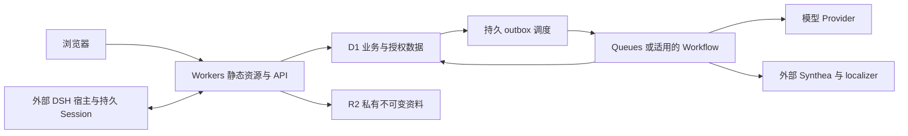

# ClinMesh 迁移 Workers 与 D1 的方案评估

核验日期：2026-10-26。代码基线为 `76aac7a2014b16ba9e905db443fa36327c8d73f5`，同时读取当前工作区；工作区存在未提交修改，本记录不是干净发行版本的验收结果。本次只评估 Cloudflare Workers + D1 对现有产品的适配，不代表批准实施、创建云资源或改变产品范围。当前合同由[系统架构](../architecture.md)、[存储与事务](../architecture/storage.md)、[部署指南](../deployment.md)和 [Demo 部署架构](../demo-architecture.md)拥有；Cloudflare 其他部署路线见[试用部署可行性](2026-10-26-cloudflare-trial-hosting.md)。

## 评估结论

技术判断：standalone Web 与 HTTP 业务能力可以迁入 Workers，但 D1 数据层和任务执行需要实质改造。迁移复杂度主要集中在事务与执行生命周期，不能按“换数据库驱动、给调用加 await”估算。

范围判断：只有 Workers 和 D1，不能原样承载当前完整 ClinMesh。DSH 仍需要宿主、Session/Profile 的持久存储和受信桥接；Synthea 患者生成仍需要 Java/localizer 执行环境。保留它们的外部运行服务属于混合部署，其成本必须纳入完整产品账单。只迁移普通业务页面、移除 DSH 或患者生成，只能证明相应子集可运行。

收益判断：低使用量的 Web/API、D1 与必要队列可以接近 Workers Paid 每月 5 美元的起步费用，也能减少常规服务器维护。完整产品仍有外部执行、素材、模型及运维成本，目前没有证据证明整体费用比现有单机方案更低。若首要目标是尽快开放试用，现阶段不建议直接全面迁移；若长期目标是 Cloudflare 托管，应先验证一个包含发号与审计的挂号切片，再决定是否继续。

## 可保留与需改造的范围

| 现有部分 | 可保留内容 | 主要适配 | 相对工作量 |
| --- | --- | --- | --- |
| React Web、共享 contracts/core | 页面、组件、wire schema、纯算法及现有业务语义 | 静态资源发布、配置注入、真实入口合同 | 低至中 |
| Hono 路由 | URL、请求校验、响应和授权语义 | Worker 入口与 bindings；服务和仓储异步传递；移除 Node 静态资源 adapter | 中 |
| 登录与岗位权限 | cookie session、Membership/PractitionerRole、Origin/CSRF、受信 Actor 规则 | Better Auth/Drizzle 数据驱动和直接 SQL 异步化，验证多实例与读后写一致性 | 中至高 |
| Command、FHIR、账本与审计 | 状态机、幂等、expectedVersion、错误和原子性合同 | 重定读检查写的事务提交方式，确保回执、发号、业务事实、审计、trace、outbox 一起成功或回滚 | 高，首要风险 |
| 业务、参考和指南数据库 | 数据模型、来源身份、查询目的 | D1 schema/import/migration；参考发布同步；FTS 与导出路径；数据库大小和 SQL 限制验证 | 中至高 |
| 异步模型与后台任务 | 持久状态机、checkpoint、unknown 不盲重发、Epoch 约束 | 持久 owner/lease、事件调度、跨实例准入与恢复；取代常驻 timer | 高 |
| DSH 原生体验 | Surface、窄 Tools、人工审阅、proof 和岗位授权合同 | 另行承载宿主与持久文件，重新设计受信远程桥接及同源登录路径 | 高；纯 Workers + D1 不覆盖 |
| 患者生成、DRG、影像与病理素材 | Synthea 窄 HTTP 合同、DRG 纯计算、素材身份与访问合同 | 外部生成服务；发布阶段准备资料；R2 私有对象与 Range-read adapter；摄取留运维执行 | 中至高；不宜塞入请求运行时 |
| 数据运维和交付 | 合成数据、可追踪版本、恢复与唯一发行权威要求 | D1 导入导出、schema 发布、业务恢复、分环境 bindings/secrets、Worker 与外部服务版本匹配 | 高 |

证据：Web 的 `apiBasePath` 注入位于 [WebApp](../../apps/web/src/app/web-app.tsx)，Hono 入口适配见 [Server adapter](../../apps/server/src/server.ts)；当前 Node 入口见 [index.ts](../../apps/server/src/index.ts)，静态资源和病历自动记录事件入口见 [app.ts](../../apps/server/src/app.ts)。共享层不能读取平台环境的规则仍应保留，不应为了 Worker 将 Cloudflare bindings 传入 contracts/core。

只读扫描口径为 `apps/server/src/**/*.ts`，当前共 185 个文件：73 个文件出现 `.driver`，共 1,169 个文本匹配；57 个文件引用 `ClinMeshDatabase`；9 个文件出现 17 处 `BEGIN IMMEDIATE`；当前 operational migration 为 105 个 SQL 文件。另有 79 个文件导入 `node:`，其中 `node:fs` 或 `node:fs/promises` 涉及 30 个文件。它们是追踪调用者的候选清单，包含 CLI 和准备脚本，不等于必须改动的文件数，更不代表代码重写比例。

## 首要难点：保存现有事务合同

### 当前事务中包含业务 JavaScript

事实：[CommandExecutor](../../apps/server/src/application/command-executor.ts)的 `execute()` 使用同步 handler。在 `BEGIN IMMEDIATE` 后读取幂等回执、活动 Epoch 和 expectedVersion，执行 handler，再追加审计、响应回执、effects 与 trace，最后统一提交；业务 handler 还会写入 FHIR、领域事实和适用的 outbox。`#appendAudit()` 先读取 `audit_head`，由 JavaScript 计算新的链哈希，再在同一事务更新 head。这些行为分布于该文件的 `execute()`、`#appendAudit()` 与 [WorkflowService](../../apps/server/src/application/workflow-service.ts)调用路径。

失败路径先回滚上述成功事务，再按现有合同单独记录失败审计及其 FHIR 投影；[Command 回归测试](../../apps/server/tests/command-executor.test.ts)明确要求业务效果回滚后仍保留失败审计。迁移验证不能把清空所有失败记录作为通过条件。

事实：[挂号号段实现](../../apps/server/src/infrastructure/sqlite/registration-numbering.ts)在调用者拥有的同一事务中检查发行权威、读取 counter，通过 JavaScript 校验并更新全部 counter 的哈希，再分配返回的号码。该号码随后进入同一业务 Command 的 Encounter 等持久事实。读、JavaScript 判断、发号和最终落库之间不能容许其他写入穿插。

### D1 有原子批处理，但没有等价的交互事务接口

平台事实：[D1 `batch()`](https://developers.cloudflare.com/d1/worker-api/d1-database/#batch)会按顺序执行预先提供的 prepared statements，任一语句失败时整批回滚。[`withSession()`](https://developers.cloudflare.com/d1/worker-api/d1-database/#withsession)提供顺序一致性和 bookmark；它不提供锁住数据库后在 JavaScript 中任意读取、分支、继续写入的事务 callback。[外键文档](https://developers.cloudflare.com/d1/sql-api/foreign-keys/)说明每个 query 在隐式事务中运行；[导入文档](https://developers.cloudflare.com/d1/best-practices/import-export-data/)要求移除 dump 中的 `BEGIN TRANSACTION` 和 `COMMIT`，否则会出现嵌套事务错误。

推断：将上述 Command 的各次调用机械替换成异步 D1 请求，会把当前一笔事务拆成多笔。单库单线程只能保证某次数据库执行的串行化，不能阻止其他请求进入两个 RPC 之间；Session 的顺序一致性也不提供该隔离。把单个 Durable Object 放在 D1 前面串行调度，仍不会凭空获得跨多个 D1 RPC 的原子回滚能力。

可验证的候选是：在事务外读取并计算待提交内容，再用一个 D1 batch 对完整读取条件、版本及审计 head 进行验证，并原子提交全部结果；或者将足够的判断移入受约束 SQL。提交时的保护还必须覆盖 Membership/岗位授权、active Epoch/Run、库存和金额，以及记录不存在、聚合结果等条件，不能只检查客户端 expectedVersion。两者都要证明没有漏掉相关读取条件和任何绕过提交路径的写入者。尤其 `UPDATE ... WHERE version = expectedVersion` 更新零行通常仍是 SQL 成功；只在 batch 返回后检查 `changes === 0`，不能撤销同批已经提交的后续写入。冲突必须在数据库事务内触发整批失败，或者确保所有写入一致受同一个数据库内条件控制，并给出公共接口的正确失败语义。

本评估没有验证某个 SQL guard、触发器或乐观提交设计已经足以覆盖全部 Command。不能通过删除审计、拆开挂号发号、弱化 expectedVersion、将幂等 receipt 单独提交来降低这部分工作量。

## 执行生命周期与后台任务

代码事实：[运行时](../../apps/server/src/runtime.ts)有 5 个 `setInterval`，分别驱动 outbox、病例生成、患者人设、检验目录发布与模型明细保留；[入口](../../apps/server/src/index.ts)将常规派发间隔设为 250ms。其进程内 Map 只限制当前进程的并发。[ModelTaskRecovery](../../apps/server/src/application/model-task-recovery.ts)的构造器将数据库中全部 `dispatching` 步骤改为 `unknown`。如果每个新 Worker isolate 都照做，可能将其他活跃实例的请求误判为失联，不能沿用“应用启动即代表旧进程已消失”的假设。

平台事实：[Workers limits](https://developers.cloudflare.com/workers/platform/limits/)允许 HTTP 客户端保持连接期间持续处理或流式响应，没有一般的 HTTP 总 wall-time 上限；等待外部 AI 网络不计 CPU。付费 HTTP CPU 默认 30 秒，可提高到 5 分钟；单 isolate 内存为 128MB。客户端断开或响应返回后，`waitUntil()` 最多延长 30 秒，不是任意时长的持久后台执行器。运行时更新或故障仍可能打断连接。

推断：请求内等待 AI 并非天然不可行，但提交之后仍需完成的任务不能依赖请求或常驻 timer。应保留数据库 task/outbox 作为权威，增加持久领取、owner/lease 与恢复规则，再由 Queue consumer 或适用的 Workflow 驱动。数据库提交与发送 Queue 消息是两次操作，不能删掉 outbox 后直接假定两者原子；应保留可补发的持久记录，处理提交后尚未通知就崩溃的窗口。

平台事实：[Queues](https://developers.cloudflare.com/queues/reference/delivery-guarantees/)默认至少一次投递，同一消息可能重复；[consumer wall-time](https://developers.cloudflare.com/queues/platform/limits/)最多 15 分钟。队列消息应尽量只携带受限任务标识，具体授权、Epoch 和输入从受信持久上下文恢复。[Workflows](https://developers.cloudflare.com/workflows/build/rules-of-workflows/)也需要幂等步骤，重试步骤不能被解释为可无条件重复调用模型。现有结果未知后不盲重发、成功 checkpoint 复用和审计规则仍要保留。

当前医生病历自动记录事件入口是约 10 秒长轮询，见 [app.ts](../../apps/server/src/app.ts)，不是 SSE；其即时唤醒来自 [CommandExecutor.subscribe()](../../apps/server/src/application/command-executor.ts)的进程内 Set。多实例下需要重新安排跨实例通知，并继续以持久 revision 查询为准，不能将某个 isolate 的通知视为唯一事实来源。

## DSH、外部生成与文件数据

事实：[DSH proxy](../../apps/dsh-web/src/proxy.ts)只接受 HTTP loopback upstream，[DSH 模型 Provider](../../apps/server/src/infrastructure/ai/dsh-model-provider.ts)也只接受 `127.0.0.1` 或 `[::1]`。将业务 API 迁到 Workers 后，不能仅把 URL 改为公网地址；需要受信远程通信 adapter，并验证双向认证、cookie、Origin/CSRF、Page Context 和 execution proof 绑定。当前[业务 preset](../architecture/agent-integration.md)不挂载 Bash/文件写工具；本评估没有把开发 preset 的任意 shell 能力当成试用必须项。宿主本身的 Session/Profile 持久化仍需承载。

事实：[Synthea Provider adapter](../../apps/server/src/infrastructure/scenario-generation/synthea-provider.ts)已有窄 HTTP/HTTPS 接口，Java 运行于[独立容器](../../apps/synthea-provider/Dockerfile)。这条接口可作为继续复用的 seam，但 Workers + D1 不提供该 Java/localizer 执行环境。若改成预生成病例供试用，是需要明确确认的产品范围选择，不能据此声称已保留患者生成能力。

事实：[运行时](../../apps/server/src/runtime.ts)另行打开 Reference 与指南 SQLite；[指南语料](../../apps/server/src/infrastructure/sqlite/guideline-corpus.ts)使用 FTS5/trigram。D1 [支持 FTS5、JSON 和数学扩展](https://developers.cloudflare.com/d1/sql-api/sql-statements/)，但 tokenizer、排序、查询、发布身份和性能仍需实际验证。[D1 导出限制](https://developers.cloudflare.com/d1/best-practices/import-export-data/#export-an-existing-d1-database)不支持含 virtual table 的数据库，官方建议先删除虚拟表、导出后再重建，因此不能直接沿用现有指南库的备份操作。

事实：[影像 asset store](../../apps/server/src/infrastructure/imaging-assets/imaging-asset-store.ts)与[病理 asset store](../../apps/server/src/infrastructure/imaging-assets/pathology-asset-store.ts)依赖文件偏移读取；[DRG 规则](../../apps/server/src/infrastructure/reference-data/drg-rules-package.ts)按文件及哈希装配，纯规则计算可复用。迁移时可评估以 R2 保存不可变资料，通过受限 Range-read adapter 读取。文件摄取、资料同步和大批量哈希核验宜在发布或运维阶段完成，不能把现有大文件处理原样移入 128MB isolate。R2 私有授权、对象身份/哈希、来源许可及署名要求均需保留；本轮未读取任何素材像素。

## D1 限制与数据运维

[D1 limits](https://developers.cloudflare.com/d1/platform/limits/)当前明确：付费单库上限 10GB，不能再提高；Free 单库 500MB。单库本身单线程，过多并发会排队并可能返回 overloaded；全站 Worker 扩容不能自动扩大一个 D1 主库的写吞吐。是否达到边界必须用实际 SQL 时长、行扫描和任务行为验证，不能从网页访问人数推导。

单行、字符串或 BLOB 上限 2MB，每条 SQL 最多 100 个绑定参数、100KB 语句长度，整个 query 或 batch 最长 30 秒。最新文档特别说明一次 `batch()` 只计一次 invocation 查询额度，批内每条 SQL 仍受独立语句限制；不能把查询次数额度误当 batch 最大语句数。D1 binding 不支持每调用 timeout 或 `AbortSignal`，见[绑定超时说明](https://developers.cloudflare.com/d1/observability/debug-d1/#d1-binding-timeout-behavior)，因此调用方停止等待不能证明数据库未提交。

当前 migration runner 会使用 `foreign_keys = OFF` 和表重建，见[数据库实现](../../apps/server/src/infrastructure/sqlite/database.ts)；D1 的外键默认开启且不能在隐式事务中关闭，应逐条评估 `defer_foreign_keys`、表重建及删除级联。原有 105 个 migration 不是已证明可直接执行的 D1 migration 集合。导入已有 SQLite 需转换 SQL dump、去掉显式事务语句，不能直接上传 `.sqlite` 文件作为 D1 数据库。

[Time Travel](https://developers.cloudflare.com/d1/reference/time-travel/)提供付费 30 天、Free 7 天历史，恢复会原地覆盖并取消在途查询。当前 ClinMesh 的[业务恢复](../../apps/server/src/infrastructure/sqlite/database.ts)还要保存可信最新挂号发行权威、合并按日高水位、退休旧权威并启用新目标；简单回退 D1 时间点可能恢复过期发号状态。应另外设计停写、保全最新发行事实、受控恢复和验收路径，不能把平台 point-in-time recovery 当成现有业务恢复合同的直接替代。

## 候选目标拓扑

这是用于验证的候选分工，不是已批准架构。D1 不会自动触发图中的 outbox 调度，需要实现可恢复通知及补发；图也不表示直接将 D1 的任意 SQL 或后台动作开放给浏览器。完整产品保留外部 DSH 与生成服务时，仍是多运行环境。应先复用现有共享 Command 的业务语义，再选出能保持原子合同的具体提交方式，不为每条 HTTP 路由复制状态机。

## 费用评估

价格依据为 [Workers Paid](https://developers.cloudflare.com/workers/platform/pricing/)、[D1](https://developers.cloudflare.com/d1/platform/pricing/)、[Queues](https://developers.cloudflare.com/queues/platform/pricing/)和 [R2 Standard](https://developers.cloudflare.com/r2/pricing/)。以下金额是美元，按账户包含量未被其他应用占用估算；不含税、域名、外部执行服务、AI 或额外日志等费用，不是 ClinMesh 测得的使用量。

| 项目 | 付费包含量与超额口径 |
| --- | --- |
| Workers | 账户最低 5 美元/月；含 1,000 万动态请求、3,000 万 CPU 毫秒；超额分别为 0.30 美元/百万请求、0.02 美元/百万 CPU 毫秒；静态资源请求另按对应免费规则 |
| D1 | 含 250 亿行读取、5,000 万行写入、合计 5GB 存储；超额分别为 0.001 美元/百万读行、1 美元/百万写行、0.75 美元/GB-month |
| Queues | 含 100 万操作；超额 0.40 美元/百万操作；不超过 64KB 计费单位的正常消息通常至少写/读/删三次操作，重试增加操作 |
| R2 Standard | 含 10GB-month、100 万 A 类和 1,000 万 B 类操作；超额存储 0.015 美元/GB-month，A 类 4.50 美元/百万、B 类 0.36 美元/百万；直接出站流量免费 |

D1 的读行是扫描行，不是只计算返回行；索引维护也会增加写行。不能将“一次 HTTP 请求”“一次数据库 query”或“一次用户操作”直接代入 D1 账单。Queue 消费 CPU 也要纳入 Workers CPU，Workflow 还需另算步骤与状态存储；没有必要为同一任务同时引入所有调度产品。

情景 A：假设一个月总计 10 万动态请求、含消费者在内 200 万 Worker CPU 毫秒、10 亿读行、100 万写行、1GB D1 存储、30 万 Queue 操作，且 R2 全部处于包含量内，则上述 Cloudflare 部分约为最低 5 美元/月。该情景不证明这些用量足够支持多少试用者，也不包含 DSH、Synthea 或 AI。

情景 B：假设一个月 100 万动态请求、5,000 万 CPU 毫秒、200 亿读行、6,000 万写行、合计 10GB D1 存储、200 万 Queue 操作、20GB-month R2，R2 A/B 类操作均不超额，则上述部分约为 `5 + 20 × 0.02 + 10 × 1 + 5 × 0.75 + 1 × 0.40 + 10 × 0.015 = 19.70` 美元/月。此情景仅解释计费口径，单个 D1 数据库仍不能超过 10GB；按数据库拆分必须维持事务、工作区和发行权威合同。

没有实际 Workers/D1 观测数据，不能给出每个用户成本、并发人数或从当前服务器迁移后的确定节省额。更不能将完整产品账单只写成最低 5 美元；保留外部 DSH 与生成运行环境后，原有主机费用未必消失。

## 验证顺序与继续条件

1. 先验证一个完整挂号 Command，覆盖登录人类受信上下文、号码分配、receipt、FHIR/业务写入、audit/trace 和适用的 outbox。相同幂等键重复、不同键并发争同一版本、同一日号段竞争、审计 head 竞争、批中后半失败、提交后响应丢失均应保持既有结果。任何冲突或中途失败不得留下部分成功的业务事实、重复发号或成功回执；失败审计继续按既有合同保留。先用合成 Provider 和临时数据验证，不调用真实模型或压测。
2. 只有上述原子性验证通过，才扩展到登录/岗位、门诊及住院纵向闭环，验证 stale-read、跨 Workspace/Epoch、read-your-writes 与既有错误码。保留已有公共接口测试，让 SQLite 和 D1 对相同行为接受同一合同，而不是只测试 SQL 是否能执行。
3. 再验证持久任务：两个 isolate 同时冷启动不误标活跃模型步骤；重复投递只产生一次业务提交；HTTP 断开、执行器重启及模型结果未知不盲重发；reset 后晚到结果拒写；数据库提交后 Queue 通知失败仍可补发。消费者并发和重试不能改变授权与额度规则。
4. 最后验证完整产品依赖和运维：外部 DSH 的 Tool → review → Effect、proof 与 CSRF；Synthea 生成闭环；参考来源身份、FTS 查询及合成 Range-read fixture；D1 schema 发布、受控恢复与高水位保全；同一产品版本的 Worker 与外部服务组合。记录实际 CPU、rows read/written、Queue ops、R2 请求和端到端体验，再判断成本及运行边界。

停止条件：若必须削弱 Command 原子性、审计、发号、恢复或 unknown 不盲重发才能通过第一个切片，应停止 D1 路线并重新比较存储选择；若完整 DSH/生成服务仍离不开原有主机，不应以“消除主机费用”作为已实现收益。通过局部切片仅允许支持后续设计判断，不等于整体迁移完成。

若长期目标是 Cloudflare 托管且 D1 事务验证不通过，可另行比较 SQLite-backed Durable Objects 的 [`transactionSync(callback)`](https://developers.cloudflare.com/durable-objects/api/sqlite-storage-api/#transactionsync)，它支持同步 JavaScript 内多条 SQL、异常回滚，形态更接近当前交互事务；这与“用 DO 包装远程 D1”不同。DO 本地 SQLite 也不是 `better-sqlite3`，仍需评估权威范围、迁移、恢复及 DSH；本评估不把该替代方向视为自动批准或低成本承诺。

## 核验范围与未解决项

本轮对官方文档和工作区源码进行了只读核查，未修改产品代码、生成迁移、实现原型、运行业务测试、调用真实模型、压测、购买或部署 Cloudflare 资源。平台文档支持只能证明候选能力，不能证明现有镜像或全部产品已经兼容。

尚未验证原子提交候选、105 个 migration 的 D1 兼容性、完整资料规模与查询行扫描、Worker 冷启动/内存、真实网络地区表现、DSH 远程多用户隔离、迁移与恢复正确性和实际账单。现阶段只能将整体实施判断为高工作量且存在前置可行性风险，不能给出可信的人日或上线日期。
