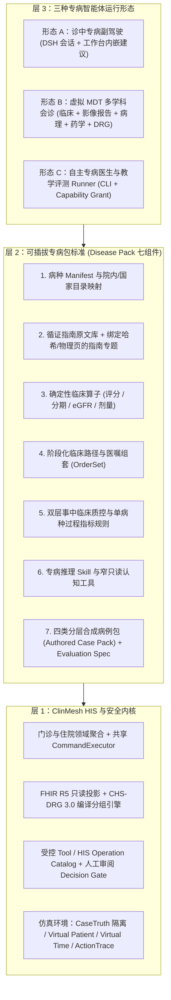

# 专病智能体全景调研与建设蓝图

> **落地状态说明（2026-11-20 更新）**：本文完稿于 2026-11-10，用于梳理专病智能体外部基准与整体演进蓝图。文中第一阶段核心底座——**受审计专病风险结构化评估与 6 项确定性临床算子（#509）**、**共享指南专题注册表（#510）**、**4 套心血管专病医嘱组套（#524）**、**双层事中临床质控与 Clinical Override（#523）**、**通用多病例 Authored Case Pack 编译器与五例典型病例（#526）**及**同源 CLI/DSH 专病只读工具（#527）**——现已正式落地，当前有效合同以 [`clinical-decision-support.md`](../architecture/clinical-decision-support.md)、[`simulation.md`](../architecture/simulation.md) 与 [`agent-integration.md`](../architecture/agent-integration.md) 为准；虚拟多学科会诊（MDT）、跨期慢病随访与独立 `Evaluation Spec` 自动评分仍属后续候选方向。

## 核心结论

国际评测基准与国内头部医院实践表明，建设专病智能体不应采用“一病一烟囱”或纯长提示词方案，而应收敛为**“1 个标准化 HIS 与受控 Harness 底座 + 1 套可插拔专病包（Disease Pack）契约 + 3 种临床运行形态（诊中副驾驶、虚拟 MDT、自主实训与独立评测）”**。

## 国内外实证基准与行业范式

### 通用医疗大模型在专科场景的四大实证瓶颈

| 瓶颈维度 | 代表性基准与一手来源 | 实证发现 | 专病架构对策 |
| --- | --- | --- | --- |
| 动态问诊与主动取证退化 | [AgentClinic](https://github.com/SamuelSchmidgall/AgentClinic)（[arXiv:2405.07960](https://arxiv.org/abs/2405.07960)） | 静态医学考题高分模型在需多轮追问与主动开单取证的交互环境中准确率显著下降 | 内置病种必问红旗征（Red Flags）排除漏斗与分阶段取证清单 |
| 定量评分与公式心算失准 | [MedCalc-Bench](https://github.com/ncbi-nlp/MedCalc-Bench)（[arXiv:2406.12036](https://arxiv.org/abs/2406.12036)） | 模型在 55 类临床计算器（GRACE、CHA₂DS₂-VASc、CURB-65、eGFR、TNM、BSA 给药）频繁发生算术或公式选择错误 | 风险评分、分期与肝肾剂量折算下沉为确定性临床算子（Deterministic Calculators），缺项显式返回 `missing` |
| 长链路 EHR 状态偏离 | [Stanford MedAgentBench](https://github.com/stanfordmlgroup/MedAgentBench)（[arXiv:2501.14654](https://arxiv.org/abs/2501.14654)） | 基于 FHIR 的 300 项多步临床工作流中易出现参数失配与步骤遗漏 | 窄 Schema 受控工具 + 阶段化临床路径里程碑与事中门禁 |
| 多模态割裂与证据幻觉 | [Microsoft Healthcare Agent Orchestrator](https://github.com/Azure-Samples/healthcare-agent-orchestrator)、[MIT MDAgents](https://arxiv.org/abs/2404.15155) | 单模型难以兼顾影像、病理、药学与指南细节 | 多专科结构化报告交叉核验，每条建议锚定指南版本、物理页与适用条件 |

### 国内建设范式与互操作标准参考

- **国内医院范式**：复旦中山“观心”等单病种全周期纵深闭环、华西 HAIP“统一底座 + 共享循证/质控/医保组件 + 专科智能体”、清华 AIR [Agent Hospital（arXiv:2405.02957）](https://arxiv.org/abs/2405.02957) 合成病例拟像演进，以及对接国家卫健委单病种过程质控指标的模块化“专病包”。
- **标准衔接**：参考 [HL7 CPG-on-FHIR](https://hl7.org/fhir/uv/cpg/)（`PlanDefinition` / `ActivityDefinition` 对应 ClinMesh [领域词汇](../../CONTEXT.md)中的 `Order Set Template` 与 `Request Orchestration`）与 [CDS Hooks](https://cds-hooks.hl7.org/) 事件触发，智能体仅生成带原文引用的草稿或 Proposal，正式写入经人工审阅与共享 `CommandExecutor` 留存审计。

## 可插拔“专病包（Disease Pack）”七组件蓝图

1. **目录与术语绑定**：声明适用科室、ICD-10 诊断、LOINC 检验、功能/放射/病理检查、核心药品（含禁忌与肾功能约束）及关联 CHS-DRG 病组。
2. **双层循证知识底座**：底层 SQLite 指南原文库保真存储并执行用途过滤；上层 `Guideline Topic` 锚定原件哈希、物理页码与限定语（原来源失效时同步停用，验证依据见 [LLM-Wiki 评估](2026-11-02-llm-wiki-for-inpatient-guidelines.md)）。
3. **确定性临床算子库**：无副作用纯函数计算风险分层与生理指标，只消费已确认正式事实，未录入项显式报告缺项而不推断默认阴性。
4. **阶段化组套模板**：结合患者有效过敏、肾功能与生命体征预筛候选并剔除禁忌项，零副作用产出待核对草稿。
5. **双层事中临床质控**：区分不可越权的药事/生理安全红线与允许提交受审计 `Clinical Override` 的指南偏离警示。
6. **受控认知工具与 Skill 装配**：遵守 DSH 单次 ≤32 个 Tool 上限，保持通用写工具不变，仅按栏目/阶段暴露窄只读认知查询并由专病 Skill 约束问诊与鉴别顺序。
7. **四类分层合成病例与独立评测**：每个病种覆盖“标准黄金例、同症异病鉴别例、合并症/禁忌陷阱例、反过度医疗例”（如稳定冠心病 `FFR > 0.80` 不植入支架、单纯病毒性流感不用抗菌药），后续配套单向引用 `CaseTruth` 与 `ActionTrace` 的 evaluator-only `Evaluation Spec`。

## 后续病种扩展梯队候选

| 梯队 | 候选专病方向 | 可复用的仓库存量资产 | 待建增量 |
| --- | --- | --- | --- |
| 第一梯队（多模态 MDT） | 乳腺癌术后病理会诊与分子分型辅助治疗 | 7 张 TCGA-BRCA 切片（[病理清单](../../pathology-assets/README.md)）、ER/PR/HER2/pT/pN 匹配、专科月经孕产史策略、2022 版乳腺癌指南短条款 | 遵守[国内指南外部附表边界](2026-10-13-clinical-recommendation-guidelines.md#国内官方指南使用依据核验)的分期算子、四亚型治疗专题与外科/病理/肿瘤/药学虚拟 MDT 汇总 |
| 第一梯队（影像与抗感染） | 肺结节早筛与呼吸道感染合理用药 | LIDC-IDRI 胸片/胸部 CT（[影像清单](../../imaging-assets/README.md)）、2025 流感方案、Synthea 呼吸与肺癌模块 | CURB-65 算子、肺结节随访转诊分层与无指征抗菌药事中提示 |
| 第二梯队（慢病跨期随访） | 原发性高血压与 2 型糖尿病综合管理 | WS/T 872—2025 标准、氨氯地平说明书、2024 肥胖指南、`Virtual Time` 推进与院后门诊复诊链 | 基于虚拟时钟推进的多轮复诊阶梯调药与长期指标追踪 |
| 第三/四梯队（住院单病种与儿科罕见病） | 心衰 / 卒中 / AECOPD 住院过程质控；儿童血液肿瘤与罕见病早筛 | 住院长临医嘱、护理执行、CHS-DRG 推演；已注册 16 份儿童血液肿瘤规范与 86 个罕见病指南 | 国家单病种时间窗核对单、儿童体表面积（BSA）剂量算子与罕见病红旗征识别 |
