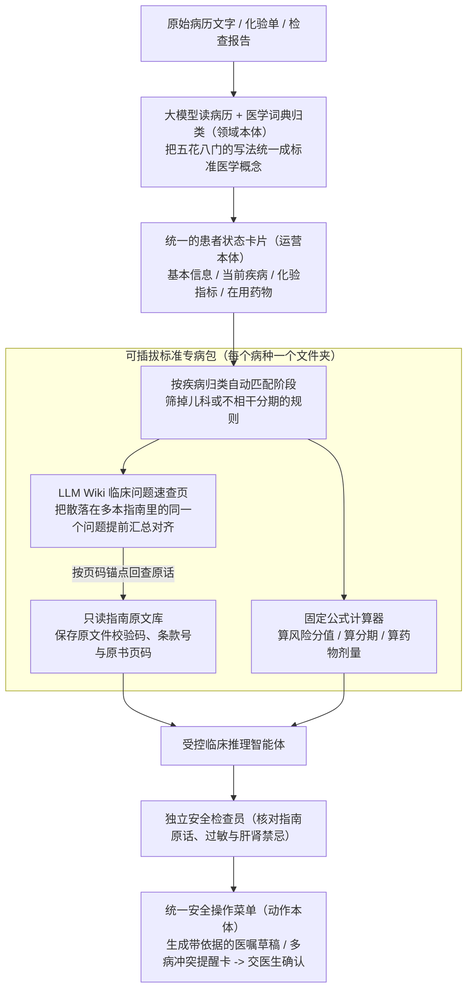
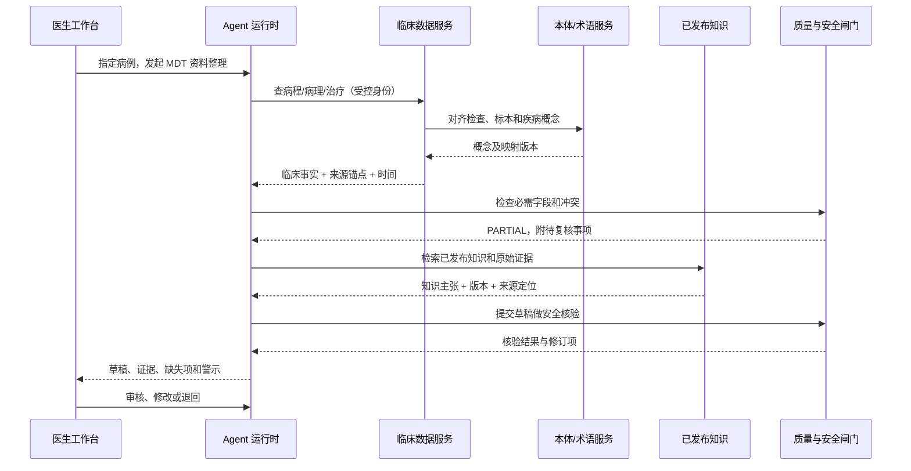

# 国内外专病智能体调研：行业实践、数据治理与标准化架构

核验日期：2026-11-17（行业案例、政策与标准），2026-11-18（新增论文与国内案例），2026-11-19（核心开源代码仓实地拉取拆解），2026-11-20（门诊实战盲区、行业产品运行逻辑、四层安全防御与 ClinMesh 同源专病临床内核对账）。本文梳理国内外“专病智能体”的政策监管、医院与企业落地案例、有同行评审证据的研究系统、数据治理方法、“一套通用底座 + 可插拔专病包”的标准化架构（含本体论与 LLM Wiki 的实际用法）、真实门诊分诊控费与受控学习闭环，以及怎么用评测和消融实验证明这套架构真的有用。文中标为【设计建议】的内容是本文基于上述证据归纳的工程假说，不是行业已有标准，也没有被任何论文整体验证过。

正文第一至八章的方案**故意独立于 ClinMesh 的源码与架构**设计，只以外部证据和通用工程原理为依据；与 ClinMesh 的事后对照放在[附录 A](#附录-a与-clinmesh-的事后对照)，不影响正文结论。本文只记录外部调研与架构参考，不改变 ClinMesh 当前产品行为，也不代表实施授权。

**证据等级约定**（避免把研究原型当成熟产品）：

| 标记 | 含义 | 能说明什么 |
| --- | --- | --- |
| **E1 临床研究** | 同行评审论文，有明确任务、样本和指标；外部验证、前瞻性静默运行比纯模拟更强 | 系统在该任务上的表现；不等于改善患者结局 |
| **E2 技术实验** | 受控数据集、模拟病例、单中心或实验室对照 | 技术可行；样本小或场景人造 |
| **E3 机构公开案例** | 医院、政府或企业自己发布的进展 | 业务场景和做法；统计口径无法独立复核 |
| **【设计建议】** | 本文提出的架构 | 什么也不能证明，需要后文的消融实验验证 |

---

## 一、什么是专病智能体？国内外为什么走出了不同路子？

### 1.1 一句话看懂“专病智能体”和以前的工具差在哪

简单说，**专病智能体就是专门盯某一种疾病（比如冠心病、脑卒中、肺癌、心衰）的“AI 专科医生助手”**。它既不像早年的传统软件那样只会死板地弹窗报错，也不像普通聊天大模型那样只能陪聊却进不了医院系统；它能自动读懂病历和检查报告、对照专科指南算风险分值、按治疗阶段提醒漏做的事，并帮医生把医嘱或随访草稿准备好。

| 对比项 | 第一代：传统规则系统（老式 CDSS） | 第二代：通用医疗聊天大模型 | 第三代：专病智能体 |
| --- | --- | --- | --- |
| 工作方式 | 程序员把“如果 A 就提示 B”写死在代码里 | 医生把病历复制粘贴进聊天框提问 | 自动读取当前患者资料，按该病种的诊疗步骤一步步辅助 |
| 能看懂什么 | 只能看填好的固定表格，看不懂自由书写的病历 | 能读文字，但不会主动去查医院里的检验和历史报告 | 自动汇总病历文字、历次化验变化、影像/病理结论和随访记录 |
| 专业靠谱度 | 规则太死板，稍微复杂点的病情就误报或漏报 | 容易“一本正经胡说八道”，常把成人/儿童、急性期/稳定期指南混用 | 每条建议都必须指明出自哪本指南第几页，算分和算剂量全走固定公式 |
| 医生用起来累不累 | 动不动就弹窗拦截，医生烦了直接点关闭 | 要专门切窗口打字聊天，门诊几分钟看一个根本顾不上 | 藏在正常看病流程里：缺检查时提醒、开单时给草稿、出院时帮核对 |
| 安全底线 | 不会乱编，但换家医院就用不了 | 算错数、给错药也没人拦 | AI 只能提“草稿建议”，而且有独立安全检查，最后必须由真医生点确认 |

把原始病历一股脑塞给大模型，会同时撞上五类问题，这也是后面每一章要解决的事：

1. **认人和对事**：同一个患者在不同系统里 ID 不同，检查结果和标本对不上号。
2. **意思对不齐**：同名不同义、不同检测方法的结果被混成一个，历史状态被当成当前状态。
3. **知识会过期**：指南更新、版本互相打架、适用人群写不清、出处无法核对。
4. **执行会越界**：Agent 越权读数据、乱调工具、生成没人核过的临床建议。
5. **分数不等于好用**：医学题库考高分，不代表真实工作流里漏得少、错得少、医生省事。

### 1.2 国内和国外为什么做法不一样？

国内外都在大力做专病智能体，但因为医疗体制、医院系统标准和“谁掏钱买单”不同，重点完全不一样：

| 维度 | 国内模式（大三甲科室带头 + 政策考核驱动） | 欧美模式（医疗 AI 公司 + 电子病历巨头 + 药企/保险买单） |
| --- | --- | --- |
| 谁在主导 | 顶尖三甲医院的大科主任/院士团队带头，联合大模型公司或医疗软件商一起做 | 两股力量：独立的专科 AI 独角兽（如 Tempus、Viz.ai）和病历系统巨头（Epic、Oracle） |
| 最想解决什么痛点 | ① 把大三甲的看病规范教给基层医院；② 帮医院应付国家绩效考核（单病种质控上报、病历质量）和医保 DRG/DIP 控费；③ 帮科室建专病数据库发论文做科研 | ① 欧美医生护士人工极贵、约个专科医生要等几周甚至几个月；② 帮药企在医院里快速找符合条件的新药临床试验患者；③ 帮保险公司减少患者出院后再住院 |
| 怎么接进医院系统 | 各家医院 HIS/病历厂商五花八门，往往要先花大力气做院内数据清洗，或者做页面级嵌入 | 美国联邦认证规则要求通过认证的病历系统开放标准 `HL7 FHIR` 接口，第三方 AI 应用像手机装 App 一样能跨医院接入；欧洲各国没有同等的统一强制要求 |
| 监管怎么管 | 管得很严：涉及辅助诊断治疗通常要拿药监局（NMPA）二类或三类医疗器械证，还得过生成式 AI 备案，要求数据不出医院 | 美国 FDA 分两条路：**只要把指南和病历依据摊开给医生自己判断，就可以免拿器械证快速上线**；真要拿证的预警软件，也可以提前报备“后续升级方案（`PCCP`）”，不用每次小更新都重审 |
| 主要是谁掏钱 | 公立医院的信息化/学科建设经费、各地卫健委数字医疗专项、科研经费 | **跨国药企**（买临床试验招募和数据）、**商业保险公司/大企业雇主**（买慢病管理省住院费）、大型私立医疗集团 |

---

## 二、政策与监管要求：红线在哪？（2024–2026）

### 2.1 国内政策与标准：国家明确时间表，要求“只辅助、不替代”

- **国家卫健委 84 个应用场景清单（`国卫办规划函〔2024〕420号`，2024 年 11 月）**：官方把“临床专病智能辅助决策”列为核心场景，明确支持围绕高血压、糖尿病、肺癌、胃癌、肝癌、房颤、脑卒中、抑郁症等重大专病建知识库，用来做风险评估、治疗推荐和病历质控。
- **五部门“人工智能+医疗卫生”实施意见（`国卫办规划发〔2025〕30号`，2025 年 11 月）**：给出了硬时间点——**到 2027 年**，要建一批高质量医疗数据集和可信数据空间，**拿出一批能用的临床专病大模型和智能体**；**到 2030 年**，二级以上医院普遍用上临床辅助决策。文件反复强调底线：**AI 只能赋能辅助，最终决定权和责任必须在执业医生手里**。
- **信通院专病数据集标准（`T/ISC 0168-2026` 等）**：中国信通院联合宣武医院、协和医院等正在按病种制定建设指南（已发布卒中专病分册，并扩展到“24 个专科 + 18 个专病”），规定专病数据怎么清洗、怎么标可信度、怎么整理成能训练智能体的临床推理问答。
- **国家药监局（NMPA）拿证边界**：如果软件直接分析 CT/超声等医学影像、心电波形或化验原始信号来帮医生下诊断、定方案，一般要按二类或三类医疗器械申报。审评最看重三点：数据是不是多中心都有代表性、AI 给的结论能不能追溯到原图或指南出处、模型更新有没有严格受控。是否属于器械取决于**预期用途、实际功能和对临床的真实影响**，不能只凭“有医生审核”或“用的是大模型”判定。
- **《个人信息保护法》**：医疗健康信息属于敏感个人信息。看病、科研、模型训练、交给第三方服务是**四种不同用途**，要分别评估合法性、必要性和告知同意；医院允许诊疗访问，不等于允许拿去训练或跨院共享。外部大模型 API 的传输、留存、训练用途和数据出境要逐项评估。

### 2.2 欧美监管巧思：怎么兼顾“用得快”和“管得住”？

- **美国 FDA 的“透明豁免规则”（`Non-Device CDS`）**：这是北美专病智能体能快速铺开的关键。FDA 规定，满足四个条件就不算医疗器械、不用走漫长的注册审批：① 不直接读取医疗设备原始影像或波形；② 只读取和分析病历文字、化验结果和医学指南；③ 给医生用，不是直接给患者自诊下结论；④ **把道理讲明白**——不能只甩出一个黑盒结论，必须把“依据患者哪条病历、对应哪本指南哪一条”摆在台面上，让医生自己能核对。
- **美国 FDA 的“提前报备升级机制”（`PCCP`）**：过去医疗 AI 一旦拿证，算法就得“冻住”，改一点就得重新申报。现在 FDA 允许厂商在第一次拿证时附带一份“预设变更计划”，提前写好以后打算怎么喂新数据、怎么测准确率、底线是多少。只要后续升级没破底线，就不用反复重新报批。
- **英国与欧盟做法**：英国 NICE 专门开了“早期价值评估（`EVA`）”通道，评估脑卒中、肿瘤等 AI 工具到底能不能省钱省时间，过了就能进公立医院采购目录；欧盟则在 2025 年 3 月正式生效《欧洲健康数据空间条例》（`Regulation (EU) 2025/327`），从法律上规定医疗数据可以在政府管的安全房间里用来训练医疗 AI，但严禁拿去给保险公司做拒保或涨价。

---

## 三、专病智能体在干什么？国内外代表案例盘点

### 3.1 最主流的三大应用场景

1. **院内帮医生看病与质控（门诊 + 住院）**：患者一入院，自动判断能不能进国家标准临床路径；按病情阶段自动算专科评分（比如心梗死风险分、房颤中风风险分、肿瘤分期）；在医生开药开手术耗材时核对肾功能、过敏史和指南依据；同时在写病历和开医嘱当时就提醒“国家单病种质控指标漏了哪项”，不用等患者出院后再人工翻病历补填。
2. **院外管患者康复与“名医分身”（诊前 + 出院后）**：看病前先像专科医生一样把关键病史和危险信号问清楚；出院后变成专家团队的“数字分身”，回答饮食、康复和吃药疑问，定期打电话随访，一旦发现居家血压、血糖、体重异常（比如心衰患者几天内体重猛涨，往往预示体内积水加重），马上提醒真人医生或护士介入。
3. **疑难病多学科会诊（MDT）与临床科研**：肿瘤或复杂重症开多学科会诊前，原本年轻医生要花两小时翻几十份报告整理病史，现在几个专科智能体分工把影像、病理、基因和既往用药整理成一页清晰的时间线；顺便把日常病历自动填进科室科研专病库，或者帮新药临床试验快速找出符合条件的患者。

### 3.2 国外代表玩家（四大类，E3）

| 类型 | 代表公司与产品 | 主攻病种 | 它是怎么落地赚钱的？ |
| --- | --- | --- | --- |
| 病历系统巨头自带 | **Epic**（`Cupid` 心血管 / `Beacon` 肿瘤 + `Agent Factory`） | 心血管、肿瘤等各专科 | 直接长在北美最大病历系统里，帮医生整理跨周期化疗记录、查漏补缺，还让医院能自己按科室规矩搭智能体 |
| 病历系统巨头自带 | **Oracle Health**（`Clinical AI Agent` + 肿瘤专用病历） | 30 多个专科，重点发力肿瘤 | 诊室里边听医患对话边自动生成检查和转诊草稿；专门做了云端肿瘤系统算终身化疗累积剂量，还能插进对手 Epic 的医院里用 |
| 肿瘤精准医疗 | **Tempus AI**（`Tempus One`，已上市） | 各类恶性肿瘤 | 嵌在医生电脑里，结合基因检测报告和美国临床肿瘤学会（ASCO）指南给靶向药依据；一旦发现患者符合某款新药临床试验条件，立刻通知医生入组，收药企的钱 |
| 肿瘤诊前与科研 | **Color Health × OpenAI** / **欧洲 Owkin** | 肿瘤诊前准备 / 肿瘤病理科研 | Color 帮刚确诊癌症的患者查还缺哪项活检或影像、自动写医保报销申请，把等待治疗的时间从几周缩到几天；Owkin 用联邦学习跨欧洲大医院找肿瘤耐药规律 |
| 心脑血管急重症 | **Viz.ai**（`Viz Stroke` / `Viz HCM` / `Viz Agent Studio`） | 脑卒中、肥厚型心肌病、肺栓塞 | 急诊拍完脑 CT 几秒钟认出大血管堵了，直接发手机警报叫醒手术团队；还能自动扫全院心电图揪出平时 85% 会漏诊的肥厚型心肌病（拿了美国 FDA 创新证），并自动安排心内科随访 |
| 院外慢病与康复 | **Hippocratic AI**（`Polaris`） / **Sword Health**（`Phoenix`） | 心衰、慢肾、肿瘤随访 / 骨科康复 | Hippocratic AI 做语音随访护士，背后十几个安全小模型同时盯着药名和剂量防说错话；Sword Health 用摄像头看患者在家做康复动作标不标准，实时语音纠正 |

### 3.3 国内代表玩家（两大类，E3）

| 类型 | 代表医院或企业 | 主攻病种 | 核心亮点与落地方式 |
| --- | --- | --- | --- |
| 顶级三甲医院自研联创 | **复旦中山医院**“观心（CardioMind）”（葛均波院士团队） | 心血管病（冠心病、心衰、心律失常等） | 喂了中山心内科几十万份病历和大查房疑难讨论思路，能把心电图、心超和化验单放一起综合判断，还做了专家数字分身管慢病 |
| 顶级三甲医院自研联创 | **复旦大学附属肿瘤医院**“复肿乳AI”（`BC-PORT` 乳腺精准诊疗智能体） | 乳腺癌 | 覆盖诊疗、质控、MDT、随访、科研全场景，用 Graph-RAG 检索保证建议可溯源；医院公开披露病例整理时长缩短 30%–40%（[复旦新闻，2026-08-05](https://newsroom.fudan.edu.cn/_s3/2026/0806/c240a150040/page.psp)），没有公开独立评测设计 |
| 顶级三甲医院自研联创 | **上海瑞金医院**“RuiPath”（宁光院士团队 × 华为） | 常见肿瘤病理（覆盖国内 90% 常见癌种）+ 代谢病 | 几秒钟辅助看病理切片，结合基因和临床资料预判肿瘤转移风险，而且开源了普通电脑就能跑的轻量版给基层医院用 |
| 顶级三甲医院自研联创 | **北京儿童医院**“福棠·百川”（× 百川智能） | 儿科疑难罕见病 & 基层儿科常见病 | 吸收 300 多位儿科专家经验，说话必带医学出处；院内帮专家开疑难会诊，在县医院和社区搞“真医生 + AI 儿科医生”双医生搭档 |
| 顶级三甲医院自研联创 | **北京协和医院**“协和·太初”（× 中科院自动化所） | 罕见病（遗传代谢、神经发育等） | 专门解决罕见病“病例极少、极易误诊”难题，帮基层医生和患者从复杂症状和基因报告里找线索、对接协和转诊 |
| 顶级三甲医院自研联创 | **四川华西医院**“华西黉医” / **安贞与天坛医院** / **清华“紫荆 AI 医院”** | 消化、急重症休克、心脑血管、全科仿真 | 华西用 1 个大模型底座带出十几个科室智能体（如消化科“睿兵”）；安贞、天坛主攻心脑血管影像和国家数据集标准；清华搭了全虚拟医院让 AI 医生在模拟看病中攒经验 |
| 省域平台与医疗软件厂 | **浙江卫健委 × 蚂蚁**“安诊儿” / **卫宁健康** / **医渡科技** / **惠每科技** / **讯飞医疗** | 云陪诊与名医分身、专病库、单病种质控、智能随访 | “安诊儿”打通浙江全省医院挂号陪诊并挂载名医专病分身；卫宁把专病入组直接嵌进病历系统；医渡强在清洗专病库和临床试验筛人；惠每专攻单病种事中质控与 DRG 提醒；讯飞强在 140 多种专病的院后电话随访 |
| 区域数据生产设施 | **上海申康医院发展中心**“高质量多模态医疗 AI 训练数据标注设施” | 24 个主要病种 | 按病种组织临床专家标注和审核，形成 46.5 万例训练集和 4.4 万例金标准测试集（[国家数据局案例，2025-06-03](https://www.nda.gov.cn/sjj/ywpd/szkjyjcss/0603/20250603211659578550278_pc.html)）；说明“专病数据怎么批量生产”，但这些数据不全是给大模型 Agent 用的 |

### 3.4 有论文证据的研究系统（E1/E2）

上面的产品案例说明“大家在做什么”，下面这批 2025–2026 年的同行评审论文说明“哪些做法有数据支撑”。数字均取自论文摘要（经 Crossref/OpenAlex 核对 DOI 与摘要）：

| 系统 | 做了什么、测出了什么 | 值得借鉴 | 不能直接推出的结论 |
| --- | --- | --- | --- |
| **HemaGuide**（血液肿瘤，*Nature Medicine* 2026，E1）[DOI](https://doi.org/10.1038/s41591-026-04494-4) / [源码](https://github.com/Friedrich-Lab/HemaGuide) | 把非结构化病历分步抽成结构化章节与既往治疗线，自动分流到“指南流程图（`GUIDELINE`）/ 相似病例+文献（`ADVANCED`）/ 分子变异（OncoKB/COSMIC）”模式；第二家中心 555 例外部验证一致率 81.8%，连续 64 例、1 个月前瞻性静默运行一致率 82.8%；664 例中幻觉 2 例（0.3%）；11 层消融显示没有单一组件能通吃所有分流类型；源码强制本地跑向量嵌入（Ollama `embeddinggemma:300m`）防病历外传，指南未覆盖时明确弃权转人工，单机中位耗时 39 秒 | 分步病历抽取 + 纵向治疗线、按病例复杂度分流、本地嵌入隐私保护、未覆盖诚实弃权、**外部验证 + 静默运行**范式 | 一致率不等于改善患者结局；源码提示词与输出结构（`konferenzbeschluss`）硬编码了德国肿瘤会诊文书习惯，需本地化改造 |
| **DeepRare**（罕见病，*Nature* 2026，E1）[DOI](https://doi.org/10.1038/s41586-025-10097-9) / [源码](https://github.com/MAGIC-AI4Med/DeepRare) | 多 Agent 鉴别诊断，接入 40 多种专业工具和知识源；源码显示其核心防幻觉机制是“**先用模型把口语病历转成标准 HPO 表型码，再调确定性生信工具（如 `Exomiser`、OMIM、Orphanet 相似度计算）给候选病排座次，最后才让大模型汇总核验**”；HPO 任务平均 Recall@1 57.18%，专家审阅推理链一致率 95.4% | “口语转标准码 → 确定性程序算分初筛 → 大模型终审写证据链”的三段式分工 | 罕见病诊断表现不代表其他病种或医院的准确率 |
| **EvoMDT**（多癌种 MDT，*npj Digital Medicine* 2026，E1/E2）[DOI](https://doi.org/10.1038/s41746-025-02304-8) | 多个专科 Agent 在病灶级数据上推理，用共识协议解决冲突并生成带证据链接的建议；乳腺、肝、肺、淋巴瘤真实数据 + 医生单盲评估，质量接近人类 MDT，响应时间缩短 30%–40%（注：论文所附代码仓 `KesselZ/EvoMDT` 于 2026-11-19 核验返回 404，仅论文公开） | 原子化证据、共识与冲突处理、安全检查 | 它的“自演化”会根据反馈自动改提示词、共识权重和检索范围，**不宜原样用于生产**（等于未审核地改临床知识）；代码未公开，工程细节不可复核 |
| **肿瘤工具增强 Agent**（*Nature Cancer* 2025，E2）[DOI](https://doi.org/10.1038/s43018-025-00991-6) | GPT-4 调用病理 ViT（判 MSI、KRAS/BRAF）、MedSAM 影像分割、OncoKB、PubMed；20 例模拟多模态病例中工具选用正确 87.5%、结论正确 91.0%、指南引用准确 75.5%；比单用 GPT-4 从 30.3% 提到 87.2% | 把专科模型和医学数据库当成**可审计的工具**调用 | 样本只有 20 例且是模拟病例 |
| **AMIE 多次就诊管理**（*Nature* 2026，E2）[DOI](https://doi.org/10.1038/s41586-026-10764-5) | 面向多次就诊管理的 Agent，用长上下文对齐指南和药典；在 100 个多次就诊虚拟 OSCE 场景中管理推理不劣于 21 名全科医生 | 跨次就诊的患者状态、指南与药典双重约束 | 论文明确说进入真实临床前还需进一步研究；对话记忆不等于可信临床事实 |
| **OncoAgents / OncoGraph**（肿瘤临床试验匹配，*ESMO Real World Data and Digital Oncology* 2026，E1）[DOI](https://doi.org/10.1016/j.esmorw.2026.100706) | 12 个月前瞻性筛查 3804 名患者；大模型负责抽取，肿瘤知识图谱 + 确定性规则负责入组条件判断，肿瘤科医生复核；患者-试验对 F1 0.82（GPT-4 零样本 0.47、思维链 0.67）；单患者筛查从中位 120 分钟降到约 30 分钟；**消融实验证明知识图谱和多 Agent 拆分都有实质贡献** | 本体映射 + 规则判断 + 医生复核 + 消融实验，这是目前“本体有没有用”最直接的证据 | 试验匹配的 F1 不能换算成治疗决策准确率 |
| **多模态医疗 Agent 综述**（*npj Digital Medicine* 2026）[DOI](https://doi.org/10.1038/s41746-026-03060-z) | 37 项研究（2022-01 至 2025-06）：多数以文本为主、用闭源模型、停在原型或早期技术评估；安全、公平、前瞻性结局验证和真实部署证据都有限 | 评测设计要补上安全、漂移和前瞻性验证 | 研究数量多不代表行业成熟 |

**小结**：国内案例告诉我们**哪些业务场景能落地、专病数据怎么批量生产**；国际论文告诉我们**架构和评测该怎么约束**。这些证据各自支持某一块能力，但**没有任何一项研究联合验证过第五、六节那套完整架构**。

---

## 四、专病数据治理：脏乱差的医院数据怎么变成智能体能用的好数据？

做专病智能体，“三分靠算法，七分靠数据治理”。平时医院里留存的病历和报告虽然多，但直接喂给智能体几乎必出乱子。

### 4.1 给智能体用的数据，和传统医院报表有什么区别？

以前医院做统计报表或传统科研库，只要在患者出院后把最终结果填成一张大表格就行；但给专病智能体用的数据，必须额外做到五件事：

1. **严格按真实时间排先后（绝不能“偷看未来答案”）**：患者刚来门诊或刚入院时，医生只知道主诉和初步化验，并不知道三天后的手术结果和出院诊断。整理数据时必须精确到分钟，还原“当时那一刻医生能看到什么”，否则训练和测试出来的 AI 一上真战场就废了。
2. **抽出来的每个结论都要绑着“原文位置”**：用大模型把手术记录里的“前降支狭窄 85%”抽成结构化字段时，必须顺手记下这句话出自哪份报告、第几行第几个字。这样 AI 给建议时，医生一点就能看到原话，不怕模型瞎编。
3. **分清“查过了没问题”和“压根还没查”**：病历里写“无黑便、无药物过敏”是非常重要的排除依据；而如果病历里根本没提，代表还没问或还没化验，必须标成“未知/待确认”，绝不能稀里糊涂都当成“正常”。
4. **不仅记“开了什么药”，还要记“当时为什么这么开、最后效果怎样”**：把“患者当时情况 → 参考了哪条指南 → 做了什么处理 → 出院后有没有复发”串成完整链条。
5. **旧结果不被新结果覆盖**：同一项检查在不同时间、不同标本上做过多次，每次都要单独保留；报告被更正时，新旧版本之间记下“谁替代了谁”，而不是直接把旧值删掉换成“最新值”。

### 4.2 国内外都在用什么数据标准？各管哪一段？

- **国际通行做法（多套标准分工，不是混用）**：

| 标准 | 管什么 | 管不了什么 |
| --- | --- | --- |
| **`HL7 FHIR`** | 看病时系统之间交换数据的接口和资源格式；自带记录数据来源的 `Provenance` 和访问留痕的 `AuditEvent` | 不会自动把各家的医学含义统一好，也不负责数据质量 |
| **FHIR 专病模板**：肿瘤 **`mCODE`**、心血管 **`CardX`** | 每个病种只挑最关键的二三十个核心指标（源码按患者、疾病特征、体能评估、基因、治疗、结局 6 大模块组织；如 TNM 分期强制要求填分期版本 `method` 与原发灶指向 `focus`，疾病进展强制挂判断依据类型 `evidenceType`） | 当前 mCODE STU4（`fhirVersion: 4.0.1`）强绑定美国 `US Core 6.1.0`，不保证每个患者都有这些字段，也不覆盖中国临床路径与 FHIR R5 |
| **`OMOP CDM`**（当前 v5.5） | 攒大样本做科研分析时的通用表结构，把五花八门的药名、化验名统一翻译成国际标准词典（临床概念 `SNOMED CT`、化验 `LOINC`、药品 `RxNorm`） | 不适合单独承担实时病程状态和临床审批流程，适合做研究库而不是 Agent 唯一数据源 |
| **`DICOM` / `DICOMweb`** | 医学影像和影像元数据 | 不解释影像的临床意义 |
| **`ICD`、`NCIt`、`HPO`、院内编码** | 疾病、肿瘤概念、表型的标准词和编码 | 替代不了时间、证据和临床状态建模 |

- **国内通行做法（国家专病标准 + 临床/医保两套编码对齐）**：
  - 按信通院 `T/ISC 0168-2026` 等指南，给每项核心数据打上**“什么时候产生的、加工到哪一步了、可信度有多高”**三个标签；
  - **国内特有的硬骨头**：医院内部必须同时对齐两套字典——医生看病写病历用的**卫健委临床编码**，和算钱报销用的**国家医保局 15 项贯标编码**（药监、耗材 27 位码等）。两边经常不是一一对应的，必须在数据底座里做好翻译对照表。

### 4.3 从原始病历到智能体可用数据的四步流水线（`L0` → `L3`）


这四步也常被叫作“原始层（Bronze）→ 标准层（Silver）→ 临床语义层（Gold）”，再往上按具体任务（MDT 准备、随访、试验筛选）切出**只含必要字段的任务视图**；科研用的 OMOP 库是另外一条支线，不是 Agent 实时读取的唯一来源。

每一步都要事先想好**出错时怎么办**【设计建议】：

| 环节 | 出问题时的处理 |
| --- | --- |
| 认人（跨系统患者匹配） | 拿不准就隔离等人工确认，**绝不仅凭姓名自动合并两个人** |
| 收数据 | 记下断点和延迟，没同步完的批次不准给 Agent 用 |
| 统一编码和单位 | 映射不了就标“未映射”，不准猜一个标准值 |
| 大模型抽字段 | 保留原文证据，标记“需复核” |
| 排病程时间线 | 时间互相矛盾时保留多个版本，生成待核查事项 |
| 质量把关 | 关键资料缺失或严重矛盾时，降级为“资料缺失报告”，不硬出结论 |
| 对外提供数据 | 按角色和用途只给最少字段；权限或证据不足就拒绝并留痕 |

这里最值得借鉴的是美国肿瘤数据巨头 **Flatiron Health 发表的 `VALID` 质控框架**与 **OHDSI `DataQualityDashboard`（DQD）开源质检引擎**。两者来源不同：`VALID` 论文摘要给出的是三根支柱——**逐变量对比专家人工摘录**、**内部一致性与合理性核查**、**复现分析（用抽取数据与人工数据集或外部标准对比结论）**，并按人群分层查偏差；DQD 是一套可以承担第二根支柱的开源工具；“多处记录对账”是本文补充的【设计建议】。合起来，用大模型批量抽病历指标时可以设四道关口：
1. **先跟真人专家比逐字段准确率**（`VALID` 第一支柱）：抽出来的每个指标，先跟专科人员手工整理的结果比对查准率与查全率，重点盯防“把未做检查瞎编成阴性”；
2. **用配置表自动查单位、时间轴与生理反常识错误**（`VALID` 第二支柱，可用 DQD 实现）：拆读 `OHDSI/DataQualityDashboard` 源码可见，它把 3,300 多条体检浓缩成 **28 个通用 SQL 模板 + 3 张 CSV 配置表**，最救命的三类拦截是：① **合法单位白名单**（`plausibleUnitConceptIds`，专门拦住中国常用的血肌酐 `μmol/L` 与欧美指南 `mg/dL` 混用导致数值差出 88.4 倍的致命乌龙）；② **时间轴穿越检查**（出生前看病、去世后开单、治疗结束早于开始）；③ **生理性别与上下限检查**（如男性名下出现宫颈病变或剖宫产、射血分数超 100%）；
3. **多处记录互相“对账”**【设计建议】：比如手术记录文字写着“放了 1 枚支架”，但医院收费单上却收了 2 枚支架的钱，系统会自动标为“记录冲突”，转给人工核实，绝不让错数据糊弄过去；
4. **复现分析（`VALID` 第三支柱）**：不仅看单字段对不对，还要拿 AI 抽出来的整批数据重做分析，与人工摘录数据集或外部标准得出的结论对比（例如分期分布、生存曲线），结论一致不跑偏，这套抽取管线才算真正过关。

另外在**隐私脱敏**上也有个实用技巧：不能简单把所有日期一删了之（否则算不出术后第几天复发），而是对同一个患者的所有日期统一往前或往后平移固定的随机天数——既藏住了真实就诊日期，又丝毫不影响计算两次检查隔了多少天；同时别忘了用图像识别抹掉超声、内镜图片边角自带的患者姓名。

### 4.4 一条“临床事实”应该长什么样？【设计建议】

L3 层的最小单位不是“一个字段”，而是一条**带出处、带时间、带标本的临床事实**。下面是结构示意（数据完全虚构，只用于讨论接口）：

```json
{
  "fact_id": "fact-9e02",
  "patient_pseudo_id": "patient-001",
  "disease_case_id": "case-bc-001",
  "concept": {"system": "local-oncology", "code": "HER2_IHC"},
  "value": {"raw": "3+", "normalized": "positive", "method": "IHC"},
  "specimen_id": "specimen-met-02",
  "observed_at": "2026-07-20",
  "reported_at": "2026-07-22",
  "ingested_at": "2026-07-23T09:00:00+08:00",
  "clinical_assertion": "affirmed",
  "verification_status": "source-verified",
  "source": {"system": "PATHOLOGY", "record_id": "report-123", "version": "v3", "anchor": "section:HER2"},
  "extraction": {"type": "model+rules", "version": "extractor-0.4"},
  "mapping_version": "oncology-map-1.0",
  "supersedes_fact_id": null
}
```

几个关键点用大白话说：

- **三个时间分开记**：检查做的时间（`observed_at`）、报告出的时间（`reported_at`）、进系统的时间（`ingested_at`）。回放“当时医生知道什么”时，看的是报告时间。
- **原始值和标准值都留**：`3+` 是报告原话，`positive` 是归一化结果，`IHC` 是检测方法——方法不同的结果不能合并。
- **肯定、否定、疑似要分开**（`clinical_assertion`）：对应 4.1 的“查过没问题”和“还没查”。
- **谁抽的、用哪版规则映射的都要记**：抽取器或映射表升级后，才能找出哪些事实要重算。
- **更正不删除**：新事实用 `supersedes_fact_id` 指向被替代的旧事实。

真实系统还需要补上签名、撤销、置信度、审批人、时区和院内身份匹配等细节。

### 4.5 “资料够不够”应该是一个接口，而不是一张报表【设计建议】

数据质量不能只在后台大屏上展示。更实用的做法是让 Agent 每次干活前先问一句：`evaluate_case_readiness(case_id, task_id)`，返回 `READY`（可以干）/ `PARTIAL`（能干但要附带提醒）/ `BLOCKED`（别干），并列出依据和需要补的资料。**没有一套“所有病例都必须有”的字段清单**——哪些字段必需，由具体任务和专病包决定。

还要分清**医学上本来就不一样**和**数据出错了**。例如同一乳腺癌患者 2024 年原发灶 HER2 IHC 1+、2026 年转移灶 IHC 3+，这可能是真实的临床现象，系统应该把两条结果都列出来提示医生核对，而不是当成数据错误丢掉其中一条：

```json
{
  "readiness": "PARTIAL",
  "issues": [
    {"code": "SPECIMEN_RESULT_CONFLICT", "severity": "requires_review", "fact_ids": ["fact-old", "fact-new"]}
  ],
  "allowed_next_actions": ["draft_with_caveat", "request_clinician_review"]
}
```

### 4.6 数据不准出医院，怎么跨院训练和合作？（中、美、欧三种解法）

| 地区 | 主流做法 | 大白话解释怎么运作 |
| --- | --- | --- |
| **中国** | **医疗可信数据空间 + 数据沙箱**<br>（如上海申康医院发展中心模式） | **“数据不动，模型进场”**：市级平台把各家三甲医院的数据整理好锁在安全沙箱里，企业不能拷走一份病历，只能把算法放进沙箱里训练测试，审核安全后只带走训练好的模型 |
| **欧盟与英国** | **欧盟健康数据空间（`EHDS`）**<br>+ **英国 NHS `OpenSAFELY`** | **“代码找数据”**：开发者连真实数据长什么样都看不见，只能在假数据上写好分析代码，把代码发进医院内网自动跑完，最后只拿回汇总统计数字；或者用联邦学习在各医院本地训练 |
| **美国** | **`HIPAA` 彻底去隐私化后商业流转** | 美国法律规定，只要按标准彻底抹掉 18 类个人身份信息（或经统计专家证明不可能反推出本人），脱敏后的数据就可以合法汇总成上千万人的商业专病大库（如 Epic `Cosmos`、Tempus） |

### 4.7 整理专病数据最容易踩的 6 个坑

1. **拿“出院小结/病案首页”去测“刚入院时的判断”**：出院诊断是所有检查做完后的马后炮，混进早期数据里会让测试分数虚高，一上线就露馅。
2. **住院病程天天“复制粘贴”**：住院医写日常记录常复制前一天的查体文字，患者第 1 天的“双下肢水肿”到第 7 天早消了，字还留在病历里。必须对比前后两天的文字差异，再结合最新体温、化验单才准。
3. **老病历配了新指南**：2017 年的心衰病历没开某款新药，是因为那年这药还没进指南。如果不记下看病当年的指南版本，AI 就会把当年完全规范的治疗错判成“漏开药”。
4. **外院带来的纸质/PDF 报告只扫成文字、没拆成指标**：像冠脉造影哪根血管堵了百分之几、心超射血分数多少，必须拆成带单位的具体数字，不能只扫成一大段字丢进库里。
5. **患者一出院就“断联”**：大医院只知道患者好转出院，不知道他回老家后有没有停药、有没有去急诊抢救。没有院后随访补齐结局，AI 算出来的远期安全率都会偏乐观。
6. **把“名字差不多”的检查当成同一项**：例如乳腺癌的 HER2 蛋白表达（IHC）和 ERBB2 基因扩增（ISH）相互关联，但不是同一个检测；名字再像也必须保留方法、标本、时间和原始结果，不能合并成一个“HER2 结果”。

---

## 五、怎么设计“标准化专病智能体”？（一套底座 + 可插拔专病包）

如果你想做一套**跨病种复用的标准架构**——不管是做冠心病、脑卒中还是肺癌，共用同一个底座引擎，每加一个新病种只需要按统一格式插上一个“专病包（`Specialty Pack` / `Disease Pack`）”——下面这套融合了国际标准、**本体论**与 **LLM Wiki** 的方案最值得参考。**专病包不是行业公认规范，整节都属于【设计建议】**。

### 5.1 为什么以前的插件方案没跑通，现在可以了？

早年医疗界试过做通用规则插件（`Arden Syntax`），但卡死在两个问题上：一是每家医院数据库表名不一样，换家医院取数代码就得重写；二是死规则读不懂医生手写的病历描述。反过来，现在如果只用纯大模型提示词当插件，又容易算错分值、引错指南。

现在的最佳解法是**“分工合作”**：
- 参考 **[HL7 CDS Hooks](https://cds-hooks.hl7.org/)** 统一规定“什么时候唤醒智能体”（如 `patient-view` 开档案、`order-select` 勾选医嘱草稿、`encounter-discharge` 办出院）：按其官方规范源码设计，临床决策只返回带草稿动作（`suggestions`）和医生否决原因枚举（`overrideReasons`）的提示卡（`cards`），严禁用静默写库字段（`systemActions`）暗改医嘱；同时注意同步钩子通常要求亚秒级响应，复杂大模型推理与新检验/影像报告到达需配合后台异步预计算；
- 参考 **[HL7 CPG-on-FHIR](https://hl7.org/fhir/uv/cpg/)**（及世卫组织 `SMART Guidelines`）统一规定“怎么把一本纸质指南拆成标准数据包”；
- 参考 **[HL7 mCODE](https://hl7.org/fhir/us/mcode/)** 统一规定每个病种只抓最核心的 20–40 个关键指标；
- 再用大模型负责“读懂病历文字”，用固定代码负责“算准公式分值”。

整套设计守住六条底线：

1. **原始事实不覆盖**：保留历次检查、标本、时间、来源和更正关系。
2. **医学知识和患者信息分开放**：公共知识库不准吸收可识别的患者病历。
3. **结构化事实优先于自由文本猜测**：Agent 只能引用受权数据服务返回的、能回溯原文的事实。
4. **知识能发布也能撤回**：新文献不会自动变成临床规则，要专家复核、版本快照、可回滚。
5. **先固定流程，再考虑多 Agent**：先做步骤有限、工具受控的单 Agent，靠消融实验证明有收益再加 Agent。
6. **任何变更都触发回归测试**：数据映射、知识、模型、工具、提示词任何一项换版本，相关评测都要重跑。

### 5.2 哪些功能放进“通用底座”，哪些装进“专病包”？

| 模块 | 留在“通用底座引擎”（写一次，所有病种共用） | 装进每个“可插拔专病包”（换病种只换这个包） |
| --- | --- | --- |
| 什么时候启动 | 监听医生看病动作（开档案、看报告、选医嘱、办出院），支持一个患者同时激活多个专病包 | 写明本专病的“触发条件”（比如出现哪些诊断、哪些危险主诉或哪项化验异常就启动） |
| 抓哪些患者信息 | 负责去医院系统读病历、调大模型抽字段，并强制记下原文出处和时间 | 列出本专病最关键的 **20–40 个核心指标清单**，以及缺某项指标时该怎么提醒医生补问或补查 |
| 查指南与走流程 | 根据患者当前年龄、分期自动筛掉不适用的指南条款，再去翻原文 | 提供本专病的**诊疗阶段流程图**、整理好的 **LLM Wiki 专题速查页**以及带页码的**指南原文库** |
| 算分与算剂量 | 提供安全的公式运行环境（缺数据时老实报“缺某项化验”，绝不瞎猜硬算） | 放进本专病的**固定计算公式代码**（比如冠心病 `GRACE` 评分、中风 `NIHSS` 评分、按肾功能减量公式） |
| 安全把关与医生确认 | 统一检查药物过敏/冲突、核对 AI 引用的指南条款是不是真存在、管好“草稿 → 医生点确认”流程 | 写明本专病的**国家单病种质控必查项**和医保 DRG 编码核对规则 |
| 多病一身怎么协调 | 当一位老人同时触发“冠心病包”和“慢肾包”且建议打架时，自动把冲突摆到桌面上让医生拍板 | 给每条治疗建议贴上风险标签（比如贴上 `[会增加出血风险]` 或 `[造影剂伤肾]`，方便底座自动发现冲突） |
| 能用哪些工具、禁止做什么 | 工具网关统一做鉴权、参数校验和留痕 | 列出本包允许的工具白名单和**明确禁止的动作**（如自动开药、签署病历、自主决定治疗） |
| 怎么验收 | 统一的评测运行器和发布门槛 | 本病种的标准测试病例和打分标准 |

跨医院复用时，四类东西的共享范围不同：

| 范围 | 内容 |
| --- | --- |
| 平台共用 | 接入契约、临床事实格式、Wiki 编译器、本体框架、Agent 引擎、质量与评测框架 |
| 病种共用 | 某病种的核心术语、本体扩展、任务模板、证据模板、测试基准 |
| 医院专用 | HIS/病历字段映射、采集权限、本院流程和报告模板、审批人、本院测试集 |
| 逐项授权才能共享 | 患者数据、有版权限制的指南全文、院内历史病例记忆 |

### 5.3 “本体论”和“LLM Wiki”在这套架构里到底起什么作用？

这两个词听着玄乎，其实在标准专病架构里干的是两件非常实在的事：



#### 先分清几个容易混的词

| 东西 | 本质 | 例子 |
| --- | --- | --- |
| 数据字典 | 字段、类型、取值范围 | `HER2_IHC_result` 的枚举值 |
| 术语系统 | 临床名称和代码 | ICD、NCIt、医院本地码 |
| **本体** | 概念、属性和关系的正式定义与约束 | “某检测必须基于某类标本”“IHC 属于蛋白表达检测” |
| 知识图谱 | 按本体约束存放的具体实体和关系 | “某版指南对某类检测给出某条有条件的说明” |
| Wiki | 给人和模型看的解释性文档和交叉索引 | HER2 检测解读、出处、争议说明 |
| 临床事实库 | 具体某个患者、某次事件的可追溯记录 | 某患者某天某标本 IHC 3+ |

#### 1. 本体论（Ontology）：干两件事——“统一医学归类词典”和“统一安全操作菜单”

- **第一层：医学归类词典（领域本体，如 `SNOMED CT`、`NCIt`、药品分类 `ATC`、罕见病症状库 `HPO`）**
  - **解决什么麻烦**：如果不做上下级概念归类，你在冠心病包里写一句“有消化道出血禁用某抗血小板药”，结果患者病历里写的是“黑便”“呕血”或者“胃窦溃疡渗血”，药单里开的是商品名“波立维”，死板的字面匹配就会全部漏掉。
  - **用上之后的好处**：专病包只需要对着上层概念写一句“属于【消化道出血】就报警”“属于【P2Y12 抑制剂】就算数”，底下几百种具体病名和商品名自动全包圆。**实操建议**：别一上来就搞全院几万个节点的重型知识图谱（如复杂图数据库），先做一张**轻量级的“标准词表上下级树”**就够解决 90% 的问题。
  - **分三层管**：通用核心概念（患者、病例、就诊、观察、标本、治疗、结局、证据、时间段）→ 病种概念（某病的分型、分期、诊疗节点）→ 医院本地扩展（本院特有检查项目和流程）。本地扩展不准改写通用定义。
  - **映射要分“完全等于”和“差不多”**：参考 W3C `SKOS` 把映射分成 `exactMatch`（完全等价）、`closeMatch`（相近）、`broadMatch`/`narrowMatch`（更宽/更窄）。把“相近”硬当成“等于”，就是 4.7 第 6 个坑的来源。每条映射要有审核人、状态（提议 → 已审 → 已批准 → 已废弃）和生效日期；映射一改，要能查出受影响的历史事实、规则和测试病例。
  - **两个技术提醒**：`OWL` 本体按“开放世界”推理——**查不到不等于不存在**，所以“没查到过敏记录”不能推出“无过敏”；需要校验“必填字段、取值范围”时用 `SHACL` 这类约束语言，而不是靠本体推理。
- **第二层：统一对象与安全操作菜单（运营本体，参考 Palantir 医疗模式）**
  - **解决什么麻烦**：不同医院底层数据库千差万别，如果让专病包直接写接口改数据，既不通用又极危险。
  - **用上之后的好处**：底座把医院系统包装成统一的“患者卡片”和固定的几个“安全动作按钮”（比如：`生成检验草稿`、`提示缺少检查`、`标记质控漏项`）。不管插上什么病种包，都只能按这几个规矩提交草稿，权限控制和留痕审计全由底座统一管住。
- **本体不是临床规则**：概念关系、指南建议的适用条件、统计风险模型要分开表达、分开验证；模型自动提出的概念关系不能直接升格为正式医学事实。**版本治理比概念数量更重要**——稳定的概念 ID 和变更影响报告，比首期覆盖多少个概念更值钱。

#### 2. LLM Wiki：把散落在多本指南里的同一个难题，提前编成“专题速查地图”

- **解决什么麻烦**：临床上一个具体问题（比如“冠心病合并肾功能不全做支架，怎么补液护肾、怎么用抗血栓药？”），答案往往分散在《血运重建指南》《对比剂肾病共识》《双抗共识》三四份文件里。传统做法是等医生提问时临时去搜前几段话，极容易漏掉某本共识角落里的“心衰患者必须少输液”这种关键例外。
- **LLM Wiki 怎么用**（参考 Karpathy 的 `LLM Wiki` 思路：不可变的原始资料 + 模型维护的 Wiki + 约束编写规则的 Schema，三个动作是摄入、查询、自检；微软开源的 [`microsoft/llmwiki`](https://github.com/microsoft/llmwiki) 提供了 `.wiki/` 三层目录、跨进程文件锁 `withWikiLock`、摄入时自动提示受影响旧页面的 `wiki_ingest_with_context`、确定性结构体检 `lint.ts`，并把 7 个只读 MCP 工具与 9 个增删改工具拆成独立文件）：在**制作专病包的时候（离线阶段）**，就围绕这个病种最常遇到的 **5–10 个核心决策难题**，提前把多本指南里的适用人群、必查指标、例外情况和冲突点对齐整理成几页清晰的 Markdown 专题页。看病时智能体**先看专题页摸清全局条件，再顺着上面的页码去翻指南原话**，既快又不容易漏条件。
- **把结论拆成“原子知识主张（Knowledge Claim）”**：专题页里每条可被机器校验的结论，都单独成一条记录，写明适用条件、原文出处锚点、来源版本、关联的本体概念和审核状态。“某治疗适用于某病”这种不带条件的泛泛之谈不算合格主张。
- **知识发布状态机**：

```text
导入 → 草稿 → 已映射本体 → 自动校验通过 → 医生已审 → 已发布
                                     └→ 驳回
已发布 → 被新版替代 / 撤回
```

- **医疗里用 LLM Wiki 必须守住六条铁律（对照 `microsoft/llmwiki` 源码避坑）**：
  1. **严禁模型用预训练记忆“脑补扩写”原文没写的内容**：`microsoft/llmwiki` 官方 `smart-ingest.md` 明确鼓励模型把原文未提及的公式靠训练记忆补进概念页；医疗编译提示词必须反过来死卡——只准归纳 `raw/` 已审原件明文写出的主张，原件未覆盖必须留空或标未知，防止把幻觉永久腌进知识库。
  2. **只能离线编好、医生审签后再上线，临床运行时拔掉所有写工具**：原版 `ARCHITECTURE.md` 设定“LLM 全权增删改、人类只读不改”并向对话暴露 9 个写删工具；医疗必须反转为离线审签发布，线上接诊只挂载 `read-tools` 读取指定版本号的**冻结快照**（这也是 EvoMDT 式线上自演化不宜原样上生产的原因）。
  3. **专题总结只能当“找证据的地图”，最终给医生的依据必须指回原始指南原话**（参考微软 `HAO` 的 `GroundedClinicalNote` 句级证据绑定，每条主张必挂原文件哈希与页码/条款锚点）；Wiki 摘要不能替代原文。
  4. **任一原指南撤回或换版，引用它的专题页必须立刻标过期报警**：原版 `fix.ts` 的 `allSourcesMissing` 只有在一张卡片引用的**全部**来源都删光时才清理该页（例如同时引用 2018 与 2024 两版指南时，废止 2018 版不会触发任何提示）；医疗必须改为**只要任一上游原件撤回或更新，所有关联专题页、原子主张和规则立即标为 `stale / 待重审` 阻断引用**。
  5. **新指南进来先出“差异报告”，中文检索换掉按空格切词**：新指南不准静默覆盖旧知识，冲突交专家裁决；同时原版 `query.ts` 按英文空格分词且 `slugifyQuery` 会过滤全部中文字符（`[^a-z0-9]`），中文专病包底层应换用 SQLite FTS5 分词配合 `SKOS` 临床同义词扩展。
  6. **版权独立于技术**：能爬到不等于能分发，没有分发权的指南全文不能打包给别的医院。
- **几种技术各干各的**：

| 技术 | 擅长 | 在架构里的角色 |
| --- | --- | --- |
| 普通 RAG 检索 | 找到相关原文段落 | 证据定位、原文核查 |
| LLM Wiki | 跨资料持续综合、积累关系 | 解释性知识和研究导航 |
| 本体 / 知识图谱 | 显式概念、关系和约束 | 语义归类、结构化查询、关联校验 |
| 确定性规则 | 条件明确、可重放、可测试 | 禁忌、前置检查和流程门控 |
| 大模型 Agent | 组织工具、解释证据、写草稿 | 受控执行者，**不是唯一事实来源** |

#### 3. 三张图要分开管

逻辑上把知识分成三张图（可以共用存储技术，但权限、更新和发布流程必须分开）：

| 图 | 内容 | 谁负责更新 | 能不能共享 |
| --- | --- | --- | --- |
| **A 参考本体图** | 通用和专病概念、关系、术语映射 | 术语与本体团队 | 审核后可跨机构复用（注意许可） |
| **B 证据知识图** | 论文、指南、原子主张、适用条件、版本与冲突 | 医学知识团队 + 专家 | 公共/机构知识分层，遵守版权 |
| **C 患者事件图** | 患者病例、检查/标本、治疗、时间和原始证据 | 医院数据责任方 | **只在授权机构和任务范围内** |

三张图之间只通过**标准概念 ID 和受控查询接口**关联，患者节点绝不写进公共 Wiki。例如：A 图说 `HER2_IHC` 属于蛋白表达检测；B 图存某版已审指南对这类检测的说明和出处；C 图存患者 P001 在 2024 年原发灶和 2026 年转移灶的两条不同结果。Agent 不能把 B 图的一般说明直接说成 P001 的治疗决定，必须先核对 C 图事实和任务允许的边界。多机构部署时，租户 ID 和授权范围要一路传到数据访问、索引和缓存层，防止向量库、日志、缓存跨院串数据。

### 5.4 一个标准“专病包”长什么样？

按照上面的思路，以后每增加一个新病种，团队只需要按下面这个标准文件夹交付一套材料：

```text
specialty-packs/
└── coronary-cad/                    # 举例：冠心病标准专病包（换成脑卒中、肺癌结构完全一样）
    ├── pack.manifest.yaml           # 1. 说明书：包名、版本号、依赖版本、启动条件、允许工具与禁止动作
    ├── ontology/
    │   ├── concepts.yaml            # 2. 本病种概念与上下级关系
    │   └── mappings.yaml            #    院内编码到标准概念的映射（含等价等级与审核状态）
    ├── data-profile/
    │   ├── core-elements.schema.json # 3. 核心指标卡：本病最关键的 20~40 个指标定义与单位
    │   └── extraction-spec.yaml      #    怎么从检查报告里抽这些指标、怎么核对前后矛盾
    ├── pathway/
    │   └── stages.yaml              # 4. 诊疗流程图：门诊筛查 -> 入院评估 -> 手术前后 -> 出院随访各阶段干什么
    ├── wiki-topics/
    │   └── *.md                     # 5. 重点难题速查页（LLM Wiki）：5~10 个跨指南高频决策专题（医生已审校）
    ├── guidelines/
    │   └── clauses.jsonl            # 6. 指南原文库：每条推荐的原话、适用人群条件、推荐等级、原书第几页
    ├── calculators/
    │   └── *.ts                     # 7. 固定计算器代码：风险评分公式、按肝肾功能算剂量公式及测试题
    ├── quality-rules/
    │   └── single-disease-qc.yaml   # 8. 质控与冲突标签：国家单病种质控必查项、DRG 校验、出血/伤肾等风险标签
    └── evals/
        ├── golden-cases.jsonl       # 9. 出厂考试题：标准测试病例（含缺资料病例、用药禁忌病例、多病冲突病例）
        └── rubrics.yaml             #    专科医生定的打分标准（考过了才准上线）
```

说明书里最关键的是**锁死依赖版本**和**写明禁止动作**。以乳腺癌为例，说明书大意如下（只是示范，还缺 JSON Schema 校验、依赖解析、签名和兼容规则）：

```yaml
kind: DiseasePack
metadata: {id: oncology.breast, version: 0.1.0, status: research}
dependencies:
  core_ontology: core-clinical@0.2.0
  terminology_map: terminology-oncology@0.1.0
  knowledge_release: breast-knowledge@2026.11-research   # 只读这个已发布知识快照
clinical_scope:
  tasks: [mdt_prep_readonly]
  requires_clinician_review: true
  prohibited_actions: [medication_order_create, clinical_report_sign, autonomous_treatment_decision]
tools:
  allowlist: [get_patient_timeline, get_verified_facts, get_source_evidence, search_approved_knowledge, check_case_readiness]
evals:
  promotion_requires: medical_review_and_release_gate
```

**从零准备一个新专病包需要哪 6 样材料？（首期无需医院真实患者隐私病历）**【设计建议】：

1. **3–5 份权威官方指南或专家共识原件 PDF**：必须是有明确物理页码、文字可校验且具备合规使用依据的正式版本（政府公开规范或学会指南），挑出该病最纠结的 5–10 个高频决策难题标清页码。
2. **20–40 个核心指标点名册与临床俗称表**：拆成“全院通用底盘指标（年龄、血压、肝肾功能、过敏史）”和**“本病独门指标”**（如乳腺癌的 `HER2`、脑卒中精确到分钟的“最后看起来正常时间”、类风湿的关节肿痛数）。底层数据库切忌为独门指标在主表硬加空列，统一存成键值型标准观察记录（`【患者】+【时间】+【指标代号】+【数值/单位】+【报告出处】`）；化验单上没有、必须当面问的独门指标，按专病包配置在侧边自动渲染两三行床旁补问小勾选框即可。
3. **2–5 个确定性医学算分公式（严禁大模型心算）**：必须基于教科书、顶刊或国家指南金标准（如肾功能 `CKD-EPI 2021`、药学减量 `Cockcroft-Gault`、心梗 `GRACE/TIMI`、双抗出血 `PRECISE-DAPT`、《中国血脂管理指南（2023年）》`ASCVD` 分层、肺炎 `CURB-65` 等）。工程上做成“通用插座底座”：全院通用算子写一次跨科共享；简单打钩加分量表直接填配置表（零代码）；带次方或对数的复杂公式单独放进该专病包的 `calculators/` 小文件中互不干扰。
4. **3–5 套禁忌预筛套餐草稿与“红线/黄牌”规则清单**：把常规成套检查与联合用药配成只读草稿模板，并列清绝对死红线（如严重肾衰禁用药）与允许填理由放行的路径偏离黄牌。
5. **本院药品/检查目录编码与医保甲乙丙对照表**：对齐 `ICD-10`、`LOINC` / 国内检验编码、院内收费码及医保报销属性。
6. **5–20 个跨阶段典型合成假病人与医生标准答案（出厂考卷）**：覆盖标准轻症、住院重症、故意缺关键化验、故意踩禁忌红线以及多病用药打架五类套路。只有后续要训练“读外院潦草自由文本报告的小模型”或建设“本院老主任疑难病例参考库”时，才需要向合作医院申请脱敏后的真实历史病历。

**防踩坑建议（先拿两个性格完全相反的病种试装）**：设计第一版标准时，千万别只盯着一个病种设计。建议同时拿 **1 个急症/手术型病种（比如冠心病支架手术或急性脑梗，特点是抢时间、看造影/CT 参数、围术期风险高）** 和 **1 个慢病/分期型病种（比如心衰或肺癌，特点是跨几个月看指标变化、按分期换方案、重院外随访）** 往同一套模板里装。只要这两个病种都能顺顺当当装进去、不用改底座代码，你这套标准化规范就真正成熟了。

### 5.5 Agent 怎么干活才可控？【设计建议】

**先固定流程，再让模型发挥**。推荐的首版流程是固定节点：鉴权 → 查数据 → 资料够不够 → 查证据 → 汇总临床事实 → 规则检查 → 写草稿 → 医生审核。大模型负责理解、规划检索和撰写，不负责越权调用、自动审批或改原始病历。只有当某个子任务（比如证据核对、规则审查）单独拆成一个 Agent 能测出稳定收益时，才引入多 Agent——HemaGuide 用有限的几种分流模式就完成了复杂任务，EvoMDT 给了多角色参考，但两者都不能证明“角色越多越好”。

**工具要窄、要有合同**：

| 工具 | 输入 | 输出 | 约束 |
| --- | --- | --- | --- |
| `get_patient_timeline` | 患者、病例、时间范围 | 结构化病程 + 证据 ID | 只有对该病例有访问权的身份 |
| `get_verified_facts` | 病例、概念清单、截止时间 | 带质量标记的临床事实 | 写明用途，只给最少字段 |
| `get_source_evidence` | 已授权的证据 ID | 原文片段、报告版本和定位 | 不能靠猜 ID 枚举别人的病历 |
| `check_case_readiness` | 病例、任务、版本 | `READY/PARTIAL/BLOCKED` + 问题清单 | 确定性规则优先 |
| `search_approved_knowledge` | 病种、概念、任务、知识版本 | 已发布主张 + 原文锚点 | 草稿知识不能当正式证据返回 |
| `evaluate_rule` | 病例事实、规则 ID 和版本 | 符合 / 不符合 / 信息不足 | 只读、可重放 |
| `create_draft_report` | 结构化事实 + 证据包 | 待审核草稿 + 证据链接 | 不能直接写进已签署病历 |

**两道独立的闸门**：

- **数据闸门**：资料够不够出一份可信草稿？典型拦截：患者匹配没确认、关键标本归属冲突、找不到原始病理报告。
- **临床安全闸门**：草稿里有没有没证据的结论、有没有引用已撤回的知识、有没有漏掉重要警示、有没有夹带不允许的诊疗指令？高影响环节必须由确定性规则和专家审阅覆盖。
- 证据不足时允许输出 `ABSTAIN`（弃答）或 `NEED_HUMAN_REVIEW`，说明缺什么，而不是硬编一个结论。

**全程可追溯**：一次执行用 `task_id`、`case_id`、`tenant_id`、专病包版本、知识快照版本、模型版本串起来；每一步保留输入/输出哈希、来源 ID、工具结果、规则结果、成本和耗时，敏感日志分级加密。**权限只能靠服务端工具网关强制，不能靠提示词**；病历、论文、网页、Wiki 里的文字一律当“不可信数据”，里面伪装成指令的内容不执行（MCP 只是工具接入方式，替代不了鉴权和临床规则）。

### 5.6 一个端到端例子：乳腺癌 MDT 会前资料整理（完全模拟）

“乳腺癌 MDT 会前资料整理”适合作为演示只读、医生审核场景的例子，理由是：有国内落地案例（复肿乳AI）、有 mCODE 肿瘤数据模型可参考、病程复杂但边界清楚，而且容易定义“漏没漏事实、能不能溯源、医生改了多少”这类指标。

| 时间 | 模拟数据 |
| --- | --- |
| 2024 年 | 原发灶病理 HER2 IHC 1+ |
| 2025 年 | 有系统治疗记录，细节待核对 |
| 2026 年 | 转移灶病理 HER2 IHC 3+ |
| 当前任务 | 生成会前患者信息摘要，列出需复核事项及证据 |



系统应该给出：按时间排列的病程（不把历史压成一个“最新值”）；两份 HER2 报告各自的日期、方法、标本、审核状态和原文链接；“不同标本/时点结果不同，请专科医生结合完整报告审阅”的待确认事项；对应主题的已审 Wiki 页和原文锚点及知识版本；医生修改、确认或驳回的审计记录。这个例子演示的是**数据治理与证据追踪**，不给出任何治疗方案。

### 5.7 真实门诊的三大实战盲区与行业成熟解法

如果只盯着“已确诊患者进专科病房”设计架构，一进真实医院门诊就会撞上**挂错科室、过度开单、多轮折腾拖慢看病效率**三堵墙。国内外成熟医疗软件已经跑出了经过验证的实行逻辑，可直接融入底座与专病包协同机制：

#### 1. 患者挂错科室、症状对不上或两病“症状撞脸”怎么办？
临床最忌讳“拿着本专科锤子看谁都是钉子”（例如大爷捂着肚子挂消化科看“胃疼”，死套胃炎规则就会漏掉致命的下壁心梗；胸口撕裂疼挂心内科若盲目喂抗血栓药，遇上主动脉夹层会大出血丧命）。
- **市面上成熟产品的实行逻辑（E1/E3）**：德国 **`Ada Health`**（获欧盟 MDR IIa 类器械证）与以色列 **`Kahun`** 不让大模型自由瞎聊，而是采用“小模型把患者口语转成标准症状节点 + 后台贝叶斯/知识图谱按**最大信息增益**挑折半率最高的那一个问题追问 + **红旗急症问题无条件插队**”；6–8 问收工后向医生工作站递交一张正反面交接卡，不仅列清阳性症状与前 3 个嫌疑病，还特意标出**已追问排除的阴性症状**。国内浙江“安诊儿”做挂号前 AI 导诊，讯飞智医助理则在基层全科/专科界面对危重撞脸病做跨科飘红强提醒。
- **平台落地四道机关【设计建议】**：① **按症状和客观证据启动，不按挂号门牌硬套**（消化科病历出现“上腹痛+冷汗+三高”照样触发心源性腹痛做心电图提醒）；② **不沾边自动休眠退群**（症状与初筛均不符合本包时输出 `ABSTAIN` 退回通用问诊并给转诊按钮）；③ **撞脸病“并排待命打淘汰赛”**（如“活动气短”同时命中“心衰包”与“慢阻肺包”时，两边均不准直接推治疗药，先合并推一张 `BNP`+肺部初筛鉴别单，出结果后自动淘汰假嫌疑）；④ **专病包首步焊死“夺命假兄弟排雷项”**（如胸痛急查包同步绑 `D-二聚体` 先排肺栓塞与夹层）。

#### 2. 会不会为了排雷导致“小病大查、AI 大包围乱开检查”？
不管住 AI，它极易为了规避漏诊风险给 22 岁俯卧撑胸壁拉伤小伙子开满两千块检查——在中国公立医院这既招患者投诉，更会被医保 DRG/DIP 飞检按“无指征检查”直接扣罚。
- **市面上成熟产品的实行逻辑（E1/E3）**：美国通过联邦 `PAMA` 法案推广 **`CareSelect Imaging（ACR Select）`** 与各专科协会《明智选择（`Choosing Wisely`）》负面清单，医生刚勾选 CT/核磁准备保存那 0.5 秒，系统按临床指征实时打出 **1–9 分适宜性红绿灯**（普通腰痛拍核磁得 1–3 分红灯，当场提示不合理并一键推荐便宜替代方案）；国内**惠每科技、卫宁健康**等“CDSS + DRG 事中控费双审”则在点保存瞬间**一边翻病历文字找适应证证据（找不到判“无指征检查”），一边实时预分组算当前病组医保包干余额**，对既无指征又将超支的高值检查弹高危警告，医生若强行通过，所填申诉理由自动汇总进医务处与医保办月底绩效扣分表以治理“弹窗疲劳”。
- **平台落地四道节流阀【设计建议】**：① 先走 **0 元问诊查体排除尺**（如肺栓塞 `Wells/PERC` 快筛尺、胸壁触诊复现痛），低风险直接禁止激活高值套餐；② **阶梯解锁**（第一层只推几十元血常规/普通心电图探路，初筛异常才解锁几百上千元确诊检查）；③ **双向质控门禁**（既拦漏查，也对无指征贵检查和滥用抗生素弹医保合规黄牌）；④ **评测双向扣分**（考题混入正常轻症样本，多开废单与漏诊同等扣分）。

#### 3. 分步检查会不会拖垮中国门诊“3 分钟看一个号”的效率？
如果机械让所有人都跑三四趟诊室，门诊当场瘫痪。真实医院靠**“三车道分流 + 空档期后台抢跑”**反而比传统手敲更快：
- **看病先分三条车道【设计建议】**：① 高危急症走**快车道**（心电图与多管血一针抽齐并联送检，绝不拆轮次折腾）；② 明确轻症走**直通车道**（0 轮或 1 轮快筛拿药回家，根本没有第二轮）；③ 仅 10%–20% 不急不躁的模糊慢病分两步走。
- **市面上成熟产品的“偷时间”实行逻辑（E3）**：
  - **中国三甲“走廊预问诊 + 先检后诊”合规闭环**（北大医院、上海瑞金等）：因中国《医师法》严禁无资质 AI 独立给患者开具任何正式化验单，医院只划定**无创、便宜、零风险的基础快筛白名单**（血尿常规、肝肾血脂、普通心电图及慢病固定复查项），患者在走廊等叫号时用手机答完 AI 预问诊生成待签草稿，后台自动派给专门设立的 **1–2 名“便民门诊 / 互联网医院预就诊值班医生”插 CA 数字证书 10 秒批量审签**；患者缴费抽完血、等半小时叫到专家号推门进去时报告刚好出来，合法合规地把“跑两趟”压成“跑一趟”。
  - **欧美诊室环境音“隐形书记员 + 预排单”**（微软 **`Nuance DAX Copilot`**、独角兽 **`Abridge`**）：诊室麦克风自动区分医患角色并滤掉寒暄，听到医生口头说“查个血常规、开盒他汀”，右侧医嘱栏已自动搜出院内对应目录项排好草稿（`Order Staging`）；`Abridge` 更在生成的每句病历下绑定 **3 秒原声录音时间戳（`Linked Evidence`）**，鼠标悬停直接回放病人原话秒验真假。
  - **回诊与查房后台抢跑【设计建议】**：检验科电脑点签发那一秒，趁患者从化验室走回诊室的 3 分钟空档，智能体已在后台算完分并备好下一步草稿，患者推门坐下医生只需 15 秒核对点确认。

---

## 六、怎么证明这套架构真的有用？评测与消融实验

**通用医学题库的分数不能代替业务评测**。下面这一节回答“怎么考”，也回答“本体和 Wiki 值不值得投入”。

### 6.1 四级评测

| 层级 | 考什么 | 主要指标 |
| --- | --- | --- |
| **L1 数据治理** | 患者匹配、清洗、抽取、时间线、证据定位 | 字段 F1、患者错配率、时间正确率、证据可追溯率 |
| **L2 医学语义** | 本体映射、跨院概念一致、约束校验 | 映射精确率、错误等价映射率、约束命中率 |
| **L3 医学知识** | Wiki 编译、主张出处、冲突、版本发布 | 引用有效率、知识幻觉率、冲突识别召回率、过期主张拦截率 |
| **L4 临床 Agent** | 工具调用、草稿、医生审阅、弃答与安全 | 关键事实覆盖率、严重遗漏率、医生修改量、违规工具调用、审阅时长 |

现成的考法可以直接拆解借鉴两套标杆源码（外加 4.3 介绍的 Flatiron `VALID`）：
- **斯坦福 `MedAgentBench`（考病房动手实操）**：在装着 100 名脱敏患者病历的 FHIR 容器上设了 10 类共 300 道限时操作题（最多 5 轮交互），既有“查血钾 → 按缺口算口服补钾量 → 顺手约明早 8 点复查化验单”的闭环题，也专门混入了“化验正常或近 24 小时无结果时不准乱开药”的防手欠陷阱题；其考场控制器对 `POST` 写操作采用“只验语法、不真改共享库、离线核对 `session.history`”的设计，保证多进程并发重跑完全可复现（注意：它给考生的裸 `POST url + 生效医嘱 JSON` 接口只适合测模型极限，绝不能搬进医院生产工具设计）。
- **OpenAI `HealthBench`（考医学问答与安全底线）**：由 262 位执业医生针对 5,000 段对话手写了 48,562 条是非采分点清单（`RubricItem`，覆盖准确性、完整性、沟通质量、上下文感知、指令遵循 5 个维度）。源码 `healthbench_eval.py` 有两个极实用的机制：① **正负分双轨制**（`calculate_score` 分母只算正分项，而漏掉危急转诊或给出有害建议绑的是大额负分，踩一条安全红线就能把整题总分直接扣成负数，防止靠客套话刷高分）；② **字数惩罚器**（`calculate_length_adjusted_score` 按每超长 500 字符扣分，专治模型吐几千字车轱辘话撞采分点）。

### 6.2 测试集怎么建

- **按患者切分**：同一患者所有就诊、影像、病理只能落在训练/验证/测试中的一份，防止泄漏。
- **按时间截断**：回顾性任务只给 Agent 当时能看到的资料（对应 4.7 第 1 个坑）。
- **按机构切分**：如果目标是跨院复用，就要有独立医院或不同源系统的外部测试。
- **分层覆盖**：疾病阶段、亚型、资料完整度、常见和高风险异常都要有。
- **人工金标准**：合格专业人员按统一手册标注，有争议走仲裁，记录一致性（如 OncoAgents 双肿瘤科医生 κ = 0.92）。
- **模拟与真实分开**：合成数据只能证明工程可行；宣称临床表现必须用经过授权和伦理审查的真实评测。
- **评测集冻结**：隐藏测试病例和规则不能被日常的知识编译、提示词调优吸收进去。

### 6.3 最关键的消融实验

**目标：证明每加一层（数据治理、本体、Wiki、多 Agent）在同等资源下有没有可测量的净收益**。

| 组 | 架构 | 回答的问题 |
| --- | --- | --- |
| A | 大模型 + 原始文本 RAG | 基础线能做到什么？ |
| B | A + 标准化临床事实和患者时间线 | 数据治理带来多少提升？ |
| C | B + 本体和语义校验 | 本体能不能减少术语误配和标本混淆？ |
| D | C + 已发布 LLM Wiki 和原子主张 | Wiki 能不能提升证据质量、更新效率或综合质量？ |
| E（可选） | D + 专科多 Agent | 多 Agent 的提升能不能抵过延迟和成本？ |

控制变量：相同病例、相同模型版本、相同原始资料、相同评审医生、相同截止时点，记录检索和工具预算。统计上逐病例配对比较并报置信区间；严重安全错误单独报，不用平均分掩盖；多次运行测随机性和成本；统计显著和临床有意义分开说。HemaGuide 的 11 层消融和 OncoAgents 的知识图谱消融是现成的参照。**只有实验显示净收益，才值得加大本体和 LLM Wiki 的投入**。

### 6.4 错误怎么归因

| 编号 | 典型故障 | 归哪一层 |
| --- | --- | --- |
| DG-01 | 两个患者的记录被错误合并 | 患者匹配 |
| DG-02 | 单位或原始值换算错 | 标准化 |
| DG-03 | 历史结果被当成当前状态 | 时间线 / 语义 |
| ON-01 | 两个不同概念被映射成等价 | 本体 / 术语 |
| KN-01 | Wiki 主张没有有效原文出处 | 知识编译 |
| KN-02 | 已被替代的指南仍被用于输出 | 知识发布 |
| AG-01 | 未授权调用患者数据工具 | Agent / 安全 |
| AG-02 | 有证据却漏掉关键事实 | 生成 / 检索 |
| AG-03 | 把不确定的事写成确定结论 | 临床安全 |
| WF-01 | 医生审核前就写进正式记录 | 工作流 / 权限 |

每次出错走“分层归因 → 修复 → 追加回归病例 → 版本批准”，而不是只改提示词。平台最少要有的回归用例包括：跨系统不同 ID 的同一患者、同名不同人（严禁凭姓名合并）、同一检查不同标本和时间、旧报告被更正、新指南与现有主张冲突、Wiki 页无原始出处、病历里嵌入恶意指令、无权限用户调用工具、病例缺关键病理信息、依赖的知识版本被撤回。

### 6.5 上线前后的四层防御与受控学习闭环

任何团队都不可能坐在会议室里把医院所有极端情况提前想全。医疗安全界对付“提前想不到的漏洞”，通行采用英国心理学家 James Reason 提出的**“瑞士奶酪防御模型（Swiss Cheese Model）”**——不指望单层完美，而是把 4 层原理不同的防线叠在一起错开漏洞，并配合离线受控学习飞轮持续进化：

#### 1. 对付“想不到的问题”的四层行业标准防线（E1/E3）
1. **第一层：套现成的“医疗软件翻车自查表”（`ONC SAFER Guides` / `HFMEA`）**：美国卫生部发布的 9 册 `SAFER Guides`（已被美国医保局 CMS 列为医院年度自查要求）与医院高危流程评审通用的 `HFMEA` 失效排查表，专门列出最易漏想的 6 类死角——① **特殊人群禁忌**（妊娠哺乳期、器官移植、极低体重高龄）；② **报告反悔撤回**（血标本溶血作废后，AI 基于旧报告生成的草稿必须连带失效）；③ **跨科吃药打架**（骨科止痛药叠加心内抗栓药致消化道大出血）；④ **口述与购药账单不符**；⑤ **大模型断网降级**（外部模型卡死时，医院原生开单界面必须零阻塞照常秒开）；⑥ **全链路责任追溯**。
2. **第二层：超纲怪病“自动挂空挡闭嘴” + 底层药房独立死拦（`Selective Abstention` / `Polaris`）**：参考哈佛团队选择性弃权研究与 Hippocratic AI `Polaris` 安全监督架构，一旦识别到未覆盖的特殊人群或复杂合并症，专病包当场停止套用常规套餐并提示医生人工决策；最底层的药事死红线（过敏、超极量、严重肝肾禁忌）独立于大模型在全院兜底硬拦。
3. **第三层：上线前跑“医嘱飞行模拟器”刁钻假病人撞车考试（`Leapfrog CPOE Flight Simulator`）**：美国 `The Leapfrog Group` 联合犹他大学 Classen 团队为全美两千多家医院建立了年度“医嘱飞行模拟器”评测——专门往真实病历系统里塞入几十个精心编造的致命陷阱假病人（肾衰正常给药、十倍剂量换算错、孕妇致畸药等），早年曾揪出商业系统近半数漏拦漏洞。仿真环境应同样常备一批“专找茬的捣乱假病人”做每次改版必跑的回归撞车。
4. **第四层：进临床前先当 1–3 个月“隐形旁听生”（`Silent Trial` / 静默试运行）**：参考密歇根大学 Wiens 团队 *Do no harm* 路线图、多伦多大学 Kwong 团队 `Silent Trial` 框架、`HemaGuide`（64 例静默 1 个月）以及国内**北京大学第三医院**、各大肿瘤医院上线 CDSS 的通行做法——新系统进科室先关掉所有前端弹窗，在后台对真实患者默默跑 1–3 个月生成虚拟建议，每天下班自动拉出“AI 拟开 ≠ 真医生实开”的分歧名单，把实验室里想破头也想不到的院内潜规则和数据漂移全部捞出来。

#### 2. AI 怎么合法安全地“向真医生偷师进步”？（受控飞轮 vs 严禁无锁自变）
系统绝对可以从医生的真实操作中持续变聪明，但铁律是**“离线攒成错题本 → 科主任与药师委员会批改 → 跑过老考卷锁版本号发布”**，严禁搞“白天看医生开单、晚上自己偷偷改脑子”：
- **为什么严禁全自动盲目照学？** ① 真医生操作里混着熬夜规培新手的误操作与习惯性乱开辅助药/抗生素的坏毛病，盲目照学会把违规习惯腌进模型；② 针对极危重个案的险招不能自动泛化为普适规则；③ 违反中国国家药监局与美国 FDA `PCCP`（预设变更控制计划）的版本受控锁死红线（也是 `EvoMDT` 式在线自演化不能直接进医院的原因）。
- **第四层（静默分歧与黄牌否决理由）怎么学？—— 借鉴哈佛“挖暴躁留言”与卫健委审核委员会机制**：哈佛与范德堡大学 Adam Wright 团队在 *JAMIA*（2019、2024）发表的著名研究证明，医生点掉弹窗时手敲的抱怨和否决理由（`Override Comments`）是发现规则 Bug 最准的金矿，可用大模型每月把海量否决理由自动聚类成简报，交给按国家卫健委《医疗机构临床决策支持系统应用管理规范（试行）》组建的“医务+科主任+临床药师审核委员会”拍板——属本院药房缺药或专科合理豁免的，正式更新进本地专病包；属个别年轻医生违规乱开的，不但不学，反而加进事中黄牌重点盯防。
- **第二层（超纲怪病与特殊越权）怎么学？—— 借鉴 `HemaGuide` 与复旦中山“观心”攒“名医疑难档案柜”**：对当初触发了系统“空挡弃权”或医生填写了正当越权理由（`Clinical Override`）、且最终随访结局良好的疑难病例，后台自动彻底脱敏生成一张《候选疑难案例卡》（当时特殊在哪 → 主任怎么破局 → 指标如何好转），经高年资主任一键审定后收入本院经验库（即 `HemaGuide` 的 2,000 例 MDT 病例库与中山医院大查房经验库模式）。下次再遇到同类超纲怪病时，系统先诚实提示“常规指南未覆盖”，紧接着附上“检索到本院既往经审定的相似成功病例供参考”；每次攒批升级前自动重跑冻结老考卷确认零退步。

建议的首版研发门槛【设计建议】（是研发目标，不是行业标准）：核心事实来源可追溯率目标 100%（可追溯要具体到证据 ID 和可核对锚点）；发布前测试中不出现越权读取成功的案例；测试中发现的严重问题未关闭则阻断发布（“没发现”不等于真实世界零风险）；关键字段的最低要求由专科团队按风险逐字段定，不用一个阈值管所有字段。

### 6.6 怎么验证“标准化”本身

不能只看新病种上线有多快，还要记录：

- **复用比例**：第二个病种不改就能复用的共享服务和核心 Schema 占多少。
- **新增工作量**：新增术语映射、规则、质检、测试病例、接口适配各花多少工时。
- **不回退**：加了第二个病种，第一个病种的回归测试不能变差。
- **不挑源系统**：同一病种在模拟医院 A、B 不同字段和接口下，产出相同的规范化事实视图。
- **知识发布效率**：新增一条权威指南，从定位影响到审核发布要多久、错多少。

---

## 七、还没定的问题与主要风险

### 7.1 需要专项论证的问题

1. **本体做多细**：要不要按 `SNOMED CT` 细到检查、状态和治疗事件？许可和本地映射怎么落地？
2. **知识主张的最小单位**：指南条款、临床规则、证据结论还是完整推荐？怎么保证拆分时不丢适用条件？
3. **知识版本和临床时间**：患者就诊时该用哪一版生效的指南？回顾性评测怎么冻结历史知识版本？
4. **实时性**：哪些任务要事件驱动，哪些可以隔天批处理？
5. **病例记忆合规**：像 HemaGuide 那样用院内历史病例做记忆，怎么脱敏、授权、索引和评测？
6. **LLM Wiki 值不值**：同一批文献下，Wiki 的增量价值能不能抵过审核成本和错误传播风险？
7. **多模态范围**：先做影像/病理报告文本和元数据，还是直接纳入 DICOM 原图和病理全切片？
8. **医工分工**：知识和本体谁批准、数据质量异常谁负责、临床安全事件怎么上报？

### 7.2 风险登记

| 风险 | 影响 | 控制办法 |
| --- | --- | --- |
| 患者 ID 错误合并 | 极高：跨患者泄露、临床安全 | 匹配置信门槛、人工确认、不自动合并 |
| 标本/时间混淆 | 极高：误用诊疗信息 | 按事件和标本建模、跨报告规则、临床审核 |
| 知识过期或冲突 | 高 | 主张级版本、发布快照、定期巡检、紧急撤回 |
| LLM Wiki 错误累积 | 高：错误跨页面传播 | 主张来源图、编译审计、影响分析、医生复核 |
| 本体做得过重 | 中高：项目交付不了 | 从核心本体和首个病种的最小集合起步 |
| 过早上图数据库 | 中 | 先用关系表 + 版本化本体文件，真需要复杂图查询再加 |
| Agent 权限绕过 | 极高 | 服务端鉴权、工具白名单、工具层日志 |
| 模型更新后性能倒退 | 高 | 模型/提示词/知识版本锁定 + 回归 |
| 评测集质量差 | 高：错误的上线信心 | 按患者隔离、专家标注、外部验证、独立测试 |
| 医院异构超预期 | 高：交付成本失控 | 标准数据契约 + 医院本地映射和适配层 |

---

## 八、延伸阅读：核心论文、标准文档与开源代码清单

### 8.1 值得读的核心论文（附大白话看点）

**专病 Agent 研究（2025–2026，本文 3.4 已摘要）**

- **HemaGuide**：*Clinical decision support in hematological malignancies using a case-grounded AI agent*. *Nature Medicine* (2026). [DOI: 10.1038/s41591-026-04494-4](https://doi.org/10.1038/s41591-026-04494-4)，代码 [Friedrich-Lab/HemaGuide](https://github.com/Friedrich-Lab/HemaGuide) —— 病例记忆 + 分流模式 + 外部验证 + 静默运行的完整范式。
- **DeepRare**：*An agentic system for rare disease diagnosis with traceable reasoning*. *Nature* (2026). [DOI: 10.1038/s41586-025-10097-9](https://doi.org/10.1038/s41586-025-10097-9)，代码 [MAGIC-AI4Med/DeepRare](https://github.com/MAGIC-AI4Med/DeepRare) —— 40 多种专业工具怎么注册、确定性算分怎么配合大模型写证据链。
- **EvoMDT**：*EvoMDT: a self-evolving multi-agent system for structured clinical decision-making in multi-cancer*. *npj Digital Medicine* (2026). [DOI: 10.1038/s41746-025-02304-8](https://doi.org/10.1038/s41746-025-02304-8)（论文所附 `KesselZ/EvoMDT` 链接于 2026-11-19 核验返回 404）—— 多角色共识和证据追溯；自演化部分只当反面参照。
- **肿瘤工具增强 Agent**：Ferber D, et al. *Development and validation of an autonomous artificial intelligence agent for clinical decision-making in oncology*. *Nature Cancer* (2025). [DOI: 10.1038/s43018-025-00991-6](https://doi.org/10.1038/s43018-025-00991-6) —— 专科模型当工具调用的效果对比。
- **AMIE 疾病管理**：*Towards conversational artificial intelligence for disease management*. *Nature* (2026). [DOI: 10.1038/s41586-026-10764-5](https://doi.org/10.1038/s41586-026-10764-5) —— 多次就诊管理、指南与药典约束。
- **OncoAgents/OncoGraph**：*Transforming oncology clinical trial matching through neuro-symbolic, multi-agent AI and an oncology-specific knowledge graph: a prospective evaluation in 3804 patients*. *ESMO Real World Data and Digital Oncology* (2026). [DOI: 10.1016/j.esmorw.2026.100706](https://doi.org/10.1016/j.esmorw.2026.100706) —— 本体/知识图谱有没有用的消融证据。
- **多模态医疗 Agent 综述**：*Multimodal artificial intelligence agents in healthcare: a scoping review*. *npj Digital Medicine* (2026). [DOI: 10.1038/s41746-026-03060-z](https://doi.org/10.1038/s41746-026-03060-z) —— 行业整体还在原型阶段的证据。

**更早的基础工作**

- **Google 专科看病研究（心血管心肌病）**：*Towards Democratization of Subspeciality Medical Expertise* (2024). [arXiv:2410.03741](https://arxiv.org/abs/2410.03741) —— 看 Google 怎么把心电图、心超、心脏核磁报告结合专科指南用起来。
- **Google 专科看病研究（乳腺肿瘤）**：*Exploring Large Language Models for Specialist-level Oncology Care* (2024). [arXiv:2411.03395](https://arxiv.org/abs/2411.03395) —— 看怎么让模型“先搜最新依据、再自我挑刺检查”，在复杂肿瘤方案上超过普通住院医。
- **Google 问诊对话基座（Nature 正刊）**：Tu T, et al. *Towards conversational diagnostic artificial intelligence*. *Nature* (2025). [DOI: 10.1038/s41586-025-08866-7](https://doi.org/10.1038/s41586-025-08866-7) —— 看怎么教 AI 像好医生一样一步步问清病史。
- **MIT 自动决定“单科看还是多科会诊”（`MDAgents`）**：Kim Y, et al. *MDAgents: An Adaptive Collaboration of LLMs for Medical Decision-Making* (NeurIPS 2024 Oral). [arXiv:2404.15155](https://arxiv.org/abs/2404.15155) —— 看怎么根据病情轻重自动拉起多学科会诊团队。
- **微软肿瘤多学科会诊系统（`HAO`）**：*Demo: Healthcare Agent Orchestrator (HAO) for Patient Summarization in Molecular Tumor Boards* (2025). [arXiv:2509.06602](https://arxiv.org/abs/2509.06602) —— 看怎么把病史、影像、病理、分期和临床试验拆成几个分工明确的智能体。
- **Hippocratic AI 多重安全监督架构（`Polaris`）**：Mukherjee S, et al. *Polaris: A Safety-focused LLM Constellation Architecture for Healthcare* (2024). [arXiv:2403.13313](https://arxiv.org/abs/2403.13313) —— 看怎么用十几个专门挑错的安全小模型盯住主模型，防止对慢病患者说错药名和剂量。
- **斯坦福真实病历操作考试（`MedAgentBench`）**：Jiang Y, et al. *MedAgentBench: A Virtual EHR Environment to Benchmark Medical LLM Agents*. *NEJM AI* (2025). [DOI: 10.1056/AIdbp2500144](https://ai.nejm.org/doi/full/10.1056/AIdbp2500144) / [arXiv:2501.14654](https://arxiv.org/abs/2501.14654) —— 300 道在模拟病历系统里查化验、下医嘱的实操考题，不再只是做选择题。
- **OpenAI 医生打分细则库（`HealthBench`）**：Arora R K, et al. *HealthBench: Evaluating Large Language Models Towards Improved Human Health* (2025). [arXiv:2505.08775](https://arxiv.org/abs/2505.08775)，判卷代码见 [openai/simple-evals](https://github.com/openai/simple-evals) —— 全球 262 位真医生写的正负分清单与字数惩罚机制，适合拿来制定专病上线验收表。
- **清华大学虚拟医院（`Agent Hospital`）**：Li J, et al. *Agent Hospital: A Simulacrum of Hospital with Evolvable Medical Agents* (2024). [arXiv:2405.02957](https://arxiv.org/abs/2405.02957) —— 看怎么造一个虚拟医院让 AI 医生通过看虚拟病人攒经验。
- **北京协和罕见病评测集（`RareBench`）**：Chen X, et al. *RareBench: Can LLMs Serve as Rare Diseases Specialists?* (2024). [arXiv:2402.06341](https://arxiv.org/abs/2402.06341) —— 看协和真实罕见病案例怎么结合症状知识图谱做鉴别诊断。
- **LLM-Wiki 多步查资料论文**：Ming H, et al. *Retrieval as Reasoning: Self-Evolving Agent-Native Retrieval via LLM-Wiki* (2026). [arXiv:2605.25480](https://arxiv.org/abs/2605.25480) —— 看把零散文档编成互链专题页并配合错题本（Error Book）的具体做法与局限。
- **Flatiron 大模型抽病历质控标准（`VALID`）**：Estevez M, et al. *Validation of Accuracy for LLM/ML-Extracted Information and Data (VALID)*. *JCO Clinical Cancer Informatics* (2026). [DOI: 10.1200/CCI-25-00215](https://doi.org/10.1200/CCI-25-00215) —— 用大模型从病历文字里提指标时，怎么验收才敢用于临床和科研。
- **肿瘤专病数据库建模经典论文（`OMOP Oncology`）**：Belenkaya R, et al. *Extending the OMOP Common Data Model and Standardized Vocabularies to Support Observational Cancer Research*. *JCO Clinical Cancer Informatics* (2021). [DOI: 10.1200/CCI.20.00079](https://doi.org/10.1200/CCI.20.00079) —— 讲透怎么在数据库里把肿瘤分期、基因和一轮轮复发治疗存清楚。
- **英国 NHS 数据不出院分析平台（`OpenSAFELY`）**：Williamson E J, et al. *Factors associated with COVID-19-related death using OpenSAFELY*. *Nature* (2020). [DOI: 10.1038/s41586-020-2521-4](https://doi.org/10.1038/s41586-020-2521-4) —— “数据锁在院内、只让代码进去跑”的隐私保护标杆方案。
- **医疗安全“瑞士奶酪模型”经典原著**：Reason J. *Human error: models and management*. *BMJ* (2000). [DOI: 10.1136/bmj.320.7237.768](https://doi.org/10.1136/bmj.320.7237.768) —— 解释为什么对付未知漏洞不能靠单层人脑想全，而要靠多层异构防线叠加。
- **医疗 AI“不会就闭嘴弃权”与“静默试运行”路线图**：Kompa B, et al. *Second opinion needed: communicating uncertainty in medical machine learning*. *npj Digital Medicine* (2021). [DOI: 10.1038/s41746-020-00367-3](https://doi.org/10.1038/s41746-020-00367-3)；Wiens J, et al. *Do no harm: a roadmap for responsible machine learning for health care*. *Nature Medicine* (2019). [DOI: 10.1038/s41591-019-0548-6](https://doi.org/10.1038/s41591-019-0548-6)；Kwong J C C, et al. *The silent trial — the bridge between bench-to-bedside clinical AI applications*. *Frontiers in Digital Health* (2022). [DOI: 10.3389/fdgth.2022.929508](https://doi.org/10.3389/fdgth.2022.929508) —— 上线前在真实病房关掉弹窗隐身陪跑抓数据漂移的标准范式。
- **医院“医嘱飞行模拟器”假病人撞车考试与“挖医生暴躁否决留言”修规则**：Kilbridge P M, Classen D C, et al. *Development of the Leapfrog methodology for evaluating hospital implemented inpatient computerized physician order entry systems*. *Qual Saf Health Care* (2006). [DOI: 10.1136/qshc.2005.014969](https://doi.org/10.1136/qshc.2005.014969)；Aaron S, Wright A, et al. *Cranky comments: detecting clinical decision support malfunctions through free-text override reasons*. *JAMIA* (2019). [DOI: 10.1093/jamia/ocy139](https://doi.org/10.1093/jamia/ocy139) 及后续大模型聚类优化研究（*JAMIA* 2024）。
- **确定性临床算子金标准原著示例**：Inker L A, et al. *New Creatinine- and Cystatin C–Based Equations to Estimate GFR without Race*（`CKD-EPI 2021`）. *NEJM* (2021). [DOI: 10.1056/NEJMoa2102953](https://doi.org/10.1056/NEJMoa2102953)；Costa F, et al. *Derivation and validation of the predicting bleeding complications in patients undergoing stent implantation and subsequent dual antiplatelet therapy (PRECISE-DAPT) score*. *The Lancet* (2017). [DOI: 10.1016/S0140-6736(17)30397-5](https://doi.org/10.1016/S0140-6736(17)30397-5)；中国血脂管理指南修订联合专家委员会《中国血脂管理指南（2023年）》。

### 8.2 标准规范与政策文件

- **怎么把纸质指南变成可执行软件包（`CPG-on-FHIR`）**：[FHIR Clinical Guidelines Implementation Guide](https://hl7.org/fhir/uv/cpg/)
- **怎么在看病关键节点唤醒智能体（`CDS Hooks`）**：[CDS Hooks Specification](https://cds-hooks.hl7.org/)
- **肿瘤专病核心指标字典参考（`mCODE`）**：[mCODE FHIR Implementation Guide](https://hl7.org/fhir/us/mcode/)；当前 [STU4 版本页](https://hl7.org/fhir/us/mcode/STU4/)基于 FHIR R4（4.0.1）
- **心血管专病核心指标参考（`CardX`）**：[CardX Hypertension Management FHIR IG](https://hl7.org/fhir/us/cardx-htn-mng/)
- **数据来源与审计**：[FHIR Provenance](https://hl7.org/fhir/R5/provenance.html)、[FHIR AuditEvent](https://hl7.org/fhir/R5/auditevent.html)
- **全球通用医疗分析表结构（`OMOP CDM`）**：[OMOP Common Data Model Specification](https://ohdsi.github.io/CommonDataModel/)（[v5.5](https://ohdsi.github.io/CommonDataModel/cdm55.html)）
- **医学术语与表型本体**：[NCI Thesaurus](https://ncit.nci.nih.gov/ncitbrowser/)、[Human Phenotype Ontology](https://hpo.jax.org/)
- **本体与映射的 W3C 标准**：[OWL 2 概览](https://www.w3.org/TR/owl2-overview/)、[SKOS](https://www.w3.org/TR/skos-reference/)、[SHACL](https://www.w3.org/TR/shacl/)、[PROV-O](https://www.w3.org/TR/prov-o/)
- **Karpathy 关于 `LLM Wiki` 的原始构想笔记**：[llm-wiki.md Gist](https://gist.github.com/karpathy/442a6bf555914893e9891c11519de94f)；通用实现见 [microsoft/llmwiki](https://github.com/microsoft/llmwiki)（[架构说明](https://github.com/microsoft/llmwiki/blob/main/ARCHITECTURE.md)、[Smart Ingest 流程](https://github.com/microsoft/llmwiki/blob/main/docs/workflows/smart-ingest.md)）
- **国内核心政策与标准文号（可直接按文号检索原文）**：国家卫健委《医疗机构临床决策支持系统应用管理规范（试行）》（`国卫办医政函〔2023〕279号`）；国家卫健委等《卫生健康行业人工智能应用场景参考指引》（`国卫办规划函〔2024〕420号`）；国家卫健委等五部门《关于促进和规范“人工智能+医疗卫生”应用发展的实施意见》（`国卫办规划发〔2025〕30号`）；中国互联网协会/中国信通院《医疗行业专病高质量数据集建设指南 第1部分：卒中专病》（`T/ISC 0168-2026`）；国家药监局《人工智能医疗器械注册审查指导原则》（`2022年第8号通告`）；[《中华人民共和国个人信息保护法》](https://www.cac.gov.cn/2021-08/20/c_1631050028355286.htm)（敏感个人信息处理章节）。
- **欧美监管与医疗安全核查核心文件**：美国卫生部 [ONC SAFER Guides](https://www.healthit.gov/topic/safety/safer-guides)（电子病历安全风险自查表）；美国放射学会 [ACR Appropriateness Criteria](https://www.acr.org/Clinical-Resources/ACR-Appropriateness-Criteria) 与 `Choosing Wisely`（防过度影像检查适宜性标准）；美国 FDA *Clinical Decision Support Software Guidance*（非器械类辅助决策豁免指南）；美国 FDA *Predetermined Change Control Plan (PCCP) Guidance*（AI 软件预设升级计划指南）；FDA `DEN230003`（Viz.ai 心肌病筛查软件获批文件）；欧盟《欧洲健康数据空间条例》（`Regulation (EU) 2025/327`）。

### 8.3 可直接翻代码的开源项目（附重点拆读入口）

| 项目与核验快照 | 适合参考哪块能力 | 建议先翻哪几个源码文件 |
| --- | --- | --- |
| [Azure-Samples/healthcare-agent-orchestrator](https://github.com/Azure-Samples/healthcare-agent-orchestrator)（`29955d0`） | 多专科 MDT 编排与句末证据锚点 | `src/scenarios/default/config/agents.yaml`（YAML 配专科角色）、`grounded_clinical_note.py` 与 `routes/views/evidence.py`（句级出处核验） |
| [Friedrich-Lab/HemaGuide](https://github.com/Friedrich-Lab/HemaGuide)（`e5e1ec7`） | 血液肿瘤专病分步抽取、指南流程图与本地嵌入 | `src/extraction.py`（分步抽病历与既往治疗线）、`src/decision.py`（`GUIDELINE / ADVANCED` 分流）、`prompts/decision.yaml`（未覆盖诚实弃权） |
| [MAGIC-AI4Med/DeepRare](https://github.com/MAGIC-AI4Med/DeepRare)（`7897820`） | 罕见病口语转标准表型码 + 生信算分初筛 | `hpo_extractor.py`（症状转 HPO 编码）、`diagnosis.py` 与 `diagnosisGene.py`（确定性相似度/基因排序再交模型汇总） |
| [microsoft/llmwiki](https://github.com/microsoft/llmwiki)（`32da49b`） | 离线知识编译、结构体检与读写工具分离 | `packages/core/src/lint.ts`（结构体检）、`mcp/read-tools.ts` 与 `write-tools.ts`（读写分离）、`fix.ts`（注意修补 `allSourcesMissing` 级联清理漏洞） |
| [HL7/fhir-mCODE-ig](https://github.com/HL7/fhir-mCODE-ig)（`543477b`） | 肿瘤专病 6 大模块核心指标与证据类型约束 | `sushi-config.yaml`（6 大业务分组，注意基于 R4）、`input/fsh/SD_Staging_TNM.fsh`、`input/fsh/SD_DiseaseStatus.fsh` |
| [OHDSI/DataQualityDashboard](https://github.com/OHDSI/DataQualityDashboard)（`321dc44`） | 配置表驱动的 3,300+ 条医疗数据自动质控 | `inst/csv/OMOP_CDMv5.4_Check_Descriptions.csv`（28 类 SQL 检查模板）、`OMOP_CDMv5.4_Concept_Level.csv`（合法单位白名单与性别常识校验） |
| [cds-hooks/docs](https://github.com/cds-hooks/docs)（`c66c8b6`） | 临床工作站触发时机、建议卡与否决理由协议 | 规范目录下的 `specification/`（`cards`、`suggestions`、`overrideReasons` 与 `feedback` 契约） |
| [stanfordmlgroup/MedAgentBench](https://github.com/stanfordmlgroup/MedAgentBench)（`9926011`） | 模拟病历系统 300 道病房连环实操考题 | `data/medagentbench/test_data_v2.json`（10 类考题与防乱开单空包弹）、`src/server/tasks/medagentbench/__init__.py`（虚拟拦截 `POST` 保题库干净） |
| [openai/simple-evals](https://github.com/openai/simple-evals)（`652c89d`） | `HealthBench` 医生正负分采分清单与字数惩罚 | `healthbench_eval.py`（`GRADER_TEMPLATE` 单条是非判卷、`calculate_score` 正负分机制、`calculate_length_adjusted_score` 字数惩罚） |
| [mitmedialab/MDAgents](https://github.com/mitmedialab/MDAgents) / [docs.opensafely.org](https://docs.opensafely.org/) / [Substra/substra](https://github.com/Substra/substra) | 按病情复杂度自适应拉起会诊 / 数据不出院联邦分析 | 分别用于参考单科与多科路由实验、院内代码沙箱与跨院联邦学习底座（注：`KesselZ/EvoMDT` 于 2026-11-19 核验不可访问，未列入上表） |

### 8.4 核验范围与限制

- 3.4 与 8.1 中 2025–2026 年的 7 篇论文：DOI、标题、期刊和摘要数字经 Crossref/OpenAlex 核对（2026-11-18）；其中 `HemaGuide` 与 `DeepRare` 已对照公开源码进一步核实内部模块（2026-11-19），其余未开源论文仍以摘要及公开信息为准。
- 8.3 所列 9 个带提交哈希的 GitHub 仓库（`healthcare-agent-orchestrator`、`HemaGuide`、`DeepRare`、`llmwiki`、`fhir-mCODE-ig`、`DataQualityDashboard`、`cds-hooks/docs`、`MedAgentBench`、`simple-evals`）均于 2026-11-19 实地拉取源码核验；`KesselZ/EvoMDT` 同日核验返回仓库不存在（404）。
- 5.7 与 6.5 新增的分诊推理（`Ada Health` / `Kahun`）、防过度检查（`ACR Select` / 惠每事中 DRG）、诊前先检后诊值班审签、环境音预排单（`Abridge` / `DAX Copilot`）及四层安全防线论文与标准均于 2026-11-20 核验；附录 A 已对齐 ClinMesh 主分支 `d200db3f` 实现与架构决策文档。
- 复旦“复肿乳AI”与上海申康案例：原页面核对（2026-11-18）。
- `国卫办规划发〔2025〕30号` 的卫健委官网页面拒绝自动访问，只保留文号；其余 2026-11-17 版已有内容沿用当时的核验，未重新核对。
- `VALID` 三根支柱按论文摘要核对（2026-11-20）。
- **待复核**（2026-11-20 尝试核验时 FDA、CMS、卫健委官网均无法自动访问）：5.7 节“美国通过 `PAMA` 法案推广影像适宜性核查”（CMS 可能已暂停该计划）；5.7 节“《医师法》严禁 AI 开化验单”的法规出处（相关条款可能在《互联网诊疗监管细则（试行）》）；6.5 节 `SAFER Guides` 册数与 CMS 自查要求；8.2 节 CDSS 管理规范文号 `国卫办医政函〔2023〕279号`；3.2 节 Viz HCM“85% 漏诊”与 FDA 认证类型。
- 标为【设计建议】的内容没有外部证据，只能作为待验证假说。

---

## 附录 A：与 ClinMesh 的事后对照

正文第一至八章的方案是独立于 ClinMesh 源码与架构设计的；本附录只是事后对照，不影响正文结论，也不构成实施计划。对照基于 ClinMesh 主分支（`d200db3f`），只列对应关系和差距。各项能力的规则、阈值和字段以链接的当前合同与决策为准，本节不重复记录。

### A.1 已有对应实现的能力

| 本文讨论的能力 | ClinMesh 对应实现（详细合同见链接） |
| --- | --- |
| Agent 只出草稿、窄工具受控、防真值泄漏 | Web、DSH 与 CLI 共用同一后端内核，正式写入经共享 Command 与人工审阅，见[人工审阅语义](../architecture/agent-integration.md#人工审阅语义)与[同源专病临床内核决策](../decisions/implemented/architecture/2026-11-19-shared-specialist-clinical-kernel-and-pixel-deferral.md) |
| 确定性评分、缺数不猜（4.5、5.2） | 零模型 `Clinical Score` 纯函数，缺项返回缺项清单，见[确定性临床算子决策](../decisions/implemented/architecture/2026-11-17-deterministic-clinical-risk-scores.md) |
| 专题速查页、原件指纹与页码、撤回隔离（5.3） | 门诊与住院共用的 `Guideline Topic` 注册表，见[共享指南专题注册表](../architecture/clinical-decision-support.md#共享指南专题注册表) |
| 按患者禁忌预筛的草稿套餐（5.4 第 4 项） | 版本与内容指纹绑定的 `Order Set Template`，见[专病医嘱组套决策](../decisions/implemented/architecture/2026-11-18-cardiology-order-set-templates.md) |
| 临床安全闸门：红线硬拦与黄牌留痕（5.5） | 双层事中临床质控与 `Clinical Override`，见[双层事中临床质控与 Clinical Override](../architecture/clinical-workflows.md#双层事中临床质控与-clinical-override) |
| 按时间截断的测试病例（4.7 第 1 个坑、6.2） | `Authored Case Pack` 分阶段 `Case Truth`，见[多病例包编译器决策](../decisions/implemented/architecture/2026-11-19-authored-case-pack-compiler.md) |
| 指南原件储备 | `apps/server/reference-data/guideline-release-manifest.json` 登记的已核验指南清单 |

### A.2 不能照搬与当前知识边界提醒

- **FHIR 版本**：ClinMesh 固定 FHIR R5 `5.0.0`，而 mCODE STU4 基于 R4。只能参考其数据元素清单，不能直接引入 R4 Profile。
- **真实院内清洗差异**：对象存储、跨院主索引和真实数据脱敏面向真实医院异构环境；ClinMesh 是 TypeScript monorepo 合成仿真 HIS，若需测脏数据拦截须靠“故意注入合成脏数据/撤回报告”模拟。
- **当前“肾病”依据的真实边界**：现行代码里的护肾水化与肾功调药依据，实际借自心血管资料包内的 3 份跨界专家共识（《含碘对比剂相关不良反应防治中国专家共识 2021》《糖尿病患者合并心血管疾病诊治专家共识 2021》《心血管病合并糖代谢异常中国专家共识 2021》），库内目前**尚未收录**原发性慢性肾脏病（如肾炎、蛋白尿、透析、KDIGO）的独立肾内科本专业指南。

### A.3 还没做完或完全空白的能力（分两档）

- **只做了一半（目前焊死在心内科 TS 代码里，扩第 2 个病种前需“插座化改造”）**：
  1. **专病包尚未声明式插件化**：算分器、6 张指南卡、4 套套餐和床旁风险表单目前全硬编码在 TypeScript 文件中；例如 `guideline-topics.ts` 仍写死了只允许 `cardiology / endocrinology` 两个专科且列表上限 `.max(6)`，尚未抽成带 `pack.manifest.yaml`、按患者病种动态筛选挂载的通用插拔框架。
  2. **指南速查卡尚缺离线半自动制卡与 `SKOS` 临床俗称字典**：防伪核验内核已成型，但制卡仍靠程序员手抄页码和片段，缺少“PDF 导入 → AI 提初稿 → 语义体检 → 医生审签导出”的离线编译工具及独立的同义词/上下级映射表。
  3. **缺少统一的 `evaluate_case_readiness` 任务就绪总入口与多标本冲突建模**：目前缺项散落在算分、套餐、质控各自返回，尚未支持肿瘤原发灶与转移灶跨标本冲突视图。
- **完全尚未实现（对应正文第 5.7 节与第六章）**：
  1. **自动化 Agent 考场与正负分判卷系统**：按[仿真边界](../architecture/simulation.md#case-truthpersona-与-action-trace)，目前尚无 `Evaluation Spec`、无 `HealthBench` 式正负分采分清单判卷器、无自治 Agent 跑分流水线及 A–E 消融实验工具。
  2. **进专病包前的全科概率分诊、撞脸病淘汰路由与“先检后诊”值班批签动线**（见 5.7 节）。
  3. **高值检查 1–9 分适宜性红绿灯 / 事中 DRG 余额联算、MDT 会前时间线汇总、院外慢病居家随访预警**，以及从 `Clinical Override` 否决记录和静默分歧中聚类提炼本地规则/疑难案例卡的治理后台。本文第五、六节可作为后续正式立项的参考输入。
