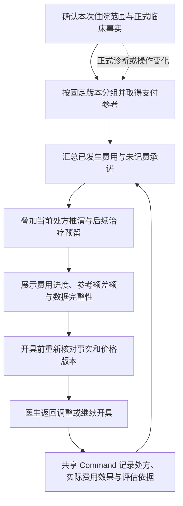

# DRG 医保质控与诊疗动态费用提示设计方案

Status: approved

首次成稿：2026-10-15。应用内模拟范围：2026-10-18。外部政策与价格的核验日期以各来源清单为准，不代表实施日重新核验全部政策。本文是本需求的唯一设计与验收入口；应用内合成模拟已实施，正式地区的住院 DRG 质控和结算仍依赖匹配分组器、支付参数及完整费用。

## 问题与目标

医生在诊疗和开药时需要提前了解本次住院病例的 DRG 预计支付、已发生及已承诺的费用、本次处方的增量，以及开药后的剩余空间。诊断、并发症、手术操作和治疗执行发生变化时，评估应随正式临床事实更新，帮助医生发现费用超支和医院结余不足的风险。

同时展示收费进度、DRG 参考额未占用金额与预计成本结余，由医生结合临床需要自主把控，不设置固定费用控制比例或目标结余率。首期采用明确标识的模拟规则验证医生流程；正式地区、年度、分组与支付方案尚未选定。本需求先验证事前费用管理，不以完成整个住院 HIS 或医保清算为原型前置条件。

核心交付是医生在开药前能够回答三个问题：本次开药会增加多少费用，整次住院费用目前处于什么进度，诊疗变化后参考额与剩余空间为什么变化。医院结余是独立的成本分析结果，不能只根据收费进度判断。

费用提示不作为科室或医务人员的诊疗限额、考核或绩效分配指标；适用政策依据见[DRG 3.0 金额与使用边界](../research/2026-10-15-drg-data-sources.md#金额编码版本与使用边界)。

## 范围

- 医生处方编辑与开具前的费用预警，以及诊断和治疗变化对当前评估的影响。
- 以 DRG 参考额为进度条的完整刻度，展示预计收费金额、实际占比和参考额未占用金额；成本口径独立展示预计结余金额和比例，不绘制固定管理目标线。
- 本次住院病例整体费用，包含已发生费用、已开立尚未记费的承诺、本次未开具处方和明确配置的后续治疗预留，不能把全部预算视为药费额度。
- [V2 交互原型](../../previews/drg-budget-v2.html)保留为设计依据；项目医生工作台另提供持久化“住院 DRG 模拟”，只创建合成住院上下文，不修改门诊病例。
- 数据接入规划覆盖六份用户提供的 PDF、已有药品目录、公开药品价格附件及 231 条心血管耗材参考报价；取得资料、完成结构化、发布参考版本与启用院内计价分别验收。
- 医保目录范围、限定支付条件和编码完整性列为后续质控扩展；处方合理用药、DRG 分组和费用测算各自保留规则依据，不合并为一个由大模型直接给出的判断。

### 当前状态与交付层级

| 层级 | 当前状态 | 本方案安排 |
| --- | --- | --- |
| 医生交互 | 独立 V2 与项目内住院模拟页签 | 完整参考额刻度、无固定管理目标；独立预览不作为持久化验收证据 |
| 项目业务基础 | 已有门诊诊断确认、处方开具、撤回、收费事实与审计 | 复用版本、命令和身份基础；住院评估另建明确范围 |
| 参考资料 | r3 五类资料、补充报价与用途状态已按哈希发布到 Reference SQLite | 可检索原文、规范字段和来源页；适用性与院内价格缺口保留 |
| DRG 规则与支付 | 国家 3.0 正文及关系作为来源参考；应用内使用合成条件和支付参数 | 保持 `SIM-*` 身份，病例冻结完整参数；不执行完整国家分组规则 |
| 全院费用与成本 | 当前没有完整住院费用账、执行承诺和成本核算闭环 | 在完整性达标前显示覆盖范围，不生成确定的全住院盈亏结论 |

### 应用内模拟的实际范围

医生登录后从“门诊诊疗 → 住院 DRG 模拟”新建合成住院病例。当前可确认肺炎、急性呼吸衰竭、高血压诊断与气管内插管完成事实；模拟规则仅覆盖肺炎基础、并呼吸衰竭、伴指定操作三个条件，参考额分别为 10,000、18,000、28,000 元，高血压作主诊断时显示规则待补全。此金额与条件均为合成演练，不是国家或浙江正式分组标准。合成院内映射覆盖阿莫西林、头孢曲松、住院输液，以及奥美拉唑缺价示例；剂型依据来自目录，规格与产品、收费和成本由模拟配置定义。

基线已发生收费为 2,400 元，基线已覆盖成本为 1,600 元；独立后续预留收费 1,200 元、成本 800 元，不包含本页新增医嘱。药品开具模拟直接记费、成本待执行，服务开具先进入待记费承诺；收费记费和成本执行各自确认。临床撤回保留原费用，仅已撤回且未执行的项目可以确认冲销；已执行项目不提供无依据的冲销。缺价医嘱保留 null 和不完整状态，不能确认零元收费。

临床草稿与当前已确认参考额分开显示，处方改动从服务端取得增量；开具前再次预览，提交在共享 Command 事务中核对 revision、固定配置及单位。病例保存完整模拟配置、冻结行价、版本和评估历史，刷新后可继续查看。此上下文不是既有门诊医嘱的影子账，也不是完整住院 HIS；预留替换、部分执行、部分冲销、正式费用接入及完整成本仍属于后续工作。部署与操作步骤见[部署说明](../deployment.md#3-同步参考目录推荐)，架构取舍见[模拟实现决策](../../.agents/notes/implemented/architecture/2026-10-18-drg-simulation.md)。

## 用户故事

1. 作为医生，我希望开药时看到本次处方增加的收费与成本，以及开药后费用占 DRG 参考额的进度，自主评估后续诊疗空间。
2. 作为医生，我希望看到预计成本结余及结余率，能够区分收费超过参考额与预计亏损，不因固定比例被判为超目标。
3. 作为医生，我希望正式确认诊断、并发症或手术操作变化后，当前病组和额度更新，并保留此前已经发生的费用。
4. 作为医生，我希望在开具前获知风险；费用提示提供决策依据，不自动更改诊断、药品、剂量或疗程。
5. 作为管理者，我希望能解释一次提示使用的临床事实、费用、价格、成本和规则版本，并回看诊疗变化带来的评估差异。

## 验收条件

- [x] 同屏显示 DRG 预计支付参考额、开药后预计收费、费用进度、参考额未占用金额，以及预计成本结余和结余比例；不设置固定比例管理目标、目标结余率或据此产生通过状态。
- [x] 进度以预计总收费除以 DRG 参考额计算；超过参考额时数值仍显示实际占比及超出金额，进度条填充可在完整刻度处封顶，不把参考额标为医保硬性限额。
- [x] 费用拆分为已发生、已开立待记费、本次处方和后续治疗预留；已发生费用包含尚未缴费的正式费用，不以支付成功作为纳入条件。
- [x] 修改药品、包装、数量、剂量、频次或疗程后重新报价；数量与包装计价单位一致，不能重复按数量和疗程乘算。没有明确数量映射时提示待补充。
- [x] 收费超过 DRG 参考额和预计成本超过参考收入分别展示事实，不把收费超额直接命名为亏损，不对正的结余率设置最低目标。
- [x] 草稿开具后，尚未记费的项目转入已承诺，已由开具 Command 正式记费的项目直接进入已发生费用；后续记费释放对应承诺，同一业务项目只计一次。
- [x] 诊断草稿只能形成待确认推演；预算依据使用已确认临床事实。再次确认触发重新评估，既有费用、承诺和评估历史保留。
- [ ] 新增检验结果只作为证据；并发症、手术和治疗事实按各自 owner 确认后影响分组，不因金额目标自动推断或修改诊断。
- [x] 临床撤回不自动删除已经形成的费用或成本；只有确认的可冲销业务事实才能释放相应金额，已执行项目的成本不能因撤回而自动消失。
- [x] 缺少病组或支付规则时不显示确定剩余额度；缺少价格时收费评估标为不完整；缺少成本时成本结余标为待核算，不用零值代替，不显示通过状态。
- [x] 开具前展示更新后的费用进度、金额与差额，医生可返回调整或继续模拟开具；不按费用占比自动拒绝临床必要治疗。
- [ ] 正式接入时，切换患者、临床 revision、处方草稿、费用、价格、成本或规则发生变化，旧评估不得覆盖当前结果；开具前在服务端重新核对依赖。
- [ ] 原型提供可复现的正常开药、诊断变化、超过参考额、撤回与冲销、资料缺失场景，并能在桌面和窄屏操作。
- [ ] 每条价格能够追溯地区、产品或报价粒度、单位、价格类型、原始来源和有证据支持的日期；历史或外省报价只以对应参考身份使用。
- [ ] 参考数据升级不覆盖原 PDF，不修改已发生费用的冻结价格，不把未通过兼容校验的新编码或规则自动用于旧病例。
- [ ] 起搏器主机按台、导线按根分别处理；中选价与基准品拟供应价分别保存；不能把同一品类名称或注册证级价格当作完整规格价格。
- [ ] 在多医生、其他科室记费或异步执行并发发生时，旧评估被标记为已变化；重试开具不重复创建医嘱、费用或评估记录。
- [x] 病例历史可解释一次重新评估由哪些正式事实和版本变化引起；诊断依据与财务提示分开，不能根据预期收入生成诊断事实。
- [x] 正式接入的验收与模拟流程分开；未完成本地分组器、支付参数和费用完整性验收时，页面持续标明模拟或覆盖不完整。
- [ ] M1/M2 补充分组解释：在当前合成规则范围内，能定位输入编码与字典版本、命中条件、条件优先关系、未命中原因及缺项；临床变化前后可解释分组和参考额变化，保持 `SIM-*` 身份。
- [ ] M1/M2 补充单条件合成对照病例：交换主次诊断、临床草稿与确认、操作计划与已完成确认、未知编码及不支持的编码版本；分别断言分组是否变化或被明确拒绝，以及既有费用保持不变。当前未实现的输入状态按支持边界验证，不伪造正式执行事实。
- [ ] M3 正式规则对照增加 CC/MCC 与主诊排除关系、特殊规则优先级及人口属性边界；分组规则与地区支付方案分别固定版本和核验，不能从模拟金额或历史共现概率生成正式规则。

## 设计决定

### 1. 产品入口与医生流程

医生在当前病例的处方区域查看费用概览，编辑药品和用量时看到本次增量及开药后进度，开具前查看最新预览，再选择返回调整或继续开具。诊断、并发症或已确认操作变化后，系统显示重新入组及参考额变化的原因；已发生费用继续保留。费用明细、价格来源和成本口径按需展开，保持开药流程可读。

这张图描述共同目标流程。独立 V2 使用内存模拟，应用内合成上下文使用共享 Command 持久化；只有发生记费效果的 Command 才形成收费事实；开具本身不一律等于执行，也不一律产生待记费承诺。

### 2. 金额口径

以 `P` 表示本次病例的 DRG 预计支付参考额，以 `R` 表示按当地政策口径计算的预计病例总收入。原型假设 `R = P`，患者另付及除外收入为零；因此原型的预计结余可以按 `P - 预计总成本` 计算。正式地区接入必须明确参考额是否已包含患者支付、除外项目和调整项，组成项不得重复相加，不能把医保基金支付单独等同医院总收入。国家分组方案提供分组依据，地方支付方案才确定金额参数，不能假定所有地区都适用同一权重乘费率公式。

| 指标 | 计算口径 | 界面含义 |
| --- | --- | --- |
| 预计总收费 `F` | 已发生净收费 + 已开立未记费金额 + 本次未开具处方预计收费 + 后续预留收费 | 整次住院当前已知和预计费用，列明覆盖范围 |
| 费用进度 | `F / P`，仅在 `P > 0` 且可用时计算 | 相对于参考额的客观进度，不设置 90% 目标线 |
| 参考额未占用金额 | `P - F` | 可为负数；不称为医保保证报销的余额或可用药费限额 |
| 预计总成本 `C` | 已发生成本 + 未执行承诺成本 + 本次处方预计成本 + 后续预留成本 | 独立于收费汇总，注明直接成本或完整成本范围 |
| 预计成本结余 | `R - C` | 收入与成本均有可靠口径时才展示确定金额 |
| 预计结余率 | `(R - C) / R`，仅在 `R > 0` 时计算 | 辅助分析，无最低目标或据此产生的通过状态 |

已发生净收费按正式收费事实及确认的收费冲销汇总，包括尚未缴费的费用。患者付款或退款只改变资金交易，不自动增减收费事实。收费与成本分别计量：同一项目已经记费但尚未执行时，收费可以已发生而成本仍为承诺，二者不能强制共用同一个状态桶。

未开具草稿不占用正式额度，仅参与当前 what-if 评估；开具后按实际效果转为承诺或收费事实，执行成本按其 owner 的确认时点发生。同一项目发生状态变化时替换其所属金额桶，保留业务引用。原型使用明确的模拟预留，正式数据未覆盖全住院或缺少后续预估时必须标识评估范围。

正式收费汇总以整数分保存；原始单价可能含多于两位小数，应保存十进制定点值及精度，按适用计价规则在明确的行金额或账单边界舍入，不先把原始单价截为分。权重、费率和调节系数同样保留规定精度，禁止使用二进制浮点累加金额。原价格文本和实际参与计算的数值分别保留。

如果仅取得药耗采购成本而缺少人工、检验、床日等成本，展示“已覆盖成本估算”及覆盖说明，不把 `R - 部分成本` 命名为完整住院结余。后续预留是明确的计划估计，不是已经发生的收费；项目从预留进入正式医嘱时须关联并替换对应预留，避免双算。

### 3. 动态临床事实

预算按一次住院病例管理，不能简单按单个疾病名称查固定上限。正式分组依赖目标分组器要求的主次诊断、并发症、手术操作、人口属性及其他字段。首期模拟分组只用来验证流程，使用 `SIM-*` 身份并明确展示模拟来源，不宣称具备正式 DRG 分组能力。

医生编辑临床草稿时可看推演，但其金额不能直接替代当前参考额。确认临床变化后生成新评估，显示变化原因和额度差异。费用信息不产生诊断依据，不提供为增加支付而补录诊断或升级分组的建议。

| 变化 | 对评估的处理 |
| --- | --- |
| 主次诊断草稿编辑 | 仅生成待确认推演；保留当前已确认分组 |
| 诊断再次确认 | 使用新的临床 revision 重新评估，保留前后分组与理由 |
| 新报告或异常检验值 | 可提示待医生核实；不自动变成并发症或 MCC/CC |
| 手术计划变化 | 只影响计划推演和相应承诺，不伪造已完成操作 |
| 手术或治疗实际完成并确认 | 按目标分组器的输入要求触发正式事实评估 |
| 药品、规格、数量、剂量、频次或疗程修改 | 重算本次增量；不因药费变化自动改变诊断或分组 |
| 价格、支付政策或分组版本更新 | 先检验地区、日期和兼容性，按明确升级策略评估；既有收费快照不被覆盖 |

正式规则需处理分组顺序、MDC/ADRG/DRG 条件、CC/MCC 与主诊排除关系、操作组合及所需人口属性；不能把“有并发症”布尔值当作完整分组器。住院中结果为当时事实下的预计分组，出院编码审核和医保结算可能改变最终结果。

编码兼容性、分层解释和单条件对照病例的方法依据及局限见[地区 DRG 分组模拟专利研究](../research/2026-10-18-regional-drg-grouping-patent.md)。当前 M1/M2 只补充合成规则的可解释性与支持范围验证；正式排除表和完整地区规则仍归 M3。专利中的决策树、经验概率阈值及编码相似度不作为当前正式分组或自动映射依据，其分组结果也不能提供当地支付金额。

### 4. 用户资料与价格数据清单

| 输入 | 在方案中的作用 | 使用前必须补齐或核验 |
| --- | --- | --- |
| `浙江省基本医疗保险医疗服务项目目录.pdf` | 服务项目、编码和医保属性的候选参考，关联本院检查、检验、治疗及收费项目 | 全量字段、目录有效期、计价单位、除外与限定条件；目录资格与地方服务价格分别验证 |
| `ICD-10医保2.0版.pdf` | 疾病诊断编码与名称字典，用于诊断录入、规范化和分组输入映射 | 与目标分组器所需字典的完整代码及版本兼容性，不用名称近似匹配替代编码 |
| `ICD-9-CM3医保2.0版.pdf` | 手术和操作编码字典，用于计划、执行和分组输入映射 | 操作状态、主次角色、代码增删与地方适配；字典本身不是分组规则 |
| `国家基本医疗保险、生育保险和工伤保险药品目录（2025年）.pdf` | 基本医保药品支付范围和限定支付条件的政策输入 | 生效日、当地执行及产品映射；支付条件不能当作完整临床适应证或所有厂家包装的价格 |
| `商业健康保险创新药品目录（2025年）.pdf` | 单独的商业保险目录及潜在保障规则输入 | 具体保险合同和责任范围；不自动纳入基本医保或作为 DRG 病例额外收入 |
| `国家医疗保障按病组（DRG）付费3.0版.pdf` | 分组规则研究来源，支持建立规则关系与证据定位 | 优先核对官网更新附件、目标地区版本、字典映射及分组器一致性；国家文件不提供当地完整支付金额 |

以上六份 PDF 的职责可以确定，但不等于已经完成每份文件的全量抽取、字段验证和业务导入。国家 DRG 3.0 用户文件与官网更新附件已确认存在规则内容差异，版本选择和兼容性限制以[来源核验](../research/2026-10-15-drg-data-sources.md#drg-30-规则来源与版本)为准，不能将两个文件的表格拼成一个未声明版本的规则包。

| 已核验价格资料 | 实际覆盖 | 当前可用程度 |
| --- | --- | --- |
| 江西集采药品“三进”快照 | 1,974 条产品，更新截点 2025-09-30 | 有中选金额和产品包装字段；仅作对应地区与批次参考，尚未全量匹配本院目录 |
| 广东 20260930 新增挂网批次 | 78 条产品，通知公布于 2026-10-13 | 有包装挂网价；属于新增批次，不是广东或浙江价格总表 |
| 湖南 2026 年执行的浙江联盟起搏类结果 | 52 条报价：37 条主机、15 条导线；35 条有基准品或替代品的 27 位医保码 | 保留台、根单位及两类不同价格列；无完整型号规格，不能等同 52 个完整 SKU |
| 天津 2023 年冠脉四类中选结果 | 导丝 42、导管 20、扩张球囊 89、药物球囊 12，共 163 条 | 历史公布价；原表为 20 字符代码，逐行计价单位和规格缺失，不能当浙江现行价 |
| 浙江上一轮冠脉支架及增补 | 16 条注册证级报价 | 仅作历史参考；2026 年第二轮名单不能自动沿用这些价格 |

心血管报价合计 231 条，已交付 Excel 和保留原始字段、哈希及行定位的 JSON；报价行不是完整院内物料行。价格附件的细节与本地交付位置归属[价格来源总览](../research/2026-10-15-drg-data-sources.md#耗材总表与价格边界)，药品字段与范围归属[药品价格研究](../research/2026-10-15-drg-data-sources.md#药品挂网与集采价格)，本方案不另建一份价格明细。

国家医疗服务立项规范、医保目录、药品挂网价、耗材挂网价、医保支付标准和本院收费价分别保存。国家已有医用耗材挂网价格一览表机制，下载权限依省级招采系统；截至现有核验，尚未取得浙江药品或耗材的全量有效价格快照。电生理消融导管、瓣膜、封堵器的完整价格也未取得。后续优先取得完整表；无法取得时先完善心血管子集，不以其他疾病的零散样本替代。

### 5. PDF 保真与结构化接入

“无损”分为原件保真和结构化准确两个验收项：原件、文件哈希与来源永久保留，派生数据逐表校验。PDF 抽取成功、存在文字层或转换成 Excel，都不能证明文字及规则关系无损。当前 DRG 文件已经发现异常字形和跨页排版问题，处理方式见[文本提取质量](../research/2026-10-15-drg-data-sources.md#文本提取质量)。

接入流程要求如下：

1. 登记发布单位、通知地址、附件地址、文件名、SHA-256、页数、获取时间、发布日期和已知有效期。用户原件与官网更新件分别登记，文件名不能充当版本主键。
2. 文字 PDF 优先提取文本与表格；扫描页或异常字形使用渲染及有范围的 OCR 辅助核对。保留 PDF 物理页、印刷页、表号、行号及必要的单元格位置，不能静默删除异常字符。
3. 同时保留原文、原始单元格和规范字段；疾病与操作代码、医保长码、注册证、产品 ID 均按字符串保存，保留小数点、前导零、`x`、`+`、`*` 等原字符。
4. 检查页覆盖、表头、序号连续性、重复或缺行、跨页延续、单位、金额精度与规则引用；分组条件及包含、排除、优先关系形成结构化关联，不能只落成无法执行的长文本。
5. 对异常行、跨行企业名称、多代码单元格和未知单位建立待复核记录，保留修正依据。未确认的代码映射、价格或条件不得自动启用，缺值不能补成零。
6. 校验通过后发布固定数据版本和变更摘要；本院启用采用单独映射及价格版本。规则包或映射有问题时可切回已验证版本，既有评估和费用仍引用其原快照。

原始 PDF、下载附件和生成工作簿属于本地资料，不放入 `references/`，不自动加入 Git。运行时不直接扫描桌面 PDF，也不在医生每次开药时联网抓价；安装后从已验证的结构化版本读取。公开参考产品可被本院合成目录引用，但患者、库存、交易和病例始终为合成数据。

### 6. 项目接入与逻辑模块

当前实现以门诊为主，诊断拥有 confirmation revision，处方拥有草稿、开具、撤回与版本控制，费用以 Charge Record 保存。处方页与 controller 见 `apps/web/src/app/doctor/prescription-page.tsx` 和 `apps/web/src/app/doctor/doctor-case-controller.tsx`；收费与开具 owner 为 `apps/server/src/application/workflow-service.ts`。它们可提供未来接入点，但当前门诊 Encounter 不能直接认定适用住院 DRG。

参考数据延续全局 Reference SQLite 与本院业务 SQLite 分离的现有架构，不把全国目录复制到每次病例中。现有参考入口为 `apps/server/src/application/reference-data-service.ts`、`apps/server/src/infrastructure/reference-data/` 和 `packages/contracts/src/reference-data.ts`；这些路径可承接后续适配，但不表示当前已经支持下表全部数据类型。

| 逻辑职责 | 输入与输出 | 所有权约束 |
| --- | --- | --- |
| 参考资料适配与发布 | 原始附件 → 经核验的目录、规则、公开价格及版本 | 离线处理；外部目录不拥有院内可用性或收费 |
| 本院项目与价格映射 | 参考产品或服务 → Hospital Medication、Hospital Service、Charge Definition 及单位关系 | 本院明确启用；采购成本、收费价与支付标准独立 |
| 病例事实投影 | 已确认诊断、操作、人口属性及其 revision → 分组输入快照 | 只读各临床 owner；不从 Case Truth 越权取隐藏资料 |
| 分组与支付评估 | 固定规则、当地方案或模拟参数 → 预计病组、参考额、原因与缺项 | 确定性执行；模拟身份不得被隐藏 |
| 费用与成本评估 | 费用事实、承诺、草稿、预留及价格成本快照 → 统一费用视图 | 读取账务 owner，不能另建可独立修改的第二套收费账 |
| 医生视图与历史 | 评估结果 → 进度、增量、来源、变化原因及历史 | TanStack Query 管服务端结果；客户端只保留编辑及展开等视图状态 |

以上是建议实施的职责边界，不预先固定新增 HTTP 路径、数据库表名或已发布能力。沿用 Node.js 模块化单体、共享 Command、受信 Actor context 和 FHIR R5 `5.0.0`；无需为本功能先拆微服务。取舍理由见[拟议评估边界](../../.agents/notes/proposed/architecture/2026-10-16-drg-cost-assessment.md)。新增持久化、公开契约、住院流程或 Agent 能力的具体设计在实施前补充 Note，并按实际变化更新 owning Catalog 和运行时 Skill。

### 7. 评估数据与版本依据

| 数据对象 | 至少保留的内容 |
| --- | --- |
| 来源与数据版本 | 来源身份、原件哈希、规则或价格类型、地域、发布日期、快照日、有效期及核验状态 |
| 本院映射与计价 | 本院物料或服务码、参考产品码、企业、规格、单位与包装换算、计价版本及适用范围 |
| 住院评估上下文 | Workspace、Epoch、合成病例、住院归集范围、责任身份、统筹区、年度、医院适用参数及模拟标识 |
| 临床输入快照 | 诊断确认 revision、主次诊断、操作及确认状态、规则所需人口属性、证据引用与字典版本 |
| 分组与支付结果 | 预计 MDC/ADRG/DRG 或模拟病组、规则版本、支付方案版本、参考额口径、触发原因、缺失输入 |
| 金额组成 | 稳定业务明细引用、收费与成本分开、已发生/承诺/草稿/预留归属、冲销或替代关系、覆盖说明 |
| 评估结果 | 当前病例与草稿摘要、所用全部 revision、金额与进度、完整性、计算时间、前次评估及变化原因 |

同一处方、执行和收费明细通过稳定业务引用归并；重复事件和重试不能新增另一份金额。一次评估需绑定病例身份、临床 revision、操作状态、费用及承诺版本、草稿摘要、预留版本、价格/成本版本、分组包和支付方案版本。临床、费用或方案变化后形成新结果，既有结果可重放解释，不能原地改成另一组依据。

历史收费按发生时确认的价格保存。新处方使用适用于当前业务时点的价格；既有未记费医嘱是否重新定价按其 owner 和当地规则处理，不能在刷新参考价时批量改写。采购按包装、收费按拆零单位的情形必须有明确换算关系，不允许只按药名或耗材品类名关联。

### 8. 评估、开具与异常恢复

目标交互能力包括查询当前评估、按当前草稿推演、开具前复核、读取历史与受控发布参考版本；这些是逻辑能力，并非当前已存在的 DRG API。日常读取和推演不修改正式处方或账务，正式开具仍调用唯一业务 Command。

开具前由服务端重新校验授权、病例范围、草稿、临床及费用依赖。若评估依据已变化，返回更新后的预览，由医生在最新信息下继续操作；不能提交旧费用结论后再异步补校验。幂等键和 expected version 沿用现有 Command 机制，是否持久化独立评估以及最终请求结构在实施时定稿。费用超参考额本身不构成临床拒绝条件；数据或版本冲突只要求恢复到正确业务状态，不等同费用审批。

| 状态或事件 | 医生端与服务端行为 |
| --- | --- |
| 初次加载、正在重算 | 显示加载状态；已有结果标明时间和正在更新，不能伪装为最新 |
| 无法分组或缺支付方案 | 已知费用仍可查看；参考额、进度和参考额差额待评估，不展示确定可用额度 |
| 部分项目缺价或单位映射 | 列出未计价项和已知金额小计；完整总额及占比待补全，不显示通过 |
| 成本或预计收入不完整 | 收费视图按自身完整性展示；结余标为待核算或明确的部分成本估算 |
| 费用超过参考额 | 显示真实比例和超出金额，填充可封顶；允许医生查看明细并按临床需要继续 |
| 切换病例或迟到响应 | 按病例及依赖版本丢弃旧结果，不能覆盖新病例或更新后的草稿 |
| 重算失败或网络中断 | 保留可辨识的旧结果与重试入口；测算失败不新增费用审批门禁，原有开具可用性、临床合法性、权限和版本校验继续执行 |
| 临床撤回、退款或收费冲销 | 分别读取对应事实；退款不必然等于费用撤销，撤回不自动抹除已执行成本 |
| 无责任权限或跨 Workspace/Epoch | 由受信上下文拒绝；读写和审计均按现有边界处理 |

未来住院岗位、病例责任和读取范围需随住院能力显式定义。当前门诊医生权限不自动扩展为全院住院费用权限；DSH 或 CLI 也只能适配已实现的窄能力，不提供任意 SQL、URL 或账务写入。

### 9. 质控规则的扩展顺序

首期只验证费用提示、动态评估和数据完整性。后续依次增加编码完整性、医保目录映射、限定支付条件核对和出院编码核对；每条命中必须有规则版本、适用范围、触发事实与可定位的依据。限定支付条件涉及诊断、治疗线数或检验事实时，缺少事实应标为待核实，不能直接判为违规。

临床禁忌、剂量、过敏和相互作用仍归合理用药规则；基本医保支付限制归医保规则；商业保险归对应合同规则。大模型可辅助解释、材料定位及待确认的结构化整理，不拥有正式诊断、分组、价格或违规裁决。对费用超额的说明不增加固定比例审批、强制填写原因或自动更换方案。

### 10. 金额变化示例

以下金额只用于说明计算关系，均为合成示例。假设参考额同时等于预计病例总收入，预计收费和成本已包含表内明确覆盖的承诺及后续预留。

| 时点 | DRG 参考额 | 预计总收费 | 费用进度 | 参考额未占用金额 | 预计总成本 | 预计结余 |
| --- | ---: | ---: | ---: | ---: | ---: | ---: |
| 当前已确认病例 | 10,000 元 | 8,200 元 | 82% | 1,800 元 | 6,200 元 | 3,800 元 |
| 本次处方增加收费 600、成本 350 元 | 10,000 元 | 8,800 元 | 88% | 1,200 元 | 6,550 元 | 3,450 元 |
| 再增加检查收费 1,700、成本 900 元 | 10,000 元 | 10,500 元 | 105% | -500 元 | 7,450 元 | 2,550 元 |
| 临床证据确认后模拟分组改变 | 13,000 元 | 10,500 元 | 80.77% | 2,500 元 | 7,450 元 | 5,550 元 |

第三行说明收费超过参考额与成本亏损不是同一个结果。第四行仅改变已确认临床事实对应的模拟参考额，既有费用不会消失；真实分组是否变化必须由完整适用规则决定，不承诺补录一个诊断就提高支付。

### 11. 分阶段交付

| 阶段 | 交付内容 | 完成标准 |
| --- | --- | --- |
| M0：医生流程验证 | 沿用独立 V2，验证正常开药、诊断变化、超参考额、撤回冲销及缺项场景 | 医生能理解费用进度与成本结余的差别；不新增固定目标线；已有预览不等于全部验收完成 |
| M1：参考数据准备 | 六份 PDF 的来源清单、按优先品类抽取的目录和规则、231 条心血管报价及药品价格附件的映射核验 | 原件可追溯、异常可定位、单位与价格类型明确；未通过验证的数据不启用 |
| M2：应用内模拟评估 | 显式的合成住院评估上下文、服务端确定性模拟分组、费用桶、处方推演及版本校验 | 从真实医生入口可重现动态提示；与既有门诊状态机隔离；所有输出保持模拟身份 |
| M3：选定地区规则验证 | 确定统筹区、年度、医院范围、匹配字典、正式分组器或经验证规则包、支付参数与完整计价数据 | 使用经核对的合成病例对照目标分组结果，能解释金额及差异；禁止自动从模拟状态切换为正式身份 |
| M4：结算反馈与成本完善 | 接入出院编码审核、病例预结算和结算结果、成本范围及差异分析 | 形成预计分组与最终结果的可解释对账；该阶段属于后续范围，不因本方案直接宣称已具备生产能力 |

心血管是耗材数据不足时的首选补齐范围，不限定所有模拟疾病只能为心血管；既有预览疾病仍可用于验证交互。首批正式对照病种和临床样例在目标地区与分组器确定后选择。

### 尚待验证

- 医生能否通过费用进度、参考额差额和成本结余理解收费与盈亏的区别，以及是否需要进一步减少信息密度。
- 资料不完整、实际费用超过参考额及预计亏损的展示方式；原型不强制填写继续开具原因，也不增加比例审批门禁。
- 后续住院费用的预留方法、标准成本的范围与更新频率、正式分组及支付基数的组成。
- 正式统筹区、年度、医院级别、编码版本和分组器的兼容要求。

## 测试策略

原型按真实可操作控件检查正常开药、增加数量、诊断草稿与确认、收费和成本不同结论、未开具到承诺到记费的金额守恒、撤回与确认冲销、缺价、缺成本和无法分组，以及桌面和窄屏布局。原型不增加生产测试或调用业务数据库，其行为只能证明设计示例。

正式实施时通过服务端公开 Query/Command 和 file-backed SQLite 验证金额桶互斥、冲销、临床与价格版本、并发开具与其他费用到达、幂等重试及病例隔离；从医生真实入口验证修改处方、重新评估、旧结果到达、失败恢复和开具前提示。DSH 共享视图按 React 18/19 与 ShadowRoot 合同验证。所有病例和金额测试数据为合成数据。

| 验证层 | 关键断言 |
| --- | --- |
| 目录和规则导入 | 页表覆盖、完整代码、版本冲突、重复与缺项、规则排除关系、单位精度和原件溯源 |
| 确定性计算 | 有效参考额、零或缺失参考额、金额舍入、草稿计价、部分执行与部分冲销、预留被正式医嘱替换后不双算 |
| 分组验证 | 模拟标识持续可见；正式阶段与目标分组器对照主次诊断、CC/MCC 排除、操作组合、人口属性与无法入组病例 |
| 事务与恢复 | 开具与记费同事务效果、重复命令、版本冲突、并发费用到达、重启后重放及旧评估不可覆盖新依据 |
| 医生真实入口 | 修改处方即更新推演、确认诊断才更新当前依据、超过参考额可继续、缺项提示、切换病例与失败重试 |
| 数据更新 | 新数据仅按适用时间启用；旧费用和评估可复现；可回退数据版本而不覆写历史事实 |

分组对照病例每次只改变一个条件，固定其余临床事实、费用、字典、规则和支付参数，并保存预期结果及其依据。M1/M2 按合成配置验证主次身份、确认状态、规则优先关系和不支持输入；M3 在取得适用规则后补充 CC/MCC 排除、特殊分组和人口属性边界。两阶段都分别比较病组与参考额，避免支付参数变化被误判为分组逻辑变化。以上补充项以验收条件的未勾选状态追踪，不沿用既有测试通过记录作为完成证据。

正式验证按目标地区要求的匹配字典、分组器版本和测试集记录差异；差异未解释清楚时不能把局部样例一致宣称为完整官方分组能力。应用内模拟的核心计算、HTTP 持久化与医生实际入口分别由 `packages/core/tests/drg.test.ts`、`apps/server/tests/drg-simulation.test.ts` 和 `apps/web/e2e/drg-simulation.spec.ts` 覆盖。正式地区与完整住院能力仍按本表单独验收。

## 范围外

- 在此次原型中建设完整住院、手术麻醉、医保上传、正式结算、月度或年度清算。
- 宣称模拟金额为浙江正式标准，或将现有 PDF 编码字典当作分组器、支付权重或院内实际成本。
- 使用财务额度自动替代临床判断、自动调整治疗、自动变更诊断、自动向医保申报。
- 将独立预览状态接入既有门诊病例，或将应用内合成模拟冒充正式住院、FHIR 与医保结算事实。

## 依赖与风险

正式收费预警依赖完整费用、已开立待记费项目、产品与包装价格；真实结余依赖明确范围的成本数据、分摊规则及预计总收入。现有药品产品目录不等于完整价格和成本目录，未计价的检验服务也不能记为免费。用户提供的浙江服务目录、ICD 编码及药品目录可作为后续参考数据输入，但不提供全部分组和支付规则。

国家 DRG 3.0 分组方案可以作为后续规则研究输入，正式导入以官网更新附件及目标地区适用版本为基准；国家规则不能直接补齐当地支付金额。来源、版本差异、编码兼容性与文本转换限制见[DRG 3.0 核验](../research/2026-10-15-drg-data-sources.md#drg-30-规则来源与版本)。取得参考文件不改变当前原型的模拟分组与模拟金额身份。

正式动态费用评估还依赖住院病例身份、可用的目标分组器与当地支付方案。在这些依赖补齐前，独立原型和应用内合成模拟只验证医生流程、费用状态与版本，不作为实际住院医保质控结果。
